<div align="center">

# RakshPulse

**Research software for cuffless blood-pressure estimation from photoplethysmography (PPG), built for a
behind-the-ear MAX30102 sensor.**

[](https://github.com/obstinix/RakshPulse/actions/workflows/ci.yml)
[](https://github.com/obstinix/RakshPulse/releases)
[](pyproject.toml)
[](.github/workflows/ci.yml)
[](tests)
[](https://github.com/astral-sh/ruff)
[](LICENSE)
<br>
[](#limitations-and-hardware-validation)
[](#limitations-and-hardware-validation)

</div>

> [!WARNING]
> **RakshPulse is a research prototype, not a medical device.** No output is a clinically validated blood-pressure
> measurement. The shipped model was trained and tested on public earlobe PPG recordings, **not** on MAX30102 data;
> on MAX30102 input it runs in **demonstration** mode and its numbers are not blood-pressure measurements.

**Contents:** [Introduction](#introduction) · [What it does](#what-rakshpulse-does) ·
[Architecture](#system-architecture) · [Data flow](#end-to-end-data-flow) · [Hardware](#hardware-architecture) ·
[MAX30102](#max30102-integration) · [ML pipeline](#ml-pipeline) · [Model and inference](#model-and-inference) ·
[Dataset](#dataset) · [Results](#evaluation-results) · [Screenshots](#screenshots-and-visualisations) ·
[Installation](#installation) · [Quick start](#quick-start) · [CLI](#cli-reference) · [Notebooks](#notebooks) ·
[Example output](#example-inference-output) · [Limitations](#limitations-and-hardware-validation) ·
[Structure](#project-structure) · [Development](#development-and-testing) · [Documentation](#documentation)

## Introduction

RakshPulse is a proposed wearable, cuffless blood-pressure monitor for military personnel in remote, high-altitude
and field settings. A MAX30102 optical sensor worn behind the ear records photoplethysmography (PPG): the small
changes in light absorption caused by each heartbeat. Software then estimates systolic (SBP) and diastolic (DBP)
blood pressure from the pulse waveform.

**The problem.** Cuff monitors are bulky, slow and need a still subject. PPG is cheap, small and continuous, but its
relation to blood pressure is indirect: pulse shape depends on the person, the sensor site, contact pressure and
motion. Published PPG blood-pressure methods usually need per-person calibration and are rarely validated outside
their own dataset. RakshPulse is built to measure honestly how far PPG goes, and to be ready for real MAX30102
recordings when the hardware exists.

## What RakshPulse does

| Area | Implemented | Status |
|---|---|---|
| Sensor acquisition | MAX30102 + ESP32/Arduino reference firmware, USB serial reader with banner and rate checks, lost-sample and reboot detection, simulator | ✅ tested with simulated and loop-back serial ports; ⚠️ firmware not yet run on a board |
| Data | Checksummed CSV session datasets with cuff references; audit and integrity checks of the public datasets | ✅ |
| Signal processing | Resampling, despiking, band-pass, beat segmentation, 4-class signal-quality gate | ✅ |
| Features | Heart rate, pulse-shape, derivative, variability and spectral features | ✅ reproduced from raw waveforms (median ρ 0.999) |
| Machine learning | Six model families + baseline, subject-wise tuning, held-out test, nested CV, per-person calibration | ✅ one command, results below |
| Inference | Contract-checked models, mode labels (`validated`/`experimental`/`demonstration`), structured API, CLI and dashboard | ✅ |
| Validation on MAX30102 | Needs MAX30102 recordings with cuff references | ❌ not possible yet |

## System architecture

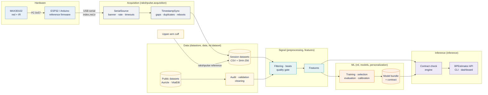

Hardware-specific code (firmware, serial protocol) lives in `hardware/` and `rakshpulse.acquisition`; the ML code
never talks to a device. Every model is wrapped in a **contract** that states its features, sensors, sampling rates
and operating mode, and inference refuses input the contract does not cover.

## End-to-end data flow

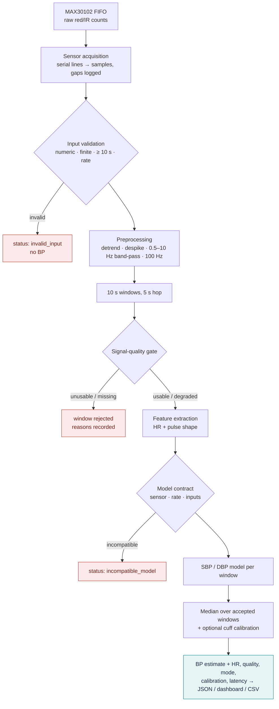

If too few windows pass the quality gate the result is `poor_signal` and no BP is returned.

## Hardware architecture

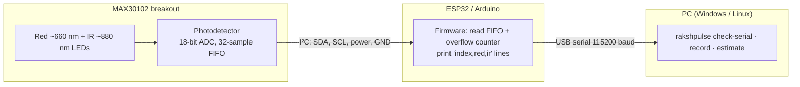

The firmware does no filtering and no BP calculation; all processing happens on the host, where it can be checked
and repeated. Pin numbers, supply voltage and pull-ups are board-specific and are deliberately not assumed.

## MAX30102 integration

The hardware team starts with the illustrated
**[Hardware Integration Manual (PDF)](docs/RAKSHPULSE_HARDWARE_INTEGRATION_MANUAL.pdf)** or the short
[HARDWARE_HANDOFF.md](docs/HARDWARE_HANDOFF.md):

1. Wire the MAX30102 (power, GND, SDA, SCL) and flash
   [`hardware/firmware/rakshpulse_max30102`](hardware/firmware/rakshpulse_max30102/rakshpulse_max30102.ino)
   (100 Hz, 411 µs pulse width, 115200 baud by default).
2. `rakshpulse check-serial --port COM5 --fs 100` must report **PASS**.
3. Record sessions with cuff readings (`record`, `reference`), validate them (`inspect --validate`) and analyse
   them (`analyze`), or get a live estimate with `rakshpulse estimate --source serial --port COM5 --fs 100`.

**Why the current model is demonstration-only on MAX30102.** It was trained on a different sensor and site:

| Property | Training data (Auricle) | Target (MAX30102) |
|---|---|---|
| Optics and site | Transmissive, earlobe | Reflective, behind the ear |
| Wavelength | Research oximeter channel | Red ~660 nm / IR ~880 nm |
| Units and level | Analogue mV, near zero | 18-bit counts on a large DC level |
| Sampling | 1 kHz (stored at 100 Hz) | 50–1000 Hz, typically 100 Hz |
| Contact | Clip | Band or adhesive; pressure varies |

The pipeline removes DC level, gain and amplitude (band-pass, z-scoring, beat-normalised shape features), so the
software runs unchanged on MAX30102 counts, but the feature-to-BP relationships must be re-learned from MAX30102
recordings. **Adding real data needs no architecture change:** record sessions with `rakshpulse record` and
`rakshpulse reference`, build a feature table, and retrain with the same training and evaluation code; a model trained
and evaluated on MAX30102 data can then be marked `experimental` for `max30102` in its contract.

## ML pipeline

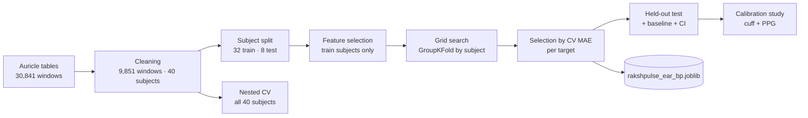

- **Cleaning:** reliable CNAP label, plausible BP (SBP 60–250, DBP 30–150, pulse pressure ≥ 10 mmHg), label stable
  within the window (SBP range ≤ 20 mmHg), quality gate passed, no ADC saturation.
- **Features:** 47 single-channel candidates from the production extractor; 40 kept after removing features missing in
  > 20 % of windows or with |Spearman ρ| > 0.95 to a kept one (training subjects only).
- **Models:** training mean (baseline), ridge, SVR (RBF), random forest, histogram gradient boosting, XGBoost and
  LightGBM, each with winsorising, median imputation and scaling fitted inside the training folds. Sequence models
  (CNN, GRU, CNN-LSTM, TCN, Transformer) are available (`[deep]` extra); the project's raw-waveform benchmark found
  they did not beat the feature models, so they are not part of the default pipeline.
- **Rules:** subject-wise splits only; tuning and selection never see the test subjects; selection uses
  cross-validated MAE, not test MAE; every model is compared with the training mean with a subject-bootstrap CI.

## Model and inference

The exported bundle `models/rakshpulse_ear_bp.joblib` holds:

- **SBP model:** ridge regression (α = 10⁴); **DBP model:** RBF support-vector regression (C = 3, ε = 2, γ = 0.01);
- **calibration models:** ridge models of the BP change since a cuff reading from the feature change;
- **contract:** 40 IR-computable features with training medians for imputation, 50–1000 Hz, modes
  (`experimental` for Auricle earlobe data, `demonstration` for `max30102` and the simulator, `validated` for
  nothing), a split-conformal 90 % interval valid only for earlobe data, and its measured test performance.

```python
from rakshpulse.inference.api import BPEstimator, StreamingBPEstimator

est = BPEstimator(sensor="max30102")                         # default bundle
r = est.estimate(ir=ir_counts, fs=100.0, red=red_counts)     # >= 10 s of samples
r.status, r.sbp, r.dbp, r.heart_rate_bpm, r.signal_quality, r.inference_mode, r.calibration_status
est.calibrate(sbp=122, dbp=78, ir=ir_at_cuff, fs=100.0)      # optional: one cuff reading
stream = StreamingBPEstimator(est, fs=100.0, buffer_s=30)    # ring buffer for FIFO-sized chunks
```

Statuses: `ok`, `poor_signal` (too few windows passed the quality gate), `invalid_input`, `incompatible_model`. Only
`ok` carries SBP/DBP. Inference takes about 0.1 s per 30 s of data on a laptop CPU.

## Dataset

| Dataset | Use | Contents |
|---|---|---|
| **Auricle** (PhysioNet v1.0.0, healthy cohort) | Training and evaluation | Simultaneous earlobe and finger PPG, CNAP continuous BP, 2 sessions on different days; 42 subjects, 30,841 windows of 10 s |
| `data/ml/auricle_ear_bp_windows.csv` | Model-ready table | 9,851 cleaned earlobe windows, 40 subjects (39 with session 1, 33 with session 2); SBP 63–195, DBP 35–137 mmHg |
| VitalDB subsets (40 + 60 surgical cases) | Earlier research, external validation | Finger PPG with arterial-line BP and cuff readings |
| Guilin, Foggia, PPG-BP | Earlier research (downloadable) | Fingertip PPG with one cuff reading per subject |

The committed Auricle tables are enough for training; the raw waveform arrays are published on the
[Releases page](https://github.com/obstinix/RakshPulse/releases) for the notebooks and figures. Synthetic data from
the simulator is used **only** for smoke tests and is labelled `synthetic=True` everywhere.

## Evaluation results

All numbers are generated by `python scripts/run_complete_pipeline.py`; the full report with every metric is
[reports/final_model_evaluation.md](reports/final_model_evaluation.md). They are **offline results on earlobe data**,
not MAX30102 hardware validation.

**1. Independent test subjects** (8 people never used for tuning or selection, 1,215 windows; mmHg):

| | Selected model | MAE | RMSE | R² | Baseline MAE | Difference [95 % CI] |
|---|---|---|---|---|---|---|
| SBP | Ridge | 13.66 | 16.26 | −0.05 | 14.08 | −0.41 [−1.73, +1.01] |
| DBP | SVR | 6.75 | 8.61 | −0.23 | 6.38 | +0.37 [−1.31, +1.87] |

**2. Nested subject-wise cross-validation** (all 40 subjects, each predicted by a model chosen without them):

| | MAE | RMSE | R² | Baseline MAE | Difference [95 % CI] |
|---|---|---|---|---|---|
| SBP | 14.50 | 18.48 | 0.04 | 14.82 | −0.31 [−0.85, +0.24] |
| DBP | 9.45 | 12.62 | 0.08 | 10.14 | −0.68 [−1.41, +0.07] |

**3. Per-person calibration** (one cuff reading per recording, windows ≥ 60 s later, test subjects; MAE in mmHg):

| Scenario | Target | Population model | Cuff only (carry forward) | Offset | Δ-model (shipped) |
|---|---|---|---|---|---|
| Same session | SBP | 13.60 | **11.17** | 11.45 | 11.28 |
| Same session | DBP | 6.65 | 6.79 | 7.86 | **6.31** ✓ |
| Next day (S1 → S2) | SBP | 13.24 | **9.57** | 12.78 | 12.51 |
| Next day (S1 → S2) | DBP | **8.00** | 10.38 | 13.66 | 10.80 |

✓ the only significant improvement over the cuff-only baseline (−0.49 mmHg, 95 % CI −0.97 to −0.01).

**What this means.** Without calibration, no model predicts an unseen person's blood pressure meaningfully better
than the population average: the differences are small and their confidence intervals include zero, and R² is near
zero. About half of the BP variance is between people, and the strongest single feature reaches only |ρ| ≈ 0.4 with
SBP at the subject level. The model regresses to the mean: it over-estimates low-BP people and under-estimates
high-BP people (see the subject-wise figure). A cuff reading helps far more than the PPG model; PPG adds a small,
significant DBP improvement only within the same session. **This is a data limitation, not a tuning problem:** better
accuracy needs data from the target sensor and site, more people (especially with high BP), repeated days per
person, and cuff references at known times.

## Screenshots and visualisations

All images come from the implemented software (`python scripts/make_figures.py`) and are labelled with their data
source. None shows MAX30102 hardware measurements, because none exist yet.

| | |
|---|---|
| 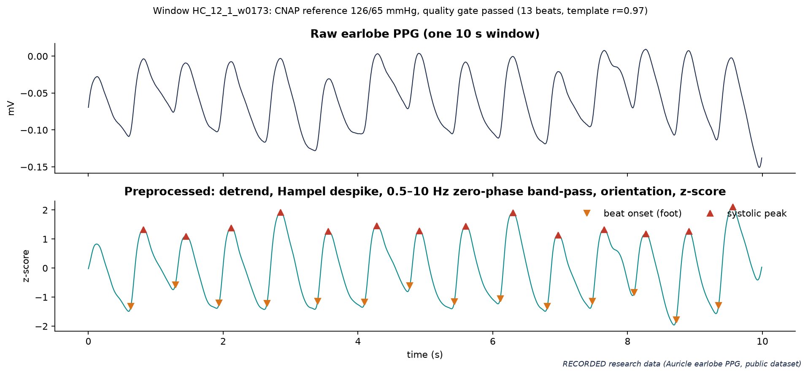 **PPG waveform, raw vs preprocessed** (recorded earlobe PPG) | 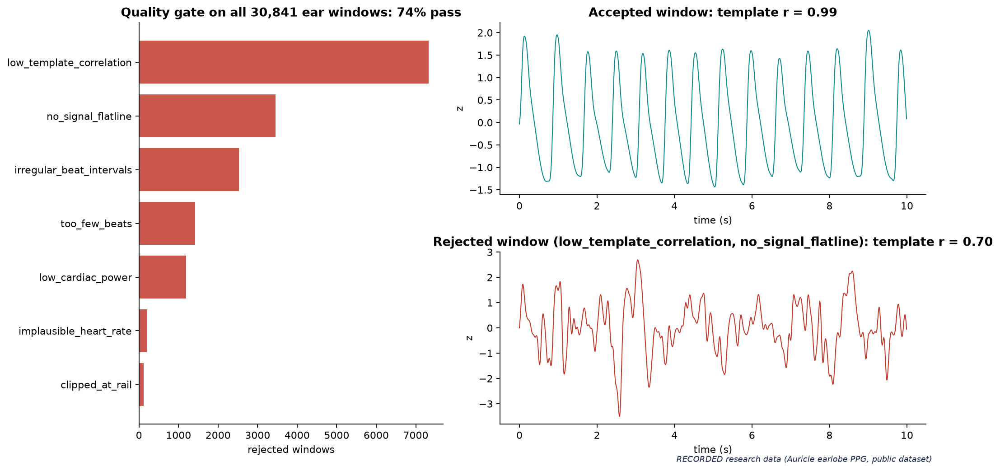 **Signal-quality gate** (recorded earlobe PPG) |
| 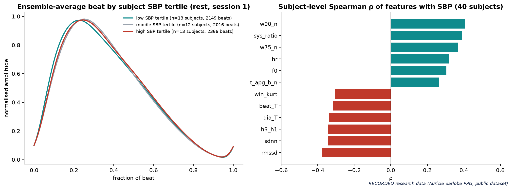 **Pulse shape and feature–BP correlation** (recorded) | 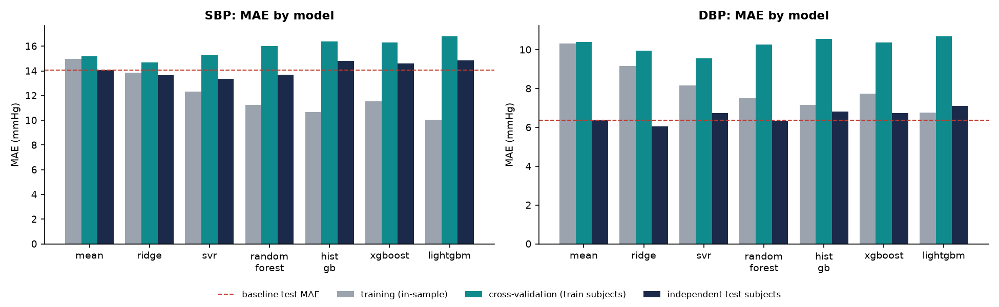 **Model comparison vs baseline** (held-out test) |
| 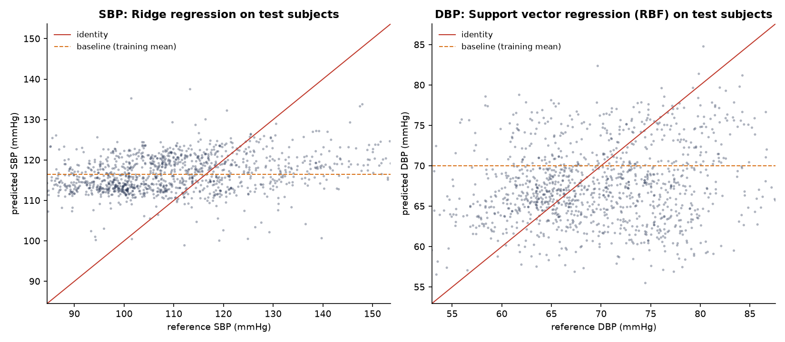 **Actual vs predicted SBP and DBP** (held-out test) | 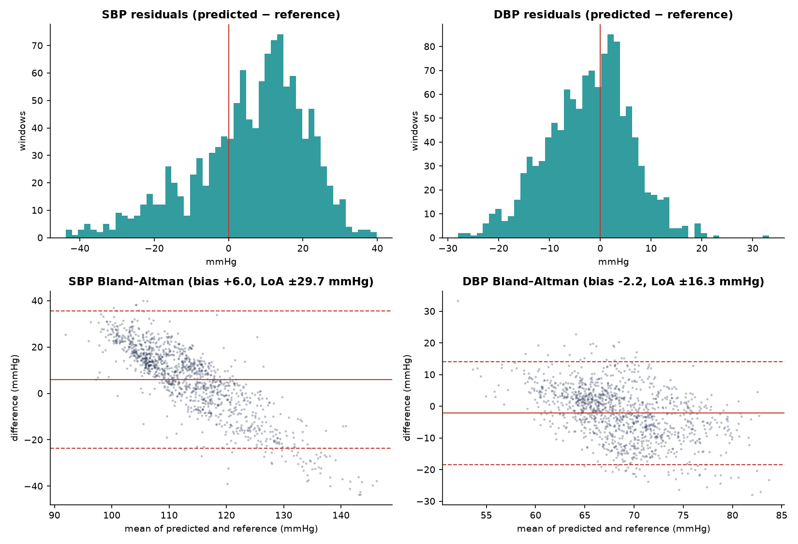 **Error distribution and Bland–Altman** (held-out test) |
| 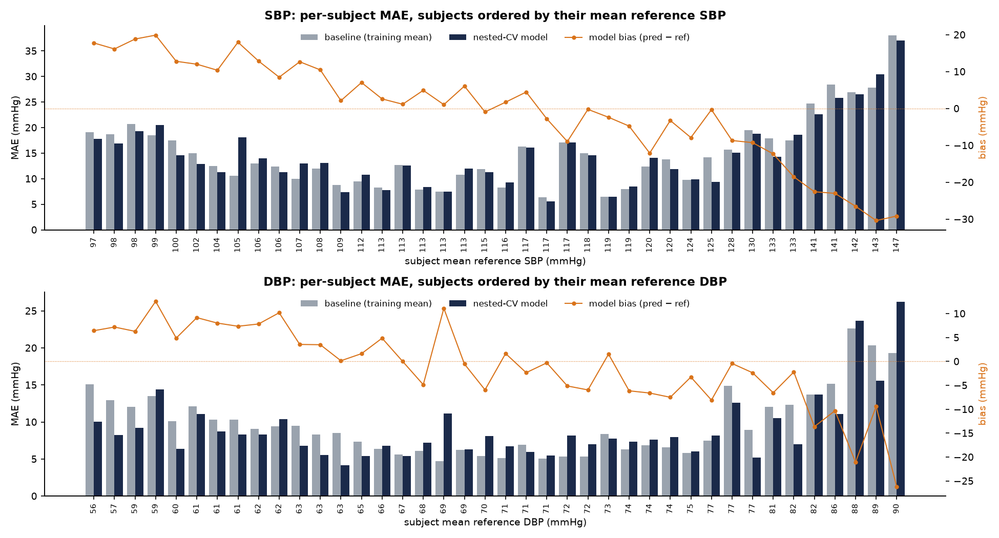 **Subject-wise error** (nested CV, 40 subjects) | 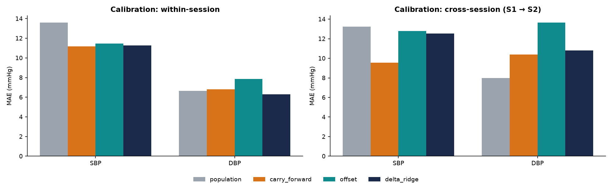 **Per-person calibration** (held-out test) |
| 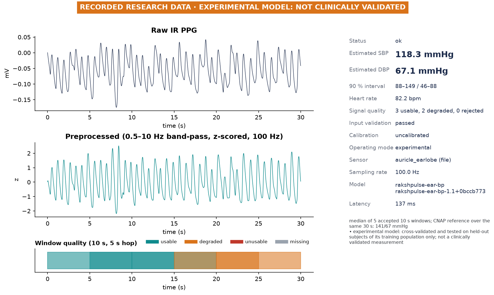 **Inference dashboard on recorded earlobe PPG** (experimental mode) | 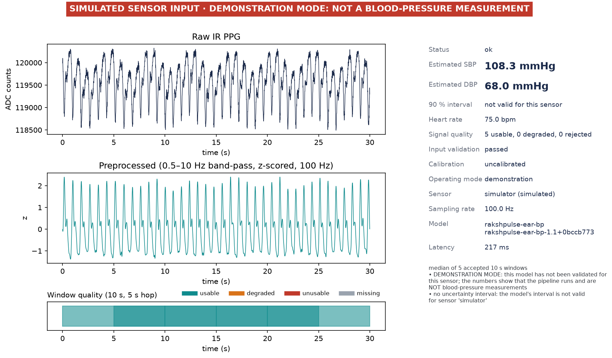 **Inference dashboard on SIMULATED input** (demonstration mode) |
| 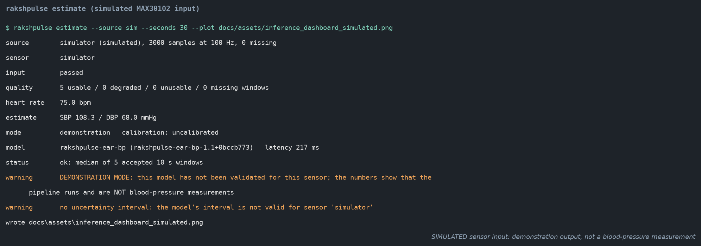 **`rakshpulse estimate`** (simulated input) | 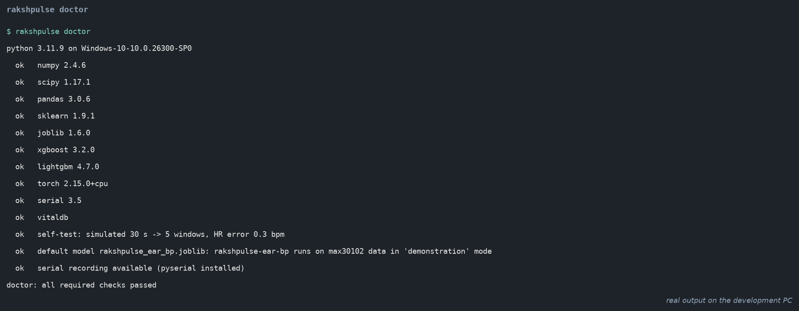 **`rakshpulse doctor`** |

## Installation

Python 3.10–3.12 on Windows or Linux (both tested in CI).

**Windows (PowerShell)**

```powershell
git clone https://github.com/obstinix/RakshPulse.git
cd RakshPulse
py -3.11 -m venv .venv
.\.venv\Scripts\Activate.ps1      # if blocked: Set-ExecutionPolicy -Scope CurrentUser RemoteSigned
pip install -e ".[dev,serial,notebook]"
rakshpulse doctor
```

**Linux (bash)**

```bash
git clone https://github.com/obstinix/RakshPulse.git && cd RakshPulse
python3 -m venv .venv && source .venv/bin/activate
pip install -e ".[dev,serial,notebook]"
sudo usermod -aG dialout "$USER"     # serial-port access for a live sensor; log out and in once
rakshpulse doctor
```

| Install | Gives you |
|---|---|
| `pip install -e .` | Core: preprocessing, features, ridge/SVR/forest models, inference API, CLI, dashboard |
| `.[train]` | XGBoost and LightGBM candidates (needed by the complete pipeline) |
| `.[data]` | Readers for the public raw datasets (WFDB, Excel) |
| `.[serial]` | Live MAX30102 input over USB serial |
| `.[notebook]` | Jupyter, to run the notebooks |
| `.[deep]` | PyTorch sequence models (CPU wheel: `pip install torch --index-url https://download.pytorch.org/whl/cpu`) |
| `.[dev]` | Tests and linting, plus `train` and `data` |

## Quick start

```bash
rakshpulse doctor                                        # environment check and self-test
python scripts/run_complete_pipeline.py                  # train, evaluate, export, report (~5 min, no download)
python scripts/run_complete_pipeline.py --evaluate-only  # re-score the exported model
python scripts/run_complete_pipeline.py --smoke-test     # SYNTHETIC data: proves the code runs, nothing more
rakshpulse estimate --source sim --seconds 30 --plot dashboard.png    # simulated sensor, demonstration mode
rakshpulse estimate --source serial --port COM5 --fs 100              # live MAX30102 (when the board exists)
python scripts/make_figures.py                           # regenerate docs/assets/
```

## CLI reference

| Command | Purpose |
|---|---|
| `rakshpulse doctor` | Check packages, run a simulated self-test, report the default model's mode |
| `rakshpulse estimate --source sim\|replay\|serial ...` | Acquire PPG and print the full estimate status; `--json`, `--plot` |
| `rakshpulse models [--sensor max30102 --fs 100 --verbose]` | List model bundles, their contracts and modes |
| `rakshpulse ports` / `check-serial --port P --fs F` | Find the board; PASS/FAIL test of the live data stream |
| `rakshpulse record --source serial ...` | Record a session (never overwrites) |
| `rakshpulse reference ...` | Add a cuff reading to a session |
| `rakshpulse inspect --dataset DS --validate [--quality]` | Integrity and signal-quality summary |
| `rakshpulse analyze --dataset DS --subject S --session D1` | Process, predict and compare a recorded session with its cuff readings |
| `simulate`, `preprocess`, `features`, `train`, `calibrate`, `evaluate`, `infer`, `export` | Research workflow ([USER_GUIDE](docs/USER_GUIDE.md)) |

Exit codes: `0` ok · `1` check failed / poor signal · `2` invalid input · `3` device problem · `4` incompatible model.

## Notebooks

| Notebook | Contents |
|---|---|
| [`RakshPulse_Complete_ML.ipynb`](notebooks/RakshPulse_Complete_ML.ipynb) | **The primary demonstration:** dataset loading and inspection, preprocessing, features, selection, subject-wise split, training and tuning, comparison with the baseline, SBP/DBP predictions, error analysis, nested CV, calibration, export and inference. It calls the same functions as the pipeline and checks it reproduces the exported model exactly. |
| [`01_ppg_exploration.ipynb`](notebooks/01_ppg_exploration.ipynb) | Signal and dataset exploration: raw and preprocessed PPG, quality-gate pass rates, between- vs within-person BP variance, feature–BP correlations, pulse shape by BP level, day-to-day shift, MAX30102 differences |

Both are committed executed. Re-run them with `jupyter lab` or
`jupyter nbconvert --to notebook --execute --inplace notebooks/RakshPulse_Complete_ML.ipynb`.

## Example inference output

Real output of `rakshpulse estimate --source sim --seconds 30` (simulated sensor input):

```text
source        simulator (simulated), 3000 samples at 100 Hz, 0 missing
sensor        simulator
input         passed
quality       5 usable / 0 degraded / 0 unusable / 0 missing windows
heart rate    75.0 bpm
estimate      SBP 108.3 / DBP 68.0 mmHg
mode          demonstration   calibration: uncalibrated
model         rakshpulse-ear-bp (rakshpulse-ear-bp-1.1+0bccb773)   latency 113 ms
status        ok: median of 5 accepted 10 s windows
warning       DEMONSTRATION MODE: this model has not been validated for this sensor; the numbers show that the pipeline runs and are NOT blood-pressure measurements
warning       no uncertainty interval: the model's interval is not valid for sensor 'simulator'
```

The same information is returned as JSON (`--json`) and by `BPEstimate.to_dict()` in Python.

## Limitations and hardware validation

- **No MAX30102 validation.** No MAX30102 recordings with reference BP exist; the firmware has not been run on a
  board. Every MAX30102 output is a demonstration.
- **No useful calibration-free accuracy.** On its own earlobe data the model is not better than the population mean.
- **Small, healthy cohort.** 40 adults; few with high BP; the independent test set has 8 people.
- **Reference.** CNAP is a calibrated continuous finger-cuff estimate, not an arterial line.
- **Motion.** No accelerometer; windows with motion artefacts are rejected, not corrected.
- **Not a medical device.** No clinical validation (ISO 81060-2 / IEEE 1708) has been performed.

**What hardware validation needs:** MAX30102 recordings at the target site from enough people (dozens, including
hypertensive participants), on several days, each with at least three cuff readings at known times
([DATA_COLLECTION_PROTOCOL](docs/DATA_COLLECTION_PROTOCOL.md)). Train and evaluate with the same subject-wise
protocol; only a model that beats the baselines on unseen people should be marked `experimental` for `max30102`, and
only an independent clinical protocol could justify `validated`.

## Project structure

```
src/rakshpulse/
  acquisition/     sensor sources (serial, replay, simulator), timestamping, recorder
  datastore/       checksummed CSV session datasets and cuff references
  data/            public-dataset download, extraction, validation, standardised builds
  preprocessing/   filtering, windows, signal-quality gate, chunked pipeline
  features/        pulse-shape, spectral, variability and physiology features
  models/          model zoo (feature and sequence models), registry
  evaluation/      splits, metrics, statistics, research studies
  personalization/ calibration strategies and policies
  ml/              complete workflow: dataset preparation, training, nested CV, calibration study, report
  inference/       contracts, engine, hardware API (api.py), dashboard, streaming, export
  experiments/     provenance registry
  cli.py           the `rakshpulse` command
hardware/          MAX30102 firmware, example streams and dataset
models/            shipped model bundles
notebooks/         master ML notebook and PPG exploration
reports/           generated evaluation report, CSV results, figures
scripts/           run_complete_pipeline.py, make_figures.py, research experiments and audits
data/              committed derived datasets and manifests (raw downloads are git-ignored)
docs/              documentation, the hardware manual and its source, docs/assets images
results/           research results and run provenance
tests/             pytest suite
```

## Development and testing

```bash
pip install -e ".[dev]"          # add: pip install torch --index-url https://download.pytorch.org/whl/cpu
pytest -q -rs                    # skipped tests are listed with their reason (e.g. torch not installed)
ruff check src tests scripts && ruff format --check src tests scripts
python scripts/run_complete_pipeline.py --smoke-test
python scripts/audit_v4.py       # research-result provenance audit
```

CI runs core-only inference, the full suite, lint and `pip check` on Ubuntu (Python 3.10–3.12, with PyTorch) and
Windows (Python 3.11, without PyTorch).

<details>
<summary><b>Reproducing the earlier research</b> (public datasets, several GB of downloads)</summary>

All seeds are fixed, results are written to `results/`, and every run is recorded with dataset hashes, commit and
package versions in `results/runs/`.

```bash
pip install -e ".[dev,deep,vitaldb]"
python -m rakshpulse.data.download guilin_dualwave foggia_multiwave ppg_bp
python scripts/extract_datasets.py
python -m rakshpulse.data.build guilin_dualwave foggia_multiwave ppg_bp guilin_unlabelled
python scripts/run_experiments.py && python scripts/run_cnn.py && python scripts/run_ecg_aux.py
python -m rakshpulse.data.physionet auricle --via-zip --jobs 3
python -m rakshpulse.data.build_auricle
python scripts/run_auricle.py && python scripts/run_cross_day.py && python scripts/audit_cross_day.py
python -m rakshpulse.data build && python -m rakshpulse.data validate
python scripts/run_personalization.py && python scripts/compare_models.py
python -m rakshpulse.data export-advanced --jobs 3 && python -m rakshpulse.data.vitaldb_dataset build --jobs 3
python scripts/run_beyond_reference.py && python scripts/run_calibration_study.py && python scripts/run_deep_benchmark.py
python -m rakshpulse.data export-physio --jobs 3 && python -m rakshpulse.data.vitaldb_dataset build --set ext --jobs 3
python scripts/run_cross_day_generalization.py && python scripts/run_physio_features.py
python scripts/run_quality_study.py && python scripts/run_calibration_uncertainty.py
python scripts/run_external_validation.py && python scripts/run_deployment_v4.py
python scripts/run_v5_experiments.py && python scripts/build_model_contracts.py && python scripts/audit_v4.py
```

</details>

## Documentation

| Document | Contents |
|---|---|
| [Final model evaluation](reports/final_model_evaluation.md) | Generated report: dataset, protocol, every metric, figures, limitations |
| [Hardware Integration Manual (PDF)](docs/RAKSHPULSE_HARDWARE_INTEGRATION_MANUAL.pdf) | Illustrated handbook for the hardware team |
| [HARDWARE_HANDOFF](docs/HARDWARE_HANDOFF.md) | Serial contract, firmware, setup, commands, data formats, troubleshooting, checklist |
| [HARDWARE_INTEGRATION](docs/HARDWARE_INTEGRATION.md) | Python inference, streaming and export interfaces |
| [USER_GUIDE](docs/USER_GUIDE.md) | Every CLI command and the research workflow |
| [DATA_COLLECTION_PROTOCOL](docs/DATA_COLLECTION_PROTOCOL.md) | Recording protocol and dataset format |
| [DATA_PREPROCESSING](docs/DATA_PREPROCESSING.md) · [MODEL_ARCHITECTURE](docs/MODEL_ARCHITECTURE.md) · [MODEL_EVALUATION](docs/MODEL_EVALUATION.md) | Signal processing, models, evaluation protocol |
| [RESEARCH_FINDINGS](docs/RESEARCH_FINDINGS.md) · [DOMAIN_ADAPTATION](docs/DOMAIN_ADAPTATION.md) | Research record and site/sensor transfer |
| [PROJECT_REQUIREMENTS](docs/PROJECT_REQUIREMENTS.md) · [DATASET_RESEARCH](docs/DATASET_RESEARCH.md) · [DATASET_ACQUISITION](docs/DATASET_ACQUISITION.md) · [data/README](data/README.md) · [RESEARCH_REFERENCES](docs/RESEARCH_REFERENCES.md) | Requirements, datasets, citations |

## Data licences and attribution

Guilin dual-wave (CC BY 4.0), Foggia multiwavelength (CC BY 4.0), PPG-BP (CC0), Auricle (ODC-By 1.0; processed
waveforms and the original WFDB records are redistributed with attribution on this repository's
[Releases](https://github.com/obstinix/RakshPulse/releases)) and VitalDB (CC BY 4.0, PhysioNet
doi:10.13026/czw8-9p62; derived tables redistributed with attribution). Required citations are in
[DATASET_ACQUISITION](docs/DATASET_ACQUISITION.md). Code is released under CC0 1.0 ([LICENSE](LICENSE)).
