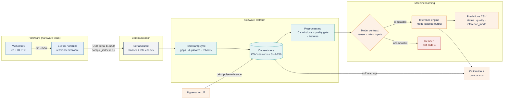
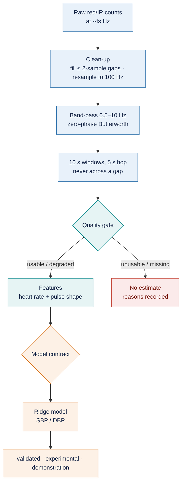

<div align="center">

# RakshPulse

**Research software for cuffless blood-pressure estimation from red/IR photoplethysmography (PPG),
built around the MAX30102 optical sensor.**

[](https://github.com/obstinix/RakshPulse/actions/workflows/ci.yml)
[](https://github.com/obstinix/RakshPulse/releases)
[](pyproject.toml)
[](tests)
[](https://github.com/astral-sh/ruff)
[](LICENSE)
<br>
[](#capabilities-and-limitations)
[](docs/HARDWARE_HANDOFF.md)
[](#capabilities-and-limitations)

</div>

> [!WARNING]
> **RakshPulse is a research prototype, not a medical device.** No output is a clinically validated blood-pressure
> measurement. No model has been validated on MAX30102 recordings: on MAX30102 data every model runs in
> **demonstration** mode, which shows the pipeline works and is **not** a BP measurement.

## Contents

[Overview](#overview) · [Architecture](#system-architecture) · [ML pipeline](#ml-pipeline) ·
[Requirements](#requirements) · [Installation](#installation) · [Usage](#usage) ·
[Hardware integration](#hardware-integration) · [Capabilities and limitations](#capabilities-and-limitations) ·
[Research findings](#research-findings) · [Reproducing the research](#reproducing-the-research) ·
[Documentation](#documentation) · [Repository layout](#repository-layout) · [Licences](#data-licences-and-attribution)

## Overview

RakshPulse is a proposed behind-the-ear blood-pressure monitor for military personnel in field and high-altitude
settings. This repository is its software side:

- **an acquisition and data platform**: serial streaming from a MAX30102 + ESP32/Arduino board, timestamping with
  lost-sample detection, checksummed CSV session datasets and cuff reference readings;
- **a signal-processing and ML pipeline**: preprocessing, a signal-quality gate, pulse features, training with
  leakage-checked splits, calibration and streaming inference behind explicit model contracts;
- **a research record**: reproducible experiments on public PPG datasets (finger, earlobe, surgical) that measure
  honestly what PPG can and cannot tell about blood pressure.

**Objectives**

1. Give the hardware team a tested, documented path from a MAX30102 sensor to a validated recording dataset.
2. Collect MAX30102 recordings with cuff references across people and days.
3. Train and evaluate a MAX30102-specific model, and report it only when it beats simple baselines on unseen
   people and days.

## System architecture



Each layer has one job and a defined interface to the next. If `rakshpulse check-serial` passes, the hardware and
communication layers work. The cuff never connects to the computer: an operator types each reading in with its
time since the recording started.

## ML pipeline



- **Preprocessing** ([DATA_PREPROCESSING](docs/DATA_PREPROCESSING.md)): DC removal, anti-aliased resampling,
  Hampel despiking, zero-phase band-pass, orientation, beat segmentation. The same code runs at training and
  inference time.
- **Quality gate:** beat count, heart-rate plausibility, beat regularity, template correlation, cardiac-band power,
  rail clipping and flat lines. Each window is `usable`, `degraded`, `unusable` or `missing`, with reasons.
  Failing windows are rejected, never repaired.
- **Features:** pulse morphology, derivative (APG), variability, spectral and red/IR cross-channel features. The
  shipped model uses heart rate plus 27 heart-rate-invariant shape features.
- **Models** ([MODEL_ARCHITECTURE](docs/MODEL_ARCHITECTURE.md)): mean and demographic baselines, ridge, elastic
  net, SVR, tree ensembles, XGBoost, LightGBM, PLS, plus raw-waveform CNN/GRU/TCN/Transformer benchmarks.
- **Evaluation** ([MODEL_EVALUATION](docs/MODEL_EVALUATION.md)): subject-wise and cross-day splits that raise on
  leakage, subject-level metrics with bootstrap confidence intervals, Bland–Altman, permutation tests with Holm
  correction. Every model is compared with predicting the mean.
- **Model contracts:** each bundle declares its required inputs, supported sensors, sampling rates and the mode it
  runs in for each sensor. Inference refuses incompatible input instead of guessing, and every output row carries
  its `inference_mode`.

| Mode | Meaning | Exists for MAX30102? |
|---|---|---|
| `validated` | Independently evaluated on this sensor type | No (none for any sensor) |
| `experimental` | Trained on this sensor type, cross-validated only | No: needs MAX30102 recordings |
| `demonstration` | Built for another sensor or site; shows the pipeline runs | **Yes**: the shipped `auricle_ear_ridge_v2` |

## Requirements

**Software**

| Item | Requirement |
|---|---|
| OS | Windows 10/11 or Linux (macOS works, untested in CI) |
| Python | 3.10, 3.11 or 3.12 (all three tested in CI) |
| Core packages | numpy, scipy, pandas, scikit-learn, xgboost, lightgbm, joblib, matplotlib, wfdb, openpyxl (installed automatically) |
| Optional extras | `serial` (pyserial, for a live sensor), `dev` (pytest, ruff), `deep` (torch), `vitaldb` (VitalDB reader) |

**Hardware** (only for live recording)

| Item | Requirement |
|---|---|
| Sensor | MAX30102 breakout (red + IR, SpO2 mode) |
| Board | ESP32 development board (recommended) or another Arduino-compatible board with I²C and USB serial |
| Connection | USB **data** cable; CP210x or CH340 driver if the board needs one |
| Reference | Automatic upper-arm cuff for reference readings |

Pin assignments, supply voltage and pull-ups depend on the board and breakout and are deliberately not assumed:
see [HARDWARE_HANDOFF](docs/HARDWARE_HANDOFF.md#1-what-you-build-and-what-the-software-expects).

## Installation

```bash
git clone https://github.com/obstinix/RakshPulse.git
cd RakshPulse
python -m venv .venv
source .venv/bin/activate              # Windows PowerShell: .\.venv\Scripts\Activate.ps1
pip install -e ".[serial]"             # core + live serial input
pip install -e ".[dev]"                # optional: tests and linting
rakshpulse doctor                      # must end with "all required checks passed"
```

`rakshpulse doctor` checks the Python packages, runs a 30 s simulated self-test and reports the default model's
mode for MAX30102.

## Usage

### Command line

| Command | Purpose |
|---|---|
| `rakshpulse doctor` | Check the installation |
| `rakshpulse models --sensor max30102 --fs 100 --verbose` | List model bundles, their contracts and the mode each runs in |
| `rakshpulse ports` | List serial ports |
| `rakshpulse check-serial --port COM5 --fs 100` | 10 s PASS/FAIL test of the live data stream |
| `rakshpulse record --source serial ...` | Record a session (never overwrites) |
| `rakshpulse reference ...` | Append a cuff reading |
| `rakshpulse inspect --dataset DS --validate` | Verify checksums, schema, ordering, ranges, references |
| `rakshpulse analyze --dataset DS --subject S --session D1` | Validate, process, predict, compare with cuff readings, export |
| `simulate`, `preprocess`, `features`, `train`, `calibrate`, `evaluate`, `infer`, `export` | Research and model workflow ([USER_GUIDE](docs/USER_GUIDE.md)) |

Exit codes: `0` success · `1` a check failed or no trustworthy result · `2` invalid usage or input ·
`3` device or serial problem · `4` incompatible model.

### Try it without hardware

```bash
rakshpulse simulate --out demo --subjects 6 --sessions 2 --duration 240    # SIMULATED data, flagged everywhere
rakshpulse inspect --dataset demo --validate
rakshpulse preprocess --dataset demo
rakshpulse features --dataset demo --out demo_table.csv
rakshpulse train --table demo_table.csv --allow-simulated --split cross_day --train-sessions D1
rakshpulse infer --model models/<version>.joblib --source sim --duration 120
```

A complete simulated session ships in `hardware/examples/example_dataset/`. Copy it and run
`rakshpulse analyze --dataset <copy> --subject SIM001 --session D1` to see real `analyze` output. Simulated
results describe the software, never blood pressure.

### Python API

```python
from rakshpulse.acquisition.simulator import SimConfig
from rakshpulse.acquisition.sources import SimulatedSensor
from rakshpulse.acquisition.ingest import Recorder
from rakshpulse.datastore.store import DatasetStore, SessionMetadata
from rakshpulse.preprocessing.pipeline import PipelineConfig, process_recording

store = DatasetStore("data/demo")
with store.create_session(SessionMetadata("SIM1", "D1", 100.0, sensor_type="simulator")) as w:
    rec = Recorder(SimulatedSensor(SimConfig(seed=1), 120), [w.write_raw])
    rec.run()
    w.add_gaps(rec.sync.gap_table())
windows, segments = process_recording(store.raw("SIM1", "D1", chunksize=50_000), PipelineConfig(), "SIM1", "D1")
```

The streaming, personalisation and export APIs are described in [USER_GUIDE](docs/USER_GUIDE.md) and
[HARDWARE_INTEGRATION](docs/HARDWARE_INTEGRATION.md).

## Hardware integration

**Hardware team: start with the
[Hardware Integration Manual (PDF)](docs/RAKSHPULSE_HARDWARE_INTEGRATION_MANUAL.pdf)**, a 43-page illustrated
handbook. [HARDWARE_HANDOFF.md](docs/HARDWARE_HANDOFF.md) is the short version kept next to the code.

1. Wire the MAX30102 to the board (power, GND, SDA, SCL; pins from your board's pinout).
2. Flash [`hardware/firmware/rakshpulse_max30102`](hardware/firmware/rakshpulse_max30102/rakshpulse_max30102.ino)
   (SparkFun MAX3010x library; defaults: 100 Hz, 411 µs, 115200 baud).
3. Verify the stream, record, add cuff readings and analyse:

```bash
rakshpulse ports
rakshpulse check-serial --port COM5 --fs 100
rakshpulse record --source serial --port COM5 --fs 100 --out data/rakshpulse_hw --subject P001 --session D1 --duration 300
rakshpulse reference --dataset data/rakshpulse_hw --subject P001 --session D1 --time 60 --sbp 121 --dbp 79 --hr 72 --device "Omron M3"
rakshpulse inspect --dataset data/rakshpulse_hw --validate
rakshpulse analyze --dataset data/rakshpulse_hw --subject P001 --session D1
```

The firmware prints one line per sample (`sample_index,red,ir`) after a `# rakshpulse fw=1 fs_hz=...` banner. The
counter advances past samples lost to FIFO overflow, so the software logs gaps instead of silently joining time.
`--fs` (sample rate ÷ averaging) is never assumed, and `record` refuses to start if it disagrees with the banner.
Example streams and a simulated dataset are in [`hardware/examples/`](hardware/examples).

## Capabilities and limitations

| Area | Status |
|---|---|
| Serial acquisition (timeouts, reconnect, duplicates, reboots, rate checks) | ✅ Tested with simulated and loop-back serial ports |
| Reference firmware for MAX30102 + ESP32/Arduino | ⚠️ Written to the datasheet; **not yet compiled or run on a board** |
| Checksummed CSV datasets with cuff references | ✅ Implemented and tested |
| Preprocessing, quality gate, features | ✅ Implemented and tested |
| Model contracts and mode-labelled inference | ✅ Implemented and tested; refuses incompatible input |
| Training, calibration, evaluation with leakage-checked splits | ✅ Implemented; used for all research results |
| Streaming inference and float32 C-header export | ✅ Desktop-verified; no microcontroller measurements |
| MAX30102 BP model | ❌ None yet: needs recordings with cuff references |
| Behind-the-ear validation | ❌ No behind-ear data exists yet ([DOMAIN_ADAPTATION](docs/DOMAIN_ADAPTATION.md)) |
| Clinical validation (ISO 81060-2 / IEEE 1708) | ❌ Not started; no compliance is claimed |

**Known limitations**

- **No hardware data yet.** Every component was exercised with simulated sensors, replayed recordings and public
  datasets. MAX30102 noise, ambient light, contact pressure and placement effects are untested.
- **Site and sensor mismatch.** The shipped model was trained on earlobe PPG from a different sensor. On its own
  data it was barely better than predicting the mean for SBP (MAE 15.0 vs 15.29 mmHg on unseen subjects) and
  slightly worse for DBP (10.98 vs 10.72).
- **Cross-day transfer.** No method tried (normalisation, domain adaptation, hierarchical calibration) carried PPG
  information across recording days, and calibrations decay within tens of minutes.
- **Populations.** The public cohorts are mostly healthy young adults or surgical patients; hypertensive subjects
  are under-represented and models regress to the mean.
- **Motion.** Neither the data nor the MAX30102 has an accelerometer; motion robustness is untested.

## Research findings

Summarised from [RESEARCH_FINDINGS](docs/RESEARCH_FINDINGS.md) and [MODEL_EVALUATION](docs/MODEL_EVALUATION.md):

1. **No public dataset has behind-the-ear PPG with BP labels.** RakshPulse must collect its own.
2. **Population, calibration-free BP from PPG did not work.** On 148 healthy adults (Guilin), PPG-only models did
   not beat the mean for SBP (11.1 vs 10.8 mmHg MAE); on unseen subjects in the standardised Auricle dataset, 0 of
   64 paired tests beat the training mean. Models trained on young adults showed −7 to −15 mmHg bias on older
   cohorts.
3. **A small within-session signal exists at the ear.** Modelling changes in pulse shape since the last cuff
   reading beat a matched no-PPG control by about 0.6–1.2 mmHg SBP, surviving subject-level permutation tests with
   Holm correction.
4. **It does not survive across days.** PPG features shift between days for reasons unrelated to BP; day-2 error
   with a day-1 calibration (ear SBP 16.1 mmHg MAE) was no better than reporting the calibration value.
5. **Cuff readings carry most of the value.** Hierarchical calibration using only cuff readings beat repeating the
   last reading by 1–4 mmHg; PPG added to it in one setting only. Conformal intervals reach 90 % coverage only at
   about ±25–30 mmHg.
6. **Bigger models did not help.** CNN, GRU, CNN-LSTM, TCN and Transformer models did not beat the baselines.

The realistic path is per-user cuff calibration plus MAX30102 data collected with a controlled, repeatable
placement across days ([DATA_COLLECTION_PROTOCOL](docs/DATA_COLLECTION_PROTOCOL.md)).

## Reproducing the research

All seeds are fixed (CV seeds 0, 1, 2; model seed 0), results are written to `results/`, and every run is recorded
with dataset hashes, commit and package versions in `results/runs/`. `python scripts/audit_v4.py` checks
provenance, checksums, splits and leakage.

<details>
<summary><b>Full reproduction commands</b> (public datasets, several GB of downloads)</summary>

```bash
pip install -e ".[dev,deep,vitaldb]"

# public fingertip datasets (≈650 MB download); see data/README.md
python -m rakshpulse.data.download guilin_dualwave foggia_multiwave ppg_bp
python scripts/extract_datasets.py
python -m rakshpulse.data.dataset_validator
python -m rakshpulse.data.build guilin_dualwave foggia_multiwave ppg_bp guilin_unlabelled
python -m rakshpulse.data.metadata
python scripts/run_experiments.py && python scripts/run_cnn.py && python scripts/run_ecg_aux.py

# Auricle finger vs earlobe and cross-day study
python -m rakshpulse.data.physionet auricle --via-zip --jobs 3
python -m rakshpulse.data.build_auricle
python scripts/run_auricle.py && python scripts/visualize_auricle.py
python scripts/run_cross_day.py
python scripts/run_cross_day.py --models ridge --no-rail-gate --tag _no_rail_gate
python scripts/compare_rail_gate.py
python -m rakshpulse.data.physionet auricle --verify
python scripts/audit_cross_day.py
python scripts/make_cross_day_figures.py && python scripts/write_findings.py

# standardised dataset and personalisation (or fetch the published NPZ waveforms)
python -m rakshpulse.data build && python -m rakshpulse.data validate && python -m rakshpulse.data summary
python -m rakshpulse.data.release fetch waveforms
python scripts/run_personalization.py && python scripts/compare_models.py && python scripts/visualize_ppg.py

# 3.0: VitalDB subset, beyond-reference and calibration studies, deep benchmarks
python -m rakshpulse.data export-advanced --jobs 3
python -m rakshpulse.data.vitaldb_dataset build --jobs 3
python scripts/run_beyond_reference.py && python scripts/run_calibration_study.py
python scripts/run_feature_analysis.py && python scripts/run_deep_benchmark.py
python scripts/benchmark_inference.py

# 4.0: generalisation, physiology, quality, calibration uncertainty, external validation, deployment
python -m rakshpulse.data export-physio --jobs 3
python -m rakshpulse.data.vitaldb_dataset build --set ext --jobs 3
python scripts/run_cross_day_generalization.py && python scripts/run_physio_features.py
python scripts/run_quality_study.py && python scripts/run_calibration_uncertainty.py
python scripts/run_external_validation.py && python scripts/run_deployment_v4.py
python scripts/plot_v4.py && python scripts/write_findings.py

# 5.0/5.1: cross-day follow-up, platform benchmarks, model contracts, audit
python scripts/run_v5_experiments.py
python scripts/build_model_contracts.py
python scripts/audit_v4.py

# or the earlier stages in order
python scripts/reproduce.py
```

</details>

## Documentation

| Document | Contents |
|---|---|
| [Hardware Integration Manual (PDF)](docs/RAKSHPULSE_HARDWARE_INTEGRATION_MANUAL.pdf) | Illustrated handbook: wiring, firmware, setup, recording, cuff readings, analysis, troubleshooting |
| [HARDWARE_HANDOFF](docs/HARDWARE_HANDOFF.md) | Serial contract, firmware, setup, commands, data formats, troubleshooting, checklist |
| [HARDWARE_INTEGRATION](docs/HARDWARE_INTEGRATION.md) | Python inference, streaming and export interfaces for device integration |
| [USER_GUIDE](docs/USER_GUIDE.md) | Every CLI command, training, calibration, evaluation, streaming, export |
| [DATA_COLLECTION_PROTOCOL](docs/DATA_COLLECTION_PROTOCOL.md) | Recording protocol and dataset format |
| [DATA_PREPROCESSING](docs/DATA_PREPROCESSING.md) | Signal-processing chain and quality gate |
| [MODEL_ARCHITECTURE](docs/MODEL_ARCHITECTURE.md) · [MODEL_EVALUATION](docs/MODEL_EVALUATION.md) | Models, evaluation protocol and results |
| [RESEARCH_FINDINGS](docs/RESEARCH_FINDINGS.md) | Full research record, releases 2.0–5.1 |
| [DOMAIN_ADAPTATION](docs/DOMAIN_ADAPTATION.md) | Why fingertip and earlobe results do not transfer to behind-the-ear |
| [PROJECT_REQUIREMENTS](docs/PROJECT_REQUIREMENTS.md) | Requirements traced to the project documents |
| [DATASET_RESEARCH](docs/DATASET_RESEARCH.md) · [DATASET_ACQUISITION](docs/DATASET_ACQUISITION.md) · [data/README](data/README.md) | Dataset survey, downloads, checksums, licences, published dataset |
| [RESEARCH_REFERENCES](docs/RESEARCH_REFERENCES.md) | Literature and dataset citations |

## Repository layout

```
src/rakshpulse/
  acquisition/       serial, replay and simulated sources; timestamp sync; recorder
  datastore/         checksummed CSV session datasets
  data/              public-dataset download, extraction, validation, standardised builds
  preprocessing/     filtering, windows, quality gate, chunked pipeline
  features/          pulse morphology, spectral, cross-channel and physiology features
  models/            model zoo, deep models, registry and contracts
  evaluation/        splits, metrics, statistics
  personalization/   calibration strategies, policies, baseline tracking
  inference/         contracts, engine, predictor, streaming, export
  experiments/       provenance registry
  cli.py             the `rakshpulse` command
hardware/            MAX30102 firmware and example streams/dataset
models/              shipped model bundles (other bundles are regenerable and git-ignored)
scripts/             reproducible experiment entry points and audits
tests/               pytest suite (synthetic fixtures; no download needed)
notebooks/           exploratory analysis
docs/                documentation, figures and the manual's source (docs/manual_source)
data/                committed derived datasets and manifests; raw downloads are git-ignored
results/             committed metrics and the run provenance registry
```

## Data licences and attribution

Guilin dual-wave (CC BY 4.0), Foggia multiwavelength (CC BY 4.0), PPG-BP (CC0), Auricle (ODC-By 1.0; processed
waveforms and the original WFDB records are redistributed with attribution on this repository's
[Releases](https://github.com/obstinix/RakshPulse/releases)) and VitalDB (CC BY 4.0, PhysioNet
doi:10.13026/czw8-9p62; derived tables redistributed with attribution). Required citations are in
[DATASET_ACQUISITION](docs/DATASET_ACQUISITION.md). Code is released under CC0 1.0 ([LICENSE](LICENSE)).
