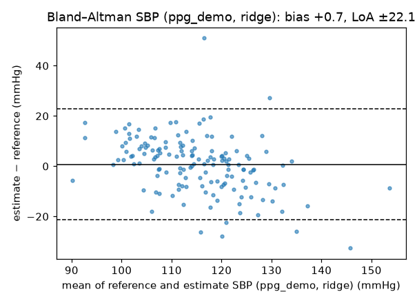
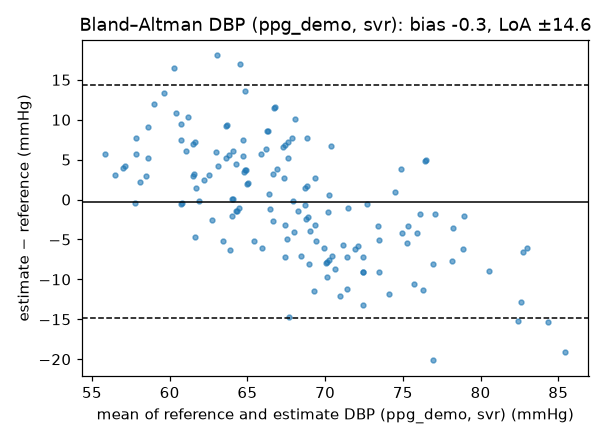

# Model Evaluation

All numbers come from `results/*.json` and can be regenerated with the commands in the
README. Reproducible seeds: outer CV seed 0 (plus seeds 1 and 2 for the ablation), model seed 0.

## Protocol

- **Data:** Guilin dual-wavelength, rest recordings, 148 subjects, 10 s windows (5 s step,
  first 10 s discarded), SQI-accepted windows only (4,934 windows built; about 93–97 % accepted
  per channel).
- **Split:** nested, subject-independent. The outer loop is 5-fold `StratifiedGroupKFold`
  (stratified by subject SBP quintile). The inner loop is 3-fold `GroupKFold` for
  hyper-parameters. Imputation and scaling are fitted inside each training fold. No subject
  appears in both train and test (asserted in code).
- **Unit of analysis:** each subject has **one** cuff reading, so all of that subject's
  windows share one label. Window predictions are aggregated by median per subject, and
  **subject-level metrics (n = 148) are primary**. Window-level MAE is listed for comparison
  with literature that reports it, and it should not be read as independent-sample accuracy.
- **Baselines:** the *mean* predictor (training-fold mean) and *demographics-only* ridge
  regression (age, sex, height, weight). A model has learned something from PPG only if
  it beats both.

## A. Model comparison (subject level, n = 148, mmHg)

### SBP

| Features | Model | MAE | RMSE | R² | Bias (ME) | SD | r | Window MAE |
|---|---|---:|---:|---:|---:|---:|---:|---:|
| — | **Mean baseline** | **10.83** | 13.60 | 0.00 | +0.0 | 13.65 | — | 10.78 |
| Demographics | Ridge | 9.21 | 11.63 | 0.27 | +0.0 | 11.67 | 0.52 | 9.17 |
| Demographics | XGBoost | 9.90 | 12.37 | 0.17 | −0.0 | 12.41 | 0.46 | 9.88 |
| PPG red+IR | Linear | 11.76 | 16.35 | −0.45 | +0.9 | 16.38 | −0.09 | 12.15 |
| PPG red+IR | Ridge | 11.22 | 14.42 | −0.13 | +0.5 | 14.46 | −0.03 | 11.29 |
| PPG red+IR | SVR | 11.41 | 14.13 | −0.08 | −0.7 | 14.17 | 0.00 | 11.50 |
| PPG red+IR | Random forest | 11.12 | 13.86 | −0.04 | +0.1 | 13.91 | 0.12 | 11.30 |
| PPG red+IR | XGBoost | 11.42 | 14.11 | −0.08 | +0.3 | 14.16 | 0.10 | 11.56 |
| PPG IR | 1D CNN (raw waveform) | 11.33 | 14.40 | −0.12 | +0.3 | 14.45 | 0.09 | 11.49 |
| PPG red+IR | 1D CNN (raw waveform) | 10.91 | 14.16 | −0.09 | −2.5 | 13.99 | 0.09 | 10.94 |
| PPG red+IR + demographics | Linear | 8.67 | 11.24 | 0.32 | +0.6 | 11.26 | 0.59 | 8.98 |
| PPG red+IR + demographics | Ridge | 8.59 | 11.25 | 0.31 | +0.7 | 11.26 | 0.58 | 8.78 |
| PPG red+IR + demographics | **SVR** | 8.63 | **10.55** | **0.40** | −0.1 | **10.58** | **0.63** | 8.86 |
| PPG red+IR + demographics | Random forest | 8.76 | 11.06 | 0.34 | +0.1 | 11.10 | 0.58 | 8.77 |
| PPG red+IR + demographics | XGBoost | 8.83 | 11.02 | 0.34 | +0.1 | 11.06 | 0.59 | 8.88 |

### DBP

| Features | Model | MAE | RMSE | R² | Bias (ME) | SD | r | Window MAE |
|---|---|---:|---:|---:|---:|---:|---:|---:|
| — | **Mean baseline** | **7.59** | 9.14 | 0.00 | −0.0 | 9.17 | — | 7.59 |
| Demographics | Ridge | 7.28 | 8.87 | 0.05 | −0.0 | 8.90 | 0.23 | 7.27 |
| Demographics | XGBoost | 8.26 | 10.14 | −0.24 | −0.1 | 10.18 | 0.03 | 8.22 |
| PPG red+IR | Linear | 7.25 | 10.68 | −0.37 | +0.6 | 10.69 | 0.15 | 7.60 |
| PPG red+IR | Ridge | 6.76 | 8.57 | 0.12 | +0.3 | 8.59 | 0.35 | 6.99 |
| PPG red+IR | SVR | 7.02 | 8.57 | 0.12 | −0.3 | 8.59 | 0.35 | 7.26 |
| PPG red+IR | Random forest | 6.83 | 8.34 | 0.16 | −0.2 | 8.36 | 0.41 | 7.00 |
| PPG red+IR | **XGBoost** | **6.73** | 8.24 | 0.18 | −0.2 | 8.26 | 0.43 | 7.02 |
| PPG IR | 1D CNN (raw waveform) | 7.52 | 9.15 | −0.01 | −0.9 | 9.13 | 0.24 | 7.66 |
| PPG red+IR | 1D CNN (raw waveform) | 7.35 | 9.19 | −0.01 | −2.4 | 8.91 | 0.26 | 7.51 |
| PPG red+IR + demographics | Linear | 6.33 | 8.98 | 0.03 | +0.5 | 9.00 | 0.41 | 6.65 |
| PPG red+IR + demographics | Ridge | 6.18 | 8.30 | 0.17 | +0.4 | 8.32 | 0.46 | 6.46 |
| PPG red+IR + demographics | **SVR** | **6.09** | **7.41** | **0.34** | −0.3 | **7.43** | **0.59** | 6.28 |
| PPG red+IR + demographics | Random forest | 6.46 | 8.11 | 0.21 | −0.2 | 8.13 | 0.46 | 6.64 |
| PPG red+IR + demographics | XGBoost | 6.46 | 8.06 | 0.22 | −0.2 | 8.09 | 0.48 | 6.64 |

### Are the differences real? Paired subject-level bootstrap (10,000 resamples)

`results/paired_comparisons.json`. Δ = MAE(candidate) − MAE(reference). * = 95 % CI excludes 0.

| Comparison | Target | Candidate MAE | Reference MAE | Δ MAE [95 % CI] |
|---|---|---:|---:|---|
| PPG-only XGBoost vs mean | SBP | 11.42 | 10.83 | +0.59 [−0.20, +1.41] |
| PPG-only XGBoost vs mean | DBP | 6.73 | 7.59 | **−0.86 [−1.48, −0.22]** * |
| PPG-only ridge vs mean | DBP | 6.76 | 7.59 | **−0.83 [−1.41, −0.24]** * |
| Demographics ridge vs mean | SBP | 9.21 | 10.83 | **−1.62 [−2.52, −0.70]** * |
| Demographics ridge vs mean | DBP | 7.28 | 7.59 | −0.31 [−0.64, +0.02] |
| PPG+demo ridge vs demographics ridge | SBP | 8.59 | 9.21 | −0.62 [−1.53, +0.30] |
| PPG+demo ridge vs demographics ridge | DBP | 6.18 | 7.28 | **−1.10 [−1.82, −0.31]** * |
| PPG+demo SVR vs demographics ridge | DBP | 6.09 | 7.28 | **−1.18 [−1.85, −0.53]** * |
| 1D CNN red+IR vs mean | SBP | 10.91 | 10.83 | +0.08 [−0.73, +0.89] |
| 1D CNN red+IR vs mean | DBP | 7.35 | 7.59 | −0.24 [−0.89, +0.41] |

**Conclusion:** PPG features give a statistically reliable but small DBP improvement
(about 1 mmHg MAE). For SBP, PPG adds no detectable information beyond demographics. The CNN
(16.4k parameters, 0.5 ms per window on a desktop CPU) is indistinguishable from the mean
predictor. With 148 single-label subjects, the raw-waveform model has too little
supervision to learn morphology–BP relationships.

## B. Red vs IR vs red+IR (subject-level MAE, mean ± SD over 3 CV seeds)

| Channels | Ridge SBP | XGBoost SBP | Ridge DBP | XGBoost DBP |
|---|---:|---:|---:|---:|
| IR only | 10.97 ± 0.03 | 11.64 ± 0.23 | 6.81 ± 0.08 | 6.99 ± 0.05 |
| Red only | 10.91 ± 0.06 | 11.51 ± 0.21 | 6.75 ± 0.06 | 6.85 ± 0.07 |
| Red + IR | 11.13 ± 0.07 | 11.18 ± 0.19 | 6.79 ± 0.10 | 6.92 ± 0.14 |
| *Mean baseline* | *10.83* | | *7.59* | |

**Using both wavelengths did not improve accuracy.** The red and IR waveforms are almost
identical after band-pass filtering (median red–IR correlation > 0.99), so the second
channel mostly adds redundant features. The wavelength-dependent information (the
AC/DC ratio of ratios) relates to SpO₂ rather than BP. Practical consequence: IR alone, which
has the better SQI pass rate (96.6 % vs 93.4 %), is sufficient for BP features. Red remains
useful for SpO₂.

## C. External generalisation (train: all Guilin; test: other datasets)

| Test set | Model | SBP MAE | SBP bias | SBP r | DBP MAE | DBP bias | DBP r |
|---|---|---:|---:|---:|---:|---:|---:|
| Foggia (127, 18–86 y, red+IR) | Mean (Guilin) | 13.26 | −7.3 | — | 8.76 | −5.8 | — |
| | Ridge | 18.19 | −14.9 | −0.19 | 9.68 | −7.0 | 0.12 |
| | Random forest | 14.75 | −10.3 | 0.18 | 9.27 | −6.5 | 0.16 |
| | XGBoost | 14.68 | −10.8 | 0.17 | 9.28 | −6.4 | 0.17 |
| PPG-BP (≈150 usable, 20–89 y, IR) | Mean (Guilin) | 18.72 | −13.2 | — | 8.88 | −3.8 | — |
| | Ridge | 19.26 | −13.9 | 0.08 | 8.52 | −4.1 | 0.38 |
| | Random forest | 19.59 | −14.1 | −0.06 | 8.24 | −2.3 | 0.36 |
| | XGBoost | 19.82 | −14.4 | −0.03 | 8.19 | −2.4 | 0.39 |

Every model trained on young adults **underestimates BP in older cohorts by 7–15 mmHg**, and
none beats Guilin's training mean for SBP. A modest DBP correlation (r ≈ 0.37) survives on
PPG-BP, which is consistent with the small DBP signal found in-sample. This is the clearest
evidence that a population model trained on one cohort cannot be trusted on another.
Soldiers are also a different population (age, fitness, altitude, stress).

## D. BP-range analysis (PPG-only XGBoost, subject level)

| SBP range | n | MAE | Bias | | DBP range | n | MAE | Bias |
|---|---:|---:|---:|---|---|---:|---:|---:|
| < 110 | 57 | 13.5 | +13.3 | | < 60 | 26 | 10.0 | +10.0 |
| 110–119 | 39 | 5.0 | 0.0 | | 60–69 | 60 | 4.1 | +2.8 |
| 120–129 | 32 | 8.9 | −8.4 | | 70–79 | 46 | 6.4 | −5.8 |
| 130–139 | 15 | 18.8 | −18.8 | | 80–89 | 13 | 11.3 | −10.9 |
| **≥ 140** | **5** | **32.2** | **−32.2** | | **≥ 90** | **3** | **17.7** | **−17.7** |

All models show strong **regression to the mean**. Errors are small only near the cohort
mean, and **hypertensive subjects are underestimated by about 32–36 mmHg (SBP)** across every
model. For a screening device this is the most important failure mode, because it would
reassure exactly the people who need follow-up.

Figures (best non-baseline model per feature set): `docs/figures/bland_altman_ppg_*.png`,
`bland_altman_ppg_demo_*.png`, `pred_vs_true_*.png`, `error_hist_*.png`.

 

## E. Auxiliary: ECG-assisted pulse arrival time (not available on MAX30102)

`scripts/run_ecg_aux.py` → `results/ecg_aux_experiments.json`. **This configuration cannot run on
the RakshPulse hardware.** It is reported only to understand what information single-site PPG lacks.

PAT (ECG R-peak → PPG foot) was available in 99.6 % of windows. Subject-level
Pearson correlation of median PAT with SBP: **-0.35**, with DBP: -0.27 (shorter
arrival time at higher BP, as physiology predicts).

| Feature set | Model | Target | Subject MAE | r |
|---|---|---|---:|---:|
| ppg_ir_red (PPG only) | ridge | SBP | 11.22 | -0.03 |
| ppg_ir_red (PPG only) | ridge | DBP | 6.76 | 0.35 |
| ppg_ir_red (PPG only) | xgboost | SBP | 11.42 | 0.10 |
| ppg_ir_red (PPG only) | xgboost | DBP | 6.73 | 0.43 |
| ecg_pat_only (aux) | ridge | SBP | 10.06 | 0.33 |
| ecg_pat_only (aux) | ridge | DBP | 7.35 | 0.24 |
| ecg_pat_only (aux) | xgboost | SBP | 9.97 | 0.35 |
| ecg_pat_only (aux) | xgboost | DBP | 7.26 | 0.26 |
| ppg_ir_red+ecg_pat (aux) | ridge | SBP | 10.66 | 0.14 |
| ppg_ir_red+ecg_pat (aux) | ridge | DBP | 6.68 | 0.37 |
| ppg_ir_red+ecg_pat (aux) | xgboost | SBP | 11.08 | 0.17 |
| ppg_ir_red+ecg_pat (aux) | xgboost | DBP | 6.91 | 0.40 |

Three PAT features alone beat the mean predictor for SBP (≈10.0 vs 10.8 mmHg), which PPG morphology
never did. Adding them to the 82 PPG features diluted the gain (ridge 10.66). **Implication for
hardware:** *timing* information (pulse arrival or transit time) carries SBP signal that
single-site PPG shape does not. A second optical site (e.g. two MAX30102s, or ear + finger),
giving a PPG-only pulse transit time, is a hardware option worth evaluating. ECG is not.

## F. Finger vs earlobe PPG with continuous BP (Auricle, healthy cohort)

`scripts/run_auricle.py` → `results/auricle_experiments.json`. Data: Auricle v1.0.0, healthy cohort
session 1, **41 subjects** (HC_1_1 excluded: no CNAP mask), 8,458 labelled 10 s windows. Labels are the
median beat-level **CNAP continuous finger-cuff** SBP/DBP inside each window. Only windows entirely
inside CNAP-valid periods are used, and only windows where *both* sites pass SQI (so the site comparison
uses identical windows). Five-fold CV grouped by subject (balanced by subject mean SBP). Unlike Guilin,
BP varies **within** subjects (breath-hold, Valsalva, exercise, cold pressor): median within-subject
SBP SD 12.7 mmHg, against a between-subject SD of 14.0 mmHg.

**Signal quality by site (SQI pass rate, after the rail-clipping and flat-signal gates):** ear 78.2 %, finger 79.7 % overall.
During exercise the rates were ear 52.3 % and finger 57.5 %; during cold pressor, ear 73.1 % and finger 80.0 %. (In one early-inspected record (HC_10_1) the ear
passed every cold-pressor and exercise window while the finger did not. The cohort-level data do **not** show a
general ear advantage. In the Auricle setup the earlobe is the *less* reliable site.)

### Quality-gate corrections (apply to all of §F)

Two defects in the window quality gate were found after the first version of this analysis and fixed:
1. **Amplifier rail clipping.** 11 % of finger windows contained samples at the ±10 V rail. Windows with more
   than 1 % clipped samples are now rejected.
2. **Flat / disconnected sensor.** 3,458 ear windows had a raw SD below 0.003 mV (noise floor), and 31 of them
   had passed SQI. A signal-presence gate now rejects them.

Tables are regenerated by `scripts/write_session1_tables.py` from the corrected run. Effect on within-session
SBP tracking (ridge): finger r 0.47 → 0.34, ear r 0.39 → 0.29. The qualitative conclusions were unchanged.

### F1. Calibration-free, subject-independent (window MAE / subject-mean MAE / median within-session r)

Windows must pass SQI (including the rail-clipping and flat-signal gates) at **both** sites.
Finger SQI pass rate 79.7 %, ear 78.2 %.

| Site | Model | SBP win MAE | SBP subj MAE | SBP tracking r | DBP win MAE | DBP subj MAE | DBP tracking r |
|---|---|---:|---:|---:|---:|---:|---:|
| — | Mean | 15.46 | 11.12 | — | 10.70 | 7.86 | — |
| — | Demographics ridge | 16.22 | 11.96 | — | 10.78 | 8.14 | — |
| Finger | HR-only ridge | 14.73 | 10.41 | 0.28 | 10.61 | 8.02 | 0.15 |
| Finger | Ridge (PPG features) | 14.40 | 9.96 | 0.34 | 11.10 | 8.07 | 0.08 |
| Finger | XGBoost | 15.61 | 11.09 | 0.38 | 12.51 | 9.15 | 0.16 |
| Ear | HR-only ridge | 14.79 | 10.47 | 0.21 | 10.63 | 8.03 | 0.15 |
| Ear | Ridge (PPG features) | 15.22 | 11.02 | 0.29 | 10.57 | 7.35 | 0.11 |
| Ear | XGBoost | 17.28 | 13.18 | 0.29 | 11.52 | 8.02 | 0.09 |

PPG morphology tracks **within-session SBP changes** a little better than heart rate alone (finger r
0.34 vs 0.28; ear r 0.29 vs 0.21). Absolute
calibration-free errors stay around 14–15 mmHg, and DBP shows essentially no PPG signal.

### F2. One-point personal calibration (first 3 rest windows ≈ 20 s of each session)

The comparison baseline is **carry-forward** (keep reporting the calibration value). ΔMAE = per-session MAE(model) −
MAE(carry-forward), with a 95 % bootstrap CI over sessions. **Bold** = CI excludes 0.

| Site | Model | SBP calibrated MAE | Carry-forward | Stressor windows (model vs carry) | ΔMAE [95 % CI] | Δ-tracking r |
|---|---|---:|---:|---|---|---:|
| Finger | HR-only ridge | 15.18 | 15.40 | 17.04 vs 17.14 | -0.69 [-1.54, +0.13] | 0.15 |
| Finger | Ridge | 14.21 | 15.40 | 14.53 vs 17.14 | **-1.61 [-2.92, -0.28]** | 0.35 |
| Finger | XGBoost | 15.16 | 15.40 | 14.90 vs 17.14 | -1.08 [-2.87, +0.59] | 0.34 |
| Ear | HR-only ridge | 15.21 | 15.40 | 16.97 vs 17.14 | -0.42 [-1.03, +0.20] | 0.14 |
| Ear | Ridge | 14.37 | 15.40 | 15.29 vs 17.14 | **-1.16 [-2.07, -0.29]** | 0.22 |
| Ear | XGBoost | 14.66 | 15.40 | 15.02 vs 17.14 | -0.54 [-2.26, +1.25] | 0.33 |

DBP: finger Ridge 9.44 vs 9.18, ΔMAE +0.37 [-0.17, +0.90]; finger XGBoost 10.13 vs 9.18, ΔMAE +1.09 [+0.19, +1.99]; ear Ridge 9.44 vs 9.18, ΔMAE +0.36 [-0.08, +0.83]; ear XGBoost 10.36 vs 9.18, ΔMAE +1.23 [+0.49, +1.99].

### F3. Finger → ear transfer (train on finger PPG, test on earlobe PPG of held-out subjects)

| Model | Adaptation | SBP win MAE | SBP bias | SBP tracking r | DBP win MAE | DBP bias |
|---|---|---:|---:|---:|---:|---:|
| Ridge | none | 15.83 | -3.32 | 0.10 | 10.53 | +1.76 |
| Ridge | per-site standardisation | 16.07 | +0.70 | 0.03 | 10.51 | +0.01 |
| XGBoost | none | 16.36 | -1.32 | 0.18 | 11.02 | +0.72 |
| XGBoost | per-site standardisation | 16.43 | -0.23 | 0.10 | 11.73 | -1.63 |
| *Ear → ear (reference)* | — | *15.22* | — | *0.29* | *10.57* | — |

A finger-trained model loses most of its tracking ability at the ear. Per-site standardisation removes the bias but
does not restore tracking (`docs/figures/cross_day/fig1_ear_vs_finger_waveforms.png`).

### F4. Guilin (fingertip IR) → Auricle

Guilin-trained models applied to Auricle were at mean-predictor level (SBP window MAE 14.4–15.1 vs 15.1).
Tracking was r 0.26 at the finger and ≤ 0.18 at the ear, with an SBP bias of −4 mmHg at the ear.

### F5. Cross-day validation (complete; audited)

Full results, methods and interpretation are in **[RESEARCH_FINDINGS.md](RESEARCH_FINDINGS.md)**. Tables there are
generated from `results/cross_day/` by `scripts/write_findings.py` after the independent audit
(`scripts/audit_cross_day.py`, 11/11 checks passed) has run. Summary for 36 healthy subjects with both sessions
(37 session-2 records verified):

- Within a day, ear PPG tracks SBP changes (r 0.41) beyond heart rate (partial r 0.23 [0.16, 0.31]), and calibration
  beats carry-forward by about 1 mmHg (CI excludes 0).
- Across days, a day-1 calibration **does not** beat carry-forward for SBP, and is worse for ear DBP. The model does not
  follow day-to-day resting-BP shifts (slope 0.02 [−0.04, 0.09]; CI excludes 1). Calibration offsets are unstable
  across days (|change| 9–12 mmHg).
- No model differs from ridge in a meaningful way. Rail-clipping removal changed MAEs by ≤ 0.5 mmHg.

## Interpretation

1. **Single-site PPG morphology carries little SBP information in this cohort.** No PPG-only
   model, linear, kernel, tree ensemble or CNN, beat the mean predictor for SBP, and
   published calibration-free, subject-independent benchmarks (González et al. 2023;
   Weber-Boisvert et al. 2023) likewise report that learned models improve little on simple
   baselines once subject leakage is removed. The narrow BP spread here makes the mean predictor
   unusually hard to beat.
2. **DBP shows a small, real PPG signal** (MAE about 11 % lower than the mean predictor, r ≈ 0.4).
3. **Demographics explain most of the explainable SBP variance.** Sex alone correlates
   ρ = 0.45 with SBP in this cohort (`notebooks/01_ppg_exploration.ipynb`).
4. **Window-level vs subject-level:** they are nearly identical here, because the error is
   dominated by between-subject offsets, not within-subject noise.
5. **Auricle (section F) adds the first positive evidence:** at the finger *and* the earlobe, PPG
   morphology tracks within-subject SBP changes beyond heart rate, and with one-point calibration it beats
   carry-forward for SBP by about 1–1.5 mmHg (statistically reliable, clinically small). It also shows that
   finger-trained models do not transfer to the ear.
6. **Model selection:** the reference inference bundle uses **ridge on PPG + demographics**.
   It is within 0.1 mmHg MAE of the best model, has a few kB of coefficients, and ports to C
   trivially. This was not chosen for R² (SVR has the highest R²). The choice is based on
   MAE parity, robustness and deployability.

## Validation requirements before any real-world use

None of the following has been done. Each is required before RakshPulse readings could be
used for anything beyond research:

| Requirement | Standard / source | Key criteria |
|---|---|---|
| Clinical validation vs reference | ISO 81060-2:2018 (intermittent) | ≥ 85 subjects, specified BP distribution (≥ 5 % with SBP ≥ 160, ≥ 5 % ≤ 100, …), mean error ≤ 5 mmHg and SD ≤ 8 mmHg, plus per-subject criterion 2 |
| Cuffless-specific testing | IEEE 1708-2014/1708a-2019; ISO 81060-3:2022 (continuous); ESH 2023 cuffless recommendations (Stergiou et al.) | Static test plus **BP-change tests** (exercise, posture, cold pressor), **calibration drift over time** (e.g. 1 week+), position and motion tests |
| Calibration evaluation | ESH 2023 | Report the cuff calibration protocol. Test points must be separate from calibration points |
| Behind-ear site | — | All of the above must be repeated **at the posterior-auricular site with the actual device**. Public fingertip results do not transfer |
| Population | Target users | Include soldiers, high-altitude exposure, hypertensive range, both sexes, a range of skin tones |
| Indian regulation | CDSCO Medical Devices Rules 2017 (from project PDFs), BIS / ISO 13485 QMS | Device classification and registration before clinical deployment |

Reported ISO-style and BHS-style statistics in `results/` (e.g. BHS grade "D" for SBP,
"C" for DBP) are **for orientation only**. The protocol, population and reference
requirements of those standards were **not** met, so no compliance is claimed.
