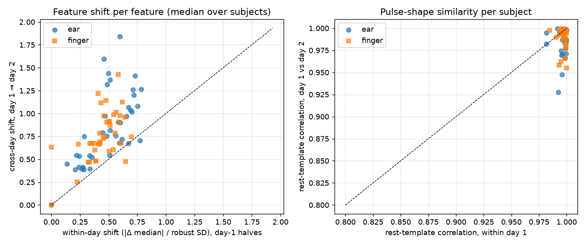
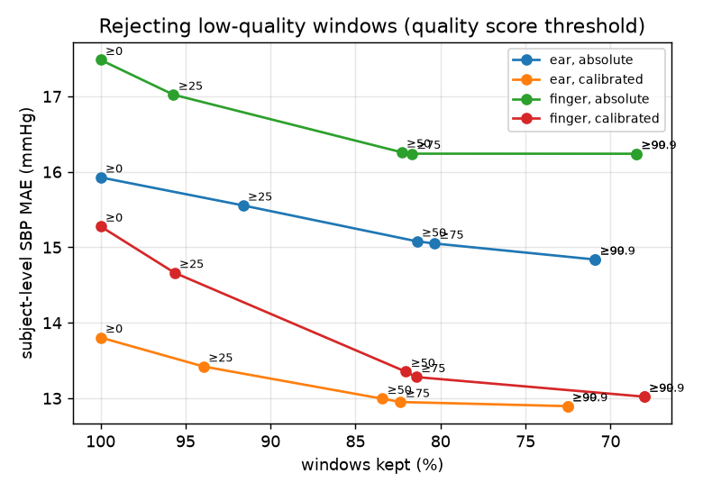
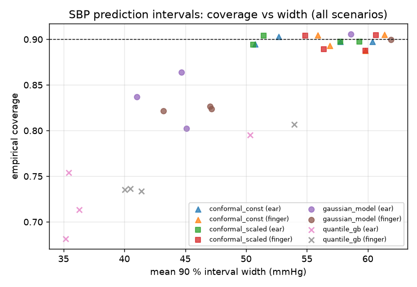
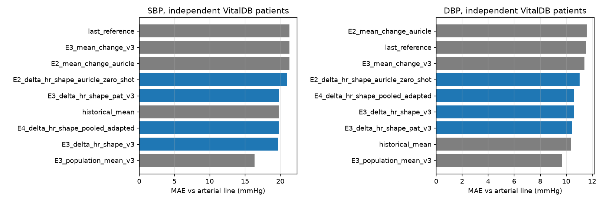
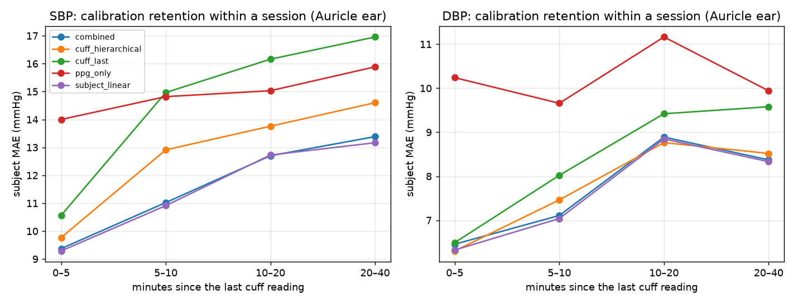
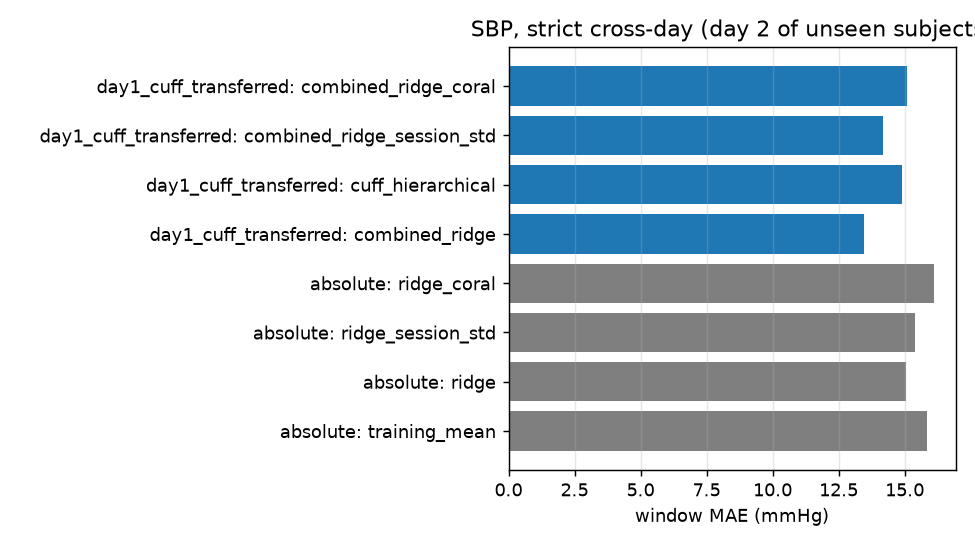

# Research Findings: Ear vs Finger PPG for Cuffless BP Tracking (Auricle, healthy cohort)

> Research results only. **RakshPulse is not a clinically validated BP monitor.** The reference is CNAP
> (a calibrated continuous finger-cuff estimate), the PPG sensors are Nonin transmissive clips (earlobe and
> finger), and none of this is behind-the-ear MAX30102 data.

## Question

Can ear PPG provide reliable, generalisable information for cuffless BP **tracking**, and exactly where
does it succeed or fail? Specifically: (a) absolute BP without calibration; (b) relative tracking within a
day; (c) whether a calibration made on one day still holds on another day.

## Methods (summary; full detail in MODEL_EVALUATION.md §F and `src/rakshpulse/evaluation/auricle_study.py`)

- **Data:** Auricle v1.0.0 (PhysioNet), healthy cohort. Sessions 1 and 2 were recorded on different days.
  Every file was verified against PhysioNet SHA-256 sums (`data/metadata/auricle_manifest.json`).
- **Windows:** 10 s, 5 s step. Labelled only when the CNAP reliability mask is valid for the whole window.
  A window passes only if its site's SQI passes and fewer than 1 % of its samples are on the ±10 V rail.
- **Feature sets:** `hr_only` (heart rate); `shape_only` (dimensionless, beat-duration-normalised morphology
  that does not change merely because heart rate changes); `hr_shape`; `ppg_all`.
- **Population models:** trained on **session-1 windows of training subjects only** (5 subject-grouped folds),
  tuned with inner GroupKFold on those subjects, then applied to held-out subjects' sessions 1 and 2.
- **Calibration** (from the first 3 rest windows ≈ 20 s of session 1):
  - *carry-forward*: report the calibration BP (no PPG; the baseline)
  - *offset*: 1-point offset on the population prediction
  - *linear*: per-subject linear map fitted on all of session 1
  - *personal model*: per-subject ridge fitted on session 1 only
- **Scopes:**
  - *within_day*: later windows of session 1
  - *within_day_s2*: session 2 with its own rest calibration (day-2 control)
  - *cross_day*: session 2 using the session-1 calibration
- **Statistics:** subject-level bootstrap (2,000 draws) for every CI, and paired per-subject differences for
  every comparison. The model-selection criterion was fixed before the run: cross-day MAE rank.
- **Audit:** `scripts/audit_cross_day.py` independently re-derives the results (11 checks). The tables below are
  produced by `scripts/write_findings.py` only when the audit has no hard failures.

## Results (auto-generated from audited outputs)

<!-- BEGIN AUTO -->

### R1. Data and audit

- Healthy session-2 records verified: **37/37**; session-1: 42/42. Records with untrusted labels (no CNAP mask): HC_1_1.
- Subjects analysed: 42 (both sessions: 36); windows by session: {'1': 8458, '2': 7961}. Bootstrap: 2000 subject-level draws, seed 0.
- Independent audit (`results/cross_day/audit.json`): 1 PASS, 2 PASS, 3 PASS, 4 PASS, 5 PASS, 10 PASS, 6 PASS, 7 PASS, 8 PASS, 9 PASS, 11 PASS

### R2. Within-day vs cross-day, by calibration strategy (ridge, HR + shape features)

| Target | Site | Scope | Calibration | MAE | MAE 95% CI | RMSE | Bias | SD err | Within-subj Pearson | Within-subj Spearman | n subj |
|---|---|---|---|---|---|---|---|---|---|---|---|
| SBP | ear | within_day | carry_forward | 14.98 | [13.04, 17.04] | 19.16 | 5.47 | 18.36 | — | — | 38 |
| SBP | ear | within_day | uncalibrated | 14.96 | [12.87, 17.31] | 18.87 | -0.17 | 18.87 | 0.41 | 0.39 | 38 |
| SBP | ear | within_day | offset | 13.84 | [11.88, 16.03] | 18.06 | 3.76 | 17.67 | 0.41 | 0.39 | 38 |
| SBP | ear | within_day_s2 | carry_forward | 13.29 | [11.12, 15.64] | 17.64 | 1.80 | 17.55 | — | — | 29 |
| SBP | ear | within_day_s2 | uncalibrated | 15.40 | [12.54, 18.47] | 19.55 | -3.65 | 19.21 | 0.40 | 0.35 | 29 |
| SBP | ear | within_day_s2 | offset | 12.25 | [10.29, 14.52] | 16.20 | 0.09 | 16.20 | 0.40 | 0.35 | 29 |
| SBP | ear | cross_day | carry_forward | 16.52 | [13.84, 19.11] | 20.91 | 1.65 | 20.85 | — | — | 31 |
| SBP | ear | cross_day | uncalibrated | 15.10 | [12.52, 17.87] | 19.21 | -3.10 | 18.96 | 0.38 | 0.33 | 31 |
| SBP | ear | cross_day | offset | 16.14 | [13.51, 18.97] | 20.24 | -0.20 | 20.24 | 0.38 | 0.33 | 31 |
| SBP | ear | cross_day | linear | 14.22 | [11.75, 16.94] | 18.46 | -4.77 | 17.83 | 0.38 | 0.33 | 31 |
| SBP | ear | cross_day | personal model (day-1 fit) | 15.01 | [12.32, 18.11] | 20.02 | -4.08 | 19.61 | 0.33 | 0.32 | 32 |
| SBP | finger | within_day | carry_forward | 15.84 | [13.76, 18.18] | 20.10 | 5.09 | 19.45 | — | — | 40 |
| SBP | finger | within_day | uncalibrated | 15.57 | [13.34, 17.89] | 19.89 | -0.10 | 19.90 | 0.30 | 0.30 | 40 |
| SBP | finger | within_day | offset | 15.45 | [13.33, 17.66] | 19.65 | 4.74 | 19.07 | 0.30 | 0.30 | 40 |
| SBP | finger | within_day_s2 | carry_forward | 12.70 | [10.54, 15.07] | 16.94 | 1.74 | 16.85 | — | — | 33 |
| SBP | finger | within_day_s2 | uncalibrated | 16.30 | [13.10, 20.11] | 20.79 | -1.80 | 20.72 | 0.24 | 0.17 | 33 |
| SBP | finger | within_day_s2 | offset | 12.19 | [10.28, 14.27] | 16.04 | 0.32 | 16.04 | 0.24 | 0.17 | 33 |
| SBP | finger | cross_day | carry_forward | 15.59 | [13.11, 18.15] | 19.99 | 1.70 | 19.92 | — | — | 35 |
| SBP | finger | cross_day | uncalibrated | 15.94 | [12.83, 19.30] | 20.35 | -1.16 | 20.32 | 0.25 | 0.18 | 35 |
| SBP | finger | cross_day | offset | 15.54 | [12.98, 18.22] | 19.85 | 1.66 | 19.78 | 0.25 | 0.18 | 35 |
| SBP | finger | cross_day | linear | 13.97 | [11.82, 16.21] | 18.39 | -3.23 | 18.11 | 0.19 | 0.13 | 35 |
| SBP | finger | cross_day | personal model (day-1 fit) | 13.61 | [11.23, 16.14] | 18.74 | -2.03 | 18.64 | 0.36 | 0.31 | 35 |
| DBP | ear | within_day | carry_forward | 8.94 | [7.36, 10.75] | 12.66 | -0.97 | 12.62 | — | — | 38 |
| DBP | ear | within_day | uncalibrated | 10.94 | [8.91, 12.98] | 15.10 | -0.53 | 15.09 | 0.19 | 0.19 | 38 |
| DBP | ear | within_day | offset | 9.50 | [8.02, 11.17] | 13.56 | -2.20 | 13.38 | 0.19 | 0.19 | 38 |
| DBP | ear | within_day_s2 | carry_forward | 8.87 | [7.16, 10.83] | 11.69 | -2.57 | 11.40 | — | — | 29 |
| DBP | ear | within_day_s2 | uncalibrated | 9.97 | [7.82, 12.83] | 13.19 | -1.92 | 13.05 | 0.11 | 0.12 | 29 |
| DBP | ear | within_day_s2 | offset | 9.04 | [7.35, 11.00] | 11.81 | -2.96 | 11.44 | 0.11 | 0.12 | 29 |
| DBP | ear | cross_day | carry_forward | 11.59 | [8.99, 14.49] | 14.86 | -1.41 | 14.80 | — | — | 31 |
| DBP | ear | cross_day | uncalibrated | 9.96 | [8.02, 12.40] | 13.10 | -1.30 | 13.04 | 0.13 | 0.12 | 31 |
| DBP | ear | cross_day | offset | 12.82 | [10.17, 15.80] | 16.06 | -2.85 | 15.80 | 0.13 | 0.12 | 31 |
| DBP | ear | cross_day | linear | 10.50 | [8.25, 13.24] | 13.98 | -1.68 | 13.88 | 0.14 | 0.12 | 31 |
| DBP | ear | cross_day | personal model (day-1 fit) | 11.90 | [9.12, 15.30] | 16.18 | -2.18 | 16.04 | 0.27 | 0.26 | 32 |
| DBP | finger | within_day | carry_forward | 9.24 | [7.70, 10.92] | 13.05 | -0.74 | 13.03 | — | — | 40 |
| DBP | finger | within_day | uncalibrated | 11.49 | [9.61, 13.56] | 15.32 | -0.35 | 15.31 | 0.05 | 0.04 | 40 |
| DBP | finger | within_day | offset | 9.84 | [8.25, 11.52] | 13.71 | -0.58 | 13.70 | 0.05 | 0.04 | 40 |
| DBP | finger | within_day_s2 | carry_forward | 8.75 | [7.15, 10.51] | 11.75 | -2.50 | 11.48 | — | — | 33 |
| DBP | finger | within_day_s2 | uncalibrated | 10.32 | [8.18, 12.89] | 13.54 | -0.66 | 13.52 | 0.04 | 0.01 | 33 |
| DBP | finger | within_day_s2 | offset | 9.35 | [7.80, 10.97] | 12.08 | -2.60 | 11.80 | 0.04 | 0.01 | 33 |
| DBP | finger | cross_day | carry_forward | 11.41 | [9.10, 14.12] | 14.66 | -0.69 | 14.65 | — | — | 35 |
| DBP | finger | cross_day | uncalibrated | 10.24 | [8.25, 12.51] | 13.37 | -0.12 | 13.37 | 0.06 | 0.04 | 35 |
| DBP | finger | cross_day | offset | 11.72 | [9.59, 14.15] | 14.80 | -1.15 | 14.75 | 0.06 | 0.04 | 35 |
| DBP | finger | cross_day | linear | 11.10 | [8.80, 13.79] | 15.01 | -0.13 | 15.01 | 0.06 | 0.04 | 35 |
| DBP | finger | cross_day | personal model (day-1 fit) | 12.22 | [9.35, 15.39] | 17.56 | 1.47 | 17.50 | 0.28 | 0.26 | 35 |

### R3. Heart rate vs pulse shape (ridge, 1-point offset calibration)

| Target | Site | Features | Scope | MAE | MAE 95% CI | Within-subj r | r 95% CI |
|---|---|---|---|---|---|---|---|
| SBP | ear | hr_only | within_day | 14.71 | [12.72, 16.89] | 0.28 | [0.16, 0.40] |
| SBP | ear | hr_only | cross_day | 16.17 | [13.72, 18.62] | 0.09 | [-0.13, 0.24] |
| SBP | ear | shape_only | within_day | 14.13 | [12.01, 16.48] | 0.43 | [0.35, 0.48] |
| SBP | ear | shape_only | cross_day | 17.46 | [14.71, 20.49] | 0.38 | [0.28, 0.53] |
| SBP | ear | hr_shape | within_day | 13.84 | [11.88, 16.03] | 0.41 | [0.27, 0.47] |
| SBP | ear | hr_shape | cross_day | 16.14 | [13.51, 18.97] | 0.38 | [0.26, 0.46] |
| SBP | ear | ppg_all | within_day | 13.66 | [11.76, 15.83] | 0.41 | [0.24, 0.48] |
| SBP | ear | ppg_all | cross_day | 15.76 | [13.26, 18.50] | 0.38 | [0.19, 0.49] |
| SBP | finger | hr_only | within_day | 15.55 | [13.34, 17.88] | 0.33 | [0.15, 0.41] |
| SBP | finger | hr_only | cross_day | 15.44 | [13.21, 17.83] | 0.17 | [-0.02, 0.28] |
| SBP | finger | shape_only | within_day | 15.38 | [13.32, 17.58] | 0.27 | [0.17, 0.37] |
| SBP | finger | shape_only | cross_day | 15.55 | [13.03, 18.33] | 0.21 | [0.15, 0.33] |
| SBP | finger | hr_shape | within_day | 15.45 | [13.33, 17.66] | 0.30 | [0.18, 0.40] |
| SBP | finger | hr_shape | cross_day | 15.54 | [12.98, 18.22] | 0.25 | [0.13, 0.36] |
| SBP | finger | ppg_all | within_day | 15.17 | [13.12, 17.45] | 0.33 | [0.20, 0.44] |
| SBP | finger | ppg_all | cross_day | 14.98 | [12.49, 17.68] | 0.35 | [0.25, 0.39] |
| DBP | ear | hr_only | within_day | 9.09 | [7.60, 10.81] | 0.18 | [0.09, 0.29] |
| DBP | ear | hr_only | cross_day | 11.69 | [9.29, 14.25] | 0.02 | [-0.11, 0.13] |
| DBP | ear | shape_only | within_day | 9.51 | [7.98, 11.26] | 0.17 | [0.09, 0.36] |
| DBP | ear | shape_only | cross_day | 12.84 | [10.12, 15.95] | 0.13 | [0.03, 0.24] |
| DBP | ear | hr_shape | within_day | 9.50 | [8.02, 11.17] | 0.19 | [0.11, 0.41] |
| DBP | ear | hr_shape | cross_day | 12.82 | [10.17, 15.80] | 0.13 | [-0.04, 0.23] |
| DBP | ear | ppg_all | within_day | 9.36 | [7.91, 11.00] | 0.19 | [0.13, 0.36] |
| DBP | ear | ppg_all | cross_day | 12.71 | [10.18, 15.52] | 0.16 | [0.04, 0.29] |
| DBP | finger | hr_only | within_day | 9.44 | [7.96, 11.08] | 0.14 | [0.04, 0.34] |
| DBP | finger | hr_only | cross_day | 11.26 | [9.10, 13.80] | -0.01 | [-0.12, 0.18] |
| DBP | finger | shape_only | within_day | 9.87 | [8.28, 11.54] | 0.03 | [-0.04, 0.26] |
| DBP | finger | shape_only | cross_day | 11.82 | [9.63, 14.32] | 0.05 | [-0.07, 0.17] |
| DBP | finger | hr_shape | within_day | 9.84 | [8.25, 11.52] | 0.05 | [-0.03, 0.29] |
| DBP | finger | hr_shape | cross_day | 11.72 | [9.59, 14.15] | 0.06 | [-0.07, 0.16] |
| DBP | finger | ppg_all | within_day | 9.79 | [8.22, 11.45] | 0.04 | [-0.05, 0.19] |
| DBP | finger | ppg_all | cross_day | 11.71 | [9.53, 14.22] | 0.06 | [-0.07, 0.13] |

### R4. Population models (HR + shape, cross-day, offset calibration)

Ranking criterion (fixed in advance): mean rank of cross-day MAE across the four site × target conditions, then worst rank, then within→cross-day gap. Correlation is not used for selection.

| model | cross_day_mae_mean | mean_rank | worst_rank | within_to_cross_day_gap |
|---|---|---|---|---|
| svr | 13.79 | 2.25 | 5.0 | 1.84 |
| elasticnet | 13.83 | 2.5 | 4.0 | 1.74 |
| extra_trees | 13.9 | 3.25 | 4.0 | 1.75 |
| ridge | 14.05 | 4.5 | 7.0 | 1.89 |
| xgboost | 14.46 | 4.75 | 6.0 | 1.87 |
| random_forest | 14.56 | 5.25 | 6.0 | 1.99 |
| hist_gb | 15.05 | 5.5 | 7.0 | 2.11 |

| comparison | mae_diff_a_minus_b | ci_low | ci_high | significant |
|---|---|---|---|---|
| ear sbp cross_day: elasticnet vs ridge (offset hr_shape) | 0.27 | -0.56 | 1.12 | False |
| ear sbp cross_day: svr vs ridge (offset hr_shape) | 0.14 | -0.68 | 0.95 | False |
| ear sbp cross_day: random_forest vs ridge (offset hr_shape) | 0.09 | -1.3 | 1.48 | False |
| ear sbp cross_day: extra_trees vs ridge (offset hr_shape) | -0.3 | -1.27 | 0.64 | False |
| ear sbp cross_day: hist_gb vs ridge (offset hr_shape) | -0.83 | -2.52 | 0.96 | False |
| ear sbp cross_day: xgboost vs ridge (offset hr_shape) | -0.61 | -1.86 | 0.61 | False |
| ear dbp cross_day: elasticnet vs ridge (offset hr_shape) | -0.22 | -0.62 | 0.11 | False |
| ear dbp cross_day: svr vs ridge (offset hr_shape) | -0.03 | -0.97 | 0.96 | False |
| ear dbp cross_day: random_forest vs ridge (offset hr_shape) | 0.67 | -0.45 | 1.84 | False |
| ear dbp cross_day: extra_trees vs ridge (offset hr_shape) | -0.06 | -0.72 | 0.65 | False |
| ear dbp cross_day: hist_gb vs ridge (offset hr_shape) | 1.59 | 0.1 | 3.25 | True |
| ear dbp cross_day: xgboost vs ridge (offset hr_shape) | 0.72 | -0.6 | 2.16 | False |
| finger sbp cross_day: elasticnet vs ridge (offset hr_shape) | -0.3 | -0.97 | 0.31 | False |
| finger sbp cross_day: svr vs ridge (offset hr_shape) | -0.62 | -1.55 | 0.34 | False |
| finger sbp cross_day: random_forest vs ridge (offset hr_shape) | -0.24 | -1.22 | 0.75 | False |
| finger sbp cross_day: extra_trees vs ridge (offset hr_shape) | -0.56 | -1.23 | 0.1 | False |
| finger sbp cross_day: hist_gb vs ridge (offset hr_shape) | 0.23 | -1.0 | 1.47 | False |
| finger sbp cross_day: xgboost vs ridge (offset hr_shape) | 0.04 | -0.97 | 1.05 | False |
| finger dbp cross_day: elasticnet vs ridge (offset hr_shape) | -0.22 | -0.63 | 0.2 | False |
| finger dbp cross_day: svr vs ridge (offset hr_shape) | -0.43 | -1.24 | 0.44 | False |
| finger dbp cross_day: random_forest vs ridge (offset hr_shape) | 0.53 | -0.89 | 2.39 | False |
| finger dbp cross_day: extra_trees vs ridge (offset hr_shape) | -0.1 | -1.11 | 1.08 | False |
| finger dbp cross_day: hist_gb vs ridge (offset hr_shape) | 1.45 | -0.59 | 4.32 | False |
| finger dbp cross_day: xgboost vs ridge (offset hr_shape) | 0.73 | -0.6 | 2.48 | False |

### R5. Key paired subject-level comparisons (Δ = MAE(a) − MAE(b); negative favours a)

| comparison | mae_diff_a_minus_b | ci_low | ci_high | significant |
|---|---|---|---|---|
| ear sbp within_day: offset hr_shape vs carry-forward | -1.03 | -1.82 | -0.25 | True |
| ear sbp within_day: offset hr_only vs carry-forward | -0.39 | -1.06 | 0.3 | False |
| ear sbp within_day: offset hr_shape vs offset hr_only | -0.63 | -1.32 | -0.01 | True |
| ear sbp within_day: offset shape_only vs offset hr_only | -0.29 | -1.21 | 0.54 | False |
| ear sbp cross_day: offset hr_shape vs carry-forward | -0.7 | -1.98 | 0.59 | False |
| ear sbp cross_day: offset hr_only vs carry-forward | -0.84 | -2.16 | 0.33 | False |
| ear sbp cross_day: offset hr_shape vs offset hr_only | 0.14 | -1.07 | 1.35 | False |
| ear sbp cross_day: offset shape_only vs offset hr_only | 1.76 | 0.07 | 3.54 | True |
| ear sbp cross_day: linear hr_shape vs offset hr_shape | -2.44 | -5.63 | 0.81 | False |
| ear sbp cross_day: personal hr_shape vs personal hr_only | 2.24 | 0.45 | 4.04 | True |
| ear sbp cross_day: personal hr_shape vs carry-forward | -1.37 | -4.68 | 2.24 | False |
| ear dbp within_day: offset hr_shape vs carry-forward | 0.44 | 0.01 | 0.91 | True |
| ear dbp within_day: offset hr_only vs carry-forward | 0.13 | -0.14 | 0.4 | False |
| ear dbp within_day: offset hr_shape vs offset hr_only | 0.31 | -0.08 | 0.71 | False |
| ear dbp within_day: offset shape_only vs offset hr_only | 0.3 | -0.12 | 0.75 | False |
| ear dbp cross_day: offset hr_shape vs carry-forward | 1.19 | 0.32 | 2.14 | True |
| ear dbp cross_day: offset hr_only vs carry-forward | -0.04 | -0.53 | 0.47 | False |
| ear dbp cross_day: offset hr_shape vs offset hr_only | 1.22 | 0.24 | 2.33 | True |
| ear dbp cross_day: offset shape_only vs offset hr_only | 1.2 | 0.17 | 2.38 | True |
| ear dbp cross_day: linear hr_shape vs offset hr_shape | -2.06 | -4.64 | 0.3 | False |
| ear dbp cross_day: personal hr_shape vs personal hr_only | 1.69 | 0.13 | 3.18 | True |
| ear dbp cross_day: personal hr_shape vs carry-forward | 0.82 | -2.07 | 3.93 | False |
| finger sbp within_day: offset hr_shape vs carry-forward | -0.57 | -1.59 | 0.41 | False |
| finger sbp within_day: offset hr_only vs carry-forward | -0.55 | -1.36 | 0.25 | False |
| finger sbp within_day: offset hr_shape vs offset hr_only | -0.01 | -0.53 | 0.5 | False |
| finger sbp within_day: offset shape_only vs offset hr_only | 0.02 | -0.47 | 0.51 | False |
| finger sbp cross_day: offset hr_shape vs carry-forward | -0.22 | -1.49 | 1.02 | False |
| finger sbp cross_day: offset hr_only vs carry-forward | -0.46 | -1.37 | 0.44 | False |
| finger sbp cross_day: offset hr_shape vs offset hr_only | 0.24 | -0.69 | 1.26 | False |
| finger sbp cross_day: offset shape_only vs offset hr_only | 0.28 | -0.6 | 1.2 | False |
| finger sbp cross_day: linear hr_shape vs offset hr_shape | -2.06 | -4.79 | 0.5 | False |
| finger sbp cross_day: personal hr_shape vs personal hr_only | 1.26 | -0.25 | 3.26 | False |
| finger sbp cross_day: personal hr_shape vs carry-forward | -1.69 | -4.83 | 1.49 | False |
| finger dbp within_day: offset hr_shape vs carry-forward | 0.47 | 0.08 | 0.89 | True |
| finger dbp within_day: offset hr_only vs carry-forward | 0.15 | -0.18 | 0.51 | False |
| finger dbp within_day: offset hr_shape vs offset hr_only | 0.31 | 0.04 | 0.62 | True |
| finger dbp within_day: offset shape_only vs offset hr_only | 0.34 | 0.05 | 0.69 | True |
| finger dbp cross_day: offset hr_shape vs carry-forward | 0.37 | -0.4 | 1.18 | False |
| finger dbp cross_day: offset hr_only vs carry-forward | -0.07 | -0.52 | 0.42 | False |
| finger dbp cross_day: offset hr_shape vs offset hr_only | 0.44 | -0.2 | 1.08 | False |
| finger dbp cross_day: offset shape_only vs offset hr_only | 0.53 | -0.14 | 1.23 | False |
| finger dbp cross_day: linear hr_shape vs offset hr_shape | -0.65 | -3.14 | 1.56 | False |
| finger dbp cross_day: personal hr_shape vs personal hr_only | 1.7 | 0.45 | 3.21 | True |
| finger dbp cross_day: personal hr_shape vs carry-forward | 0.81 | -1.8 | 3.65 | False |
| ear sbp cross_day: finger-trained vs ear-trained (offset) | 0.6 | -1.73 | 2.55 | False |
| ear sbp cross_day: finger-trained vs ear-trained (linear) | -0.17 | -0.66 | 0.41 | False |
| sbp cross_day: ear vs finger (offset hr_shape, each site's own windows) | 0.65 | -1.22 | 2.61 | False |
| ear dbp cross_day: finger-trained vs ear-trained (offset) | -0.91 | -1.92 | -0.0 | True |
| ear dbp cross_day: finger-trained vs ear-trained (linear) | -0.28 | -0.75 | 0.16 | False |
| dbp cross_day: ear vs finger (offset hr_shape, each site's own windows) | 0.55 | -0.48 | 1.66 | False |

### R6. Day-to-day resting BP shift and calibration stability

| Site | Target | n | True rest shift mean | SD | Slope pred-shift~true | Slope 95% CI | r | r 95% CI | Min detectable |r| | Offset day1~day2 r | r 95% CI | Mean |offset change| |
|---|---|---|---|---|---|---|---|---|---|---|---|---|
| ear | SBP | 29 | 4.69 | 15.40 | 0.02 | [-0.04, 0.09] | 0.10 | [-0.28, 0.38] | 0.50 | 0.42 | [0.07, 0.70] | 11.95 |
| ear | DBP | 29 | 2.94 | 11.65 | -0.03 | [-0.15, 0.05] | -0.13 | [-0.45, 0.22] | 0.50 | 0.33 | [0.07, 0.64] | 9.62 |
| finger | SBP | 33 | 3.10 | 16.40 | -0.01 | [-0.11, 0.10] | -0.04 | [-0.43, 0.40] | 0.47 | 0.37 | [-0.01, 0.69] | 12.46 |
| finger | DBP | 33 | 1.25 | 11.74 | 0.02 | [-0.07, 0.09] | 0.12 | [-0.27, 0.44] | 0.47 | 0.44 | [0.22, 0.69] | 8.81 |

### R7. Amplifier rail-clipping gate ablation (ridge, HR + shape, offset)

Finger windows clipped: 8.1 %; ear: 0.2 %. Subjects with any clipped finger window: 29; with > 25 % clipped: 5.

| Site | Target | Scope | MAE no gate | MAE gated | Δ | r no gate | r gated | Windows removed |
|---|---|---|---|---|---|---|---|---|
| ear | SBP | cross_day | 16.14 | 16.14 | 0.00 | 0.38 | 0.38 | 0 |
| ear | SBP | within_day | 13.84 | 13.84 | 0.00 | 0.41 | 0.41 | 0 |
| ear | SBP | within_day_s2 | 12.25 | 12.25 | 0.00 | 0.41 | 0.41 | 0 |
| ear | DBP | cross_day | 12.82 | 12.82 | 0.00 | 0.13 | 0.13 | 0 |
| ear | DBP | within_day | 9.50 | 9.50 | 0.00 | 0.19 | 0.19 | 0 |
| ear | DBP | within_day_s2 | 9.04 | 9.04 | 0.00 | 0.11 | 0.11 | 0 |
| finger | SBP | cross_day | 15.40 | 15.54 | 0.15 | 0.26 | 0.25 | 283 |
| finger | SBP | within_day | 14.97 | 15.45 | 0.48 | 0.33 | 0.30 | 490 |
| finger | SBP | within_day_s2 | 12.30 | 12.19 | -0.12 | 0.28 | 0.24 | 277 |
| finger | DBP | cross_day | 11.73 | 11.72 | -0.02 | 0.04 | 0.06 | 283 |
| finger | DBP | within_day | 9.62 | 9.84 | 0.22 | 0.04 | 0.05 | 490 |
| finger | DBP | within_day_s2 | 9.61 | 9.36 | -0.25 | 0.06 | 0.04 | 277 |

### R8. Confounds and subject structure (SBP)

| Site | Within-session r(SBP, HR) | Partial r(SBP, shape pred | HR) | 95% CI | Between-subject share of pred. variance | r(subject-mean pred, truth) |
|---|---|---|---|---|---|
| ear | 0.19 | 0.22 | [0.16, 0.31] | 0.39 | 0.14 |
| finger | 0.23 | 0.11 | [0.02, 0.17] | 0.26 | -0.03 |

<!-- END AUTO -->

## Interpretation (from the audited results above)

> **Correction (2026-11-11).** The standardised-dataset work found 3,458 ear windows from flat or disconnected
> sensors (raw SD < 0.003 mV). 31 of them had passed the SQI gate and entered the labelled analysis set. A
> signal-presence gate now rejects them, and every analysis on this page was rerun. MAEs moved by ≤ 0.62 mmHg
> and tracking r by ≤ 0.09. One earlier statement no longer holds: ElasticNet is not significantly better than
> ridge for ear DBP. The audit passes 11/11.

**1. Relative tracking within a session: modest but real, and better at the ear.**
Within session 1, ear PPG (HR + shape, ridge) tracks SBP changes with a median within-subject r of 0.41 (finger 0.30).
With a 20 s rest calibration it beats carry-forward by 1.03 mmHg (95 % CI [−1.82, −0.25]). Pulse shape carries
SBP information **beyond heart rate at the ear**: within-session partial r(SBP, shape prediction | HR) = 0.23
[0.16, 0.31], against 0.12 [0.02, 0.17] at the finger. At the ear, HR + shape beats HR-only by 0.63 mmHg [−1.32, −0.01].
The stressors therefore do not explain the tracking through heart rate alone. The effect, however, is small:
absolute errors stay at 12–16 mmHg MAE.

**2. Cross-day: a day-1 calibration does not hold on day 2.**
- True resting SBP changed between days by 4.7 ± 15.4 mmHg (ear subjects), and DBP by 2.9 ± 11.7.
- The model's predicted shift does **not** follow it. The slope of predicted on true shift is 0.02, 95 % CI
  [−0.04, 0.09] for SBP at the ear, and similar for every site and target. The CI **excludes 1**, so the
  failure to track day-level baseline changes is statistically supported.
- Each subject's calibration offset is only weakly reproducible across days (day-1 vs day-2 offset r 0.33–0.44,
  mean |change| 9–12 mmHg).
- So a 1-point day-1 calibration did not beat carry-forward on day 2 for SBP (ear −0.70 [−1.98, +0.59]; finger
  −0.22 [−1.49, +1.02]). For ear DBP it was **worse** than carry-forward (+1.19 [+0.32, +2.14]).
- Applying day-1 calibration *hurt* relative to the uncalibrated population model (ear DBP +2.83 [+0.23, +5.68]),
  because a stale offset adds noise.

**3. What survives across days is within-session *shape* tracking, not absolute level.**
Within-subject SBP correlation on day 2 using day-1-trained models stays at r 0.38 for ear shape features (HR-only
drops to 0.09). PPG shape relates to *changes* within a recording, but carries almost no information about a
person's *absolute* BP level or its day-to-day drift. Subject-mean predictions correlate with subject-mean truth at
r 0.14 (ear) and −0.03 (finger).

**4. Independence is not proven.** The correlation between true and predicted day shifts is near zero (ear SBP r
0.10 [−0.28, 0.38]), but with n = 29–33 the minimum correlation detectable at 80 % power is |r| ≈ 0.5. The data
therefore **do not establish independence**: moderate associations up to about 0.4 cannot be excluded. What *is*
established is that the slope is far below 1, so the model cannot be relied on to follow day-to-day changes.

**5. DBP behaves differently from SBP.** No PPG feature set improved DBP over carry-forward at any scope.
Finger DBP tracking r was ≈ 0.05, and ear DBP reached 0.19 within day but only 0.13 across days. Within a day,
calibrated ear DBP was slightly *worse* than carry-forward (+0.44 [+0.01, +0.91]).

**6. Ear vs finger.** The ear showed stronger within-session SBP tracking and the only clear evidence of shape
information beyond heart rate. Cross-day absolute errors did not differ between sites (ear − finger SBP
+0.65 [−1.22, +2.61]). A finger-trained model with ear calibration was not significantly worse than an
ear-trained one here (+0.60 [−1.73, +2.55]). For ear DBP the finger-trained model was marginally *better* (−0.91 [−1.92, −0.00]),
which is consistent with the absence of a usable DBP signal at either site. In session 1, however, finger→ear transfer lost tracking
(MODEL_EVALUATION.md §F3).

**7. Model choice does not matter at this sample size.** By the pre-specified criterion (mean cross-day MAE rank),
SVR ranks first and ElasticNet second (ElasticNet has the lowest mean MAE and best worst-case rank). **No
model is significantly better than ridge**. The only significant difference is HistGradientBoosting being worse
for ear DBP (+1.59 [+0.10, +3.25]). We recommend the regularised linear models
(ridge / ElasticNet): they are as good as any, simpler, and portable to a microcontroller.

**8. Amplifier clipping.** Removing rail-clipped windows (8.1 % of finger windows, 29 subjects affected, 5 with
> 25 % clipped) changed finger MAEs by ≤ 0.5 mmHg and never changed a conclusion. Ear data were unaffected.

**9. Population models vs simple baselines.** Calibration-free population predictions were not better than
carry-forward within a day. Across days they were numerically better than carry-forward (ear SBP −2.60
[−6.14, +0.90]) only because carry-forward suffers from day-to-day drift, and the CIs include 0.

### Bottom line for RakshPulse

Ear PPG contains a small amount of genuine, heart-rate-independent information about **within-session SBP
changes**. It does **not** provide reliable absolute BP, does not track day-to-day baseline shifts, gives no DBP
benefit, and its per-user calibration degrades within a day or two. Any RakshPulse BP feature would need frequent
cuff re-calibration, could at best report *trends within a session*, and would still need validation with the
actual behind-ear MAX30102 hardware against an ISO 81060-2/IEEE 1708-compliant reference.

### Limitations

- CNAP (calibrated finger-cuff) reference, not auscultatory, oscillometric-arm or arterial-line BP.
- Earlobe transmissive Nonin clip, not behind-ear reflective MAX30102. Healthy, young cohort; 36 subjects with
  both sessions. Stressors are laboratory manoeuvres, not field conditions.
- Session-2 analyses exclude subjects without ≥ 3 SQI-passing rest windows in session 1 (per-subject reasons in
  `results/cross_day/audit.json` check 9).
- The heart-failure cohort was not analysed (download stopped at 0/28 records, with 3 resumable partial files).

---

## Population model and personalisation (standardised dataset `data/auricle/`)

**Question:** can a population model give a usable first estimate for a new person, and does personal calibration
(and adaptive updating as new reference readings arrive) give better BP tracking than simply using those reference
readings?

**Setup** (`scripts/run_personalization.py`; engine in `src/rakshpulse/personalization/`):
- Population models are trained on session-1 windows of training subjects only (5 subject-grouped folds), with
  HR + pulse-shape features. They are evaluated uncalibrated on the held-out subjects' session 1 and session 2.
- Strategy comparison: every strategy is evaluated on the **same** day-2 windows (after the first three day-2 rest
  references). "baseline" strategies use only the reference readings (no PPG) via `BaselineTracker`. "pop+…"
  strategies apply `PersonalizationEngine` to the ridge population prediction. Personal models are ridge or
  ElasticNet fitted to the subject's own day-1 features and labels.
- Adaptive experiment: within each session a reference reading arrives every 2 minutes (nearest labelled
  window). Each method predicts the following windows using only past references.
- All CIs come from 2,000 subject-level bootstrap draws. Paired tests use per-subject MAE differences.

<!-- BEGIN PERSONALIZATION -->

### P1. Population models on unseen subjects (uncalibrated; HR + shape features)

| Site | Target | Model | MAE S1 | 95% CI | MAE S2 | 95% CI | Within-subj r (S1) | n subj (S1) |
|---|---|---|---|---|---|---|---|---|
| ear | SBP | mean | 15.29 | [13.27, 17.37] | 15.72 | [12.92, 18.97] | — | 39 |
| ear | DBP | mean | 10.72 | [8.86, 12.55] | 9.90 | [7.79, 12.65] | — | 39 |
| ear | SBP | ridge | 15.01 | [12.95, 17.24] | 15.16 | [12.63, 17.97] | 0.39 | 39 |
| ear | DBP | ridge | 10.98 | [9.00, 12.94] | 9.88 | [8.01, 12.37] | 0.18 | 39 |
| ear | SBP | elasticnet | 15.00 | [12.97, 17.22] | 15.11 | [12.48, 18.10] | 0.38 | 39 |
| ear | DBP | elasticnet | 10.80 | [8.82, 12.68] | 9.82 | [7.84, 12.54] | 0.24 | 39 |
| ear | SBP | svr | 15.44 | [13.23, 17.91] | 15.65 | [12.88, 18.76] | 0.36 | 39 |
| ear | DBP | svr | 11.24 | [9.28, 13.22] | 10.01 | [8.02, 12.76] | 0.18 | 39 |
| ear | SBP | random_forest | 16.11 | [13.88, 18.55] | 15.77 | [13.06, 18.96] | 0.33 | 39 |
| ear | DBP | random_forest | 11.35 | [9.45, 13.30] | 10.65 | [8.77, 13.17] | 0.17 | 39 |
| ear | SBP | extra_trees | 15.54 | [13.35, 17.88] | 15.34 | [12.66, 18.49] | 0.40 | 39 |
| ear | DBP | extra_trees | 10.99 | [9.08, 12.94] | 10.00 | [8.07, 12.62] | 0.17 | 39 |
| ear | SBP | hist_gb | 16.40 | [14.13, 18.93] | 16.12 | [13.34, 19.36] | 0.30 | 39 |
| ear | DBP | hist_gb | 11.74 | [9.84, 13.71] | 11.19 | [9.36, 13.76] | 0.15 | 39 |
| ear | SBP | xgboost | 15.87 | [13.61, 18.29] | 15.62 | [12.91, 18.84] | 0.35 | 39 |
| ear | DBP | xgboost | 11.55 | [9.69, 13.49] | 10.62 | [8.84, 13.16] | 0.15 | 39 |
| ear | SBP | lightgbm | 16.32 | [14.01, 18.85] | 15.98 | [13.23, 19.27] | 0.36 | 39 |
| ear | DBP | lightgbm | 11.83 | [9.96, 13.76] | 11.34 | [9.47, 13.85] | 0.16 | 39 |
| finger | SBP | mean | 15.88 | [13.82, 18.27] | 15.67 | [13.12, 18.47] | — | 41 |
| finger | DBP | mean | 10.88 | [9.39, 12.55] | 9.99 | [8.04, 12.35] | — | 41 |
| finger | SBP | ridge | 15.50 | [13.35, 17.95] | 16.07 | [13.28, 19.18] | 0.25 | 41 |
| finger | DBP | ridge | 11.45 | [9.77, 13.39] | 10.28 | [8.31, 12.50] | 0.06 | 41 |
| finger | SBP | elasticnet | 15.40 | [13.28, 17.91] | 15.60 | [12.82, 18.80] | 0.28 | 41 |
| finger | DBP | elasticnet | 11.03 | [9.47, 12.86] | 10.00 | [8.03, 12.29] | 0.05 | 41 |
| finger | SBP | svr | 15.45 | [13.22, 17.96] | 15.30 | [12.67, 18.20] | 0.42 | 41 |
| finger | DBP | svr | 12.09 | [10.13, 14.17] | 10.34 | [8.42, 12.39] | 0.15 | 41 |
| finger | SBP | random_forest | 15.81 | [13.69, 18.26] | 15.62 | [13.51, 17.91] | 0.38 | 41 |
| finger | DBP | random_forest | 12.06 | [10.19, 14.16] | 11.33 | [9.61, 13.20] | 0.16 | 41 |
| finger | SBP | extra_trees | 15.80 | [13.69, 18.28] | 15.48 | [12.95, 18.25] | 0.34 | 41 |
| finger | DBP | extra_trees | 11.71 | [9.90, 13.74] | 10.51 | [8.78, 12.43] | 0.14 | 41 |
| finger | SBP | hist_gb | 16.03 | [13.99, 18.39] | 16.22 | [13.81, 18.64] | 0.38 | 41 |
| finger | DBP | hist_gb | 12.46 | [10.62, 14.43] | 12.52 | [10.28, 15.02] | 0.17 | 41 |
| finger | SBP | xgboost | 15.82 | [13.69, 18.33] | 15.93 | [13.35, 18.68] | 0.35 | 41 |
| finger | DBP | xgboost | 12.29 | [10.41, 14.31] | 11.45 | [9.72, 13.36] | 0.12 | 41 |
| finger | SBP | lightgbm | 15.90 | [13.83, 18.25] | 16.02 | [13.79, 18.31] | 0.38 | 41 |
| finger | DBP | lightgbm | 12.43 | [10.55, 14.47] | 12.01 | [10.08, 14.05] | 0.15 | 41 |

Paired tests of each model against the training-mean predictor: 64 tests, 0 significantly better, 13 significantly worse (hist_gb, lightgbm, random_forest, xgboost).

### P2. Cross-day strategies (common day-2 evaluation set)

| Site | Target | Strategy | Information used | MAE | 95% CI | RMSE | Bias | SD err | Pearson | Spearman | Within-subj r | n subj |
|---|---|---|---|---|---|---|---|---|---|---|---|---|
| ear | SBP | population | none | 15.40 | [12.54, 18.47] | 19.55 | -3.65 | 19.21 | 0.38 | 0.33 | 0.40 | 29 |
| ear | SBP | pop+S1cal | S1 refs | 16.42 | [13.48, 19.58] | 20.57 | -0.75 | 20.56 | 0.48 | 0.43 | 0.40 | 29 |
| ear | SBP | pop+S1cal+S2update | S1+S2 refs | 12.05 | [10.08, 14.37] | 16.02 | 0.03 | 16.02 | 0.66 | 0.66 | 0.40 | 29 |
| ear | SBP | pop+S2cal | S1+S2 refs | 12.25 | [10.29, 14.52] | 16.20 | 0.09 | 16.20 | 0.65 | 0.65 | 0.40 | 29 |
| ear | SBP | pop+S1linear | S1 refs | 14.62 | [11.88, 17.53] | 18.88 | -4.77 | 18.27 | 0.50 | 0.49 | 0.40 | 29 |
| ear | SBP | personal_ridge | S1 features+labels | 15.46 | [12.47, 18.84] | 20.63 | -4.37 | 20.16 | 0.45 | 0.43 | 0.30 | 29 |
| ear | SBP | personal_elasticnet | S1 features+labels | 14.27 | [11.50, 17.35] | 19.01 | -4.42 | 18.49 | 0.52 | 0.49 | 0.35 | 29 |
| ear | SBP | baseline_S1 | S1 refs | 17.49 | [14.25, 21.07] | 22.36 | 1.53 | 22.31 | 0.35 | 0.30 | — | 29 |
| ear | SBP | baseline_S1+S2 | S1+S2 refs | 13.13 | [11.12, 15.50] | 17.40 | 1.42 | 17.35 | 0.57 | 0.58 | — | 29 |
| ear | DBP | population | none | 9.97 | [7.82, 12.83] | 13.19 | -1.92 | 13.05 | 0.30 | 0.23 | 0.11 | 29 |
| ear | DBP | pop+S1cal | S1 refs | 12.78 | [10.02, 15.78] | 16.12 | -3.70 | 15.70 | 0.38 | 0.38 | 0.11 | 29 |
| ear | DBP | pop+S1cal+S2update | S1+S2 refs | 8.92 | [7.27, 10.88] | 11.67 | -3.00 | 11.28 | 0.58 | 0.51 | 0.11 | 29 |
| ear | DBP | pop+S2cal | S1+S2 refs | 9.04 | [7.35, 11.00] | 11.81 | -2.96 | 11.44 | 0.57 | 0.50 | 0.11 | 29 |
| ear | DBP | pop+S1linear | S1 refs | 10.84 | [8.40, 14.06] | 14.27 | -2.17 | 14.11 | 0.35 | 0.44 | 0.11 | 29 |
| ear | DBP | personal_ridge | S1 features+labels | 12.07 | [9.14, 15.67] | 16.42 | -2.97 | 16.15 | 0.31 | 0.43 | 0.25 | 29 |
| ear | DBP | personal_elasticnet | S1 features+labels | 10.70 | [8.17, 13.75] | 14.48 | -2.82 | 14.21 | 0.38 | 0.49 | 0.31 | 29 |
| ear | DBP | baseline_S1 | S1 refs | 11.44 | [8.79, 14.51] | 14.84 | -2.19 | 14.68 | 0.37 | 0.39 | — | 29 |
| ear | DBP | baseline_S1+S2 | S1+S2 refs | 8.69 | [6.87, 10.93] | 11.55 | -2.63 | 11.25 | 0.57 | 0.49 | — | 29 |
| finger | SBP | population | none | 16.30 | [13.10, 20.11] | 20.79 | -1.80 | 20.72 | 0.16 | 0.16 | 0.24 | 33 |
| finger | SBP | pop+S1cal | S1 refs | 15.68 | [12.98, 18.66] | 20.08 | 1.01 | 20.06 | 0.47 | 0.46 | 0.24 | 33 |
| finger | SBP | pop+S1cal+S2update | S1+S2 refs | 12.05 | [10.17, 14.09] | 15.86 | 0.36 | 15.86 | 0.66 | 0.67 | 0.24 | 33 |
| finger | SBP | pop+S2cal | S1+S2 refs | 12.19 | [10.28, 14.27] | 16.04 | 0.32 | 16.04 | 0.66 | 0.66 | 0.24 | 33 |
| finger | SBP | pop+S1linear | S1 refs | 14.08 | [11.93, 16.38] | 18.39 | -2.39 | 18.23 | 0.49 | 0.48 | 0.22 | 33 |
| finger | SBP | personal_ridge | S1 features+labels | 13.96 | [11.39, 16.57] | 18.95 | -2.00 | 18.85 | 0.51 | 0.54 | 0.32 | 33 |
| finger | SBP | personal_elasticnet | S1 features+labels | 13.70 | [11.17, 16.31] | 18.44 | -2.21 | 18.31 | 0.51 | 0.53 | 0.37 | 33 |
| finger | SBP | baseline_S1 | S1 refs | 15.80 | [12.92, 18.85] | 20.50 | 0.74 | 20.49 | 0.44 | 0.41 | — | 33 |
| finger | SBP | baseline_S1+S2 | S1+S2 refs | 12.09 | [10.39, 13.95] | 16.23 | 1.07 | 16.19 | 0.63 | 0.63 | — | 33 |
| finger | DBP | population | none | 10.32 | [8.18, 12.89] | 13.54 | -0.66 | 13.52 | 0.16 | 0.09 | 0.04 | 33 |
| finger | DBP | pop+S1cal | S1 refs | 11.51 | [9.09, 13.98] | 14.64 | -2.14 | 14.48 | 0.39 | 0.37 | 0.04 | 33 |
| finger | DBP | pop+S1cal+S2update | S1+S2 refs | 9.12 | [7.57, 10.71] | 11.86 | -2.57 | 11.58 | 0.54 | 0.49 | 0.04 | 33 |
| finger | DBP | pop+S2cal | S1+S2 refs | 9.35 | [7.80, 10.97] | 12.08 | -2.60 | 11.80 | 0.53 | 0.47 | 0.04 | 33 |
| finger | DBP | pop+S1linear | S1 refs | 10.41 | [8.13, 13.10] | 14.01 | -0.77 | 13.99 | 0.32 | 0.40 | 0.02 | 33 |
| finger | DBP | personal_ridge | S1 features+labels | 12.55 | [9.29, 16.03] | 17.87 | 0.96 | 17.84 | 0.20 | 0.34 | 0.23 | 33 |
| finger | DBP | personal_elasticnet | S1 features+labels | 11.65 | [8.76, 14.64] | 16.02 | 0.77 | 16.01 | 0.24 | 0.36 | 0.21 | 33 |
| finger | DBP | baseline_S1 | S1 refs | 11.19 | [8.59, 13.86] | 14.59 | -1.94 | 14.46 | 0.36 | 0.36 | — | 33 |
| finger | DBP | baseline_S1+S2 | S1+S2 refs | 8.51 | [6.84, 10.40] | 11.50 | -2.39 | 11.25 | 0.56 | 0.50 | — | 33 |

### P3. Paired subject-level comparisons (Δ = MAE(a) − MAE(b); negative favours a)

| site | target | comparison | mae_diff | ci_low | ci_high | significant |
|---|---|---|---|---|---|---|
| ear | sbp | pop+S1cal vs baseline_S1 | -1.11 | -2.55 | 0.24 | False |
| ear | sbp | pop+S1cal+S2update vs baseline_S1+S2 | -0.97 | -2.05 | 0.1 | False |
| ear | sbp | pop+S2cal vs baseline_S1+S2 | -0.81 | -1.98 | 0.34 | False |
| ear | sbp | pop+S1cal+S2update vs pop+S1cal | -4.77 | -7.81 | -2.09 | True |
| ear | sbp | pop+S1linear vs pop+S1cal | -1.86 | -5.0 | 1.37 | False |
| ear | sbp | personal_ridge vs baseline_S1 | -1.98 | -6.13 | 2.36 | False |
| ear | sbp | personal_elasticnet vs baseline_S1 | -3.32 | -7.44 | 0.94 | False |
| ear | sbp | population vs baseline_S1 | -2.6 | -6.55 | 1.12 | False |
| ear | sbp | personal_elasticnet vs personal_ridge | -1.34 | -2.03 | -0.75 | True |
| ear | dbp | pop+S1cal vs baseline_S1 | 1.16 | 0.24 | 2.11 | True |
| ear | dbp | pop+S1cal+S2update vs baseline_S1+S2 | 0.2 | -0.72 | 1.11 | False |
| ear | dbp | pop+S2cal vs baseline_S1+S2 | 0.32 | -0.75 | 1.41 | False |
| ear | dbp | pop+S1cal+S2update vs pop+S1cal | -3.73 | -6.47 | -1.34 | True |
| ear | dbp | pop+S1linear vs pop+S1cal | -1.76 | -4.14 | 0.53 | False |
| ear | dbp | personal_ridge vs baseline_S1 | 0.87 | -2.13 | 4.15 | False |
| ear | dbp | personal_elasticnet vs baseline_S1 | -0.58 | -3.35 | 2.2 | False |
| ear | dbp | population vs baseline_S1 | -1.55 | -4.38 | 1.09 | False |
| ear | dbp | personal_elasticnet vs personal_ridge | -1.44 | -2.45 | -0.67 | True |
| ear | sbp | adaptive S1: rolling3_reference vs last_reference | 0.2 | -0.44 | 0.84 | False |
| ear | sbp | adaptive S1: engine_offset vs last_reference | -0.34 | -1.11 | 0.49 | False |
| ear | sbp | adaptive S1: engine_linear vs last_reference | -0.07 | -0.93 | 0.84 | False |
| ear | sbp | adaptive S1: population vs last_reference | 5.16 | 2.83 | 7.5 | True |
| ear | sbp | adaptive S2: rolling3_reference vs last_reference | 0.18 | -0.48 | 0.89 | False |
| ear | sbp | adaptive S2: engine_offset vs last_reference | 0.1 | -1.1 | 1.29 | False |
| ear | sbp | adaptive S2: engine_linear vs last_reference | 0.34 | -0.97 | 1.64 | False |
| ear | sbp | adaptive S2: population vs last_reference | 6.38 | 3.86 | 9.14 | True |
| finger | sbp | pop+S1cal vs baseline_S1 | -0.26 | -1.75 | 1.22 | False |
| finger | sbp | pop+S1cal+S2update vs baseline_S1+S2 | 0.18 | -0.95 | 1.43 | False |
| finger | sbp | pop+S2cal vs baseline_S1+S2 | 0.29 | -0.94 | 1.61 | False |
| finger | sbp | pop+S1cal+S2update vs pop+S1cal | -4.02 | -7.02 | -1.36 | True |
| finger | sbp | pop+S1linear vs pop+S1cal | -2.28 | -5.13 | 0.27 | False |
| finger | sbp | personal_ridge vs baseline_S1 | -2.56 | -5.91 | 0.64 | False |
| finger | sbp | personal_elasticnet vs baseline_S1 | -2.87 | -6.1 | 0.34 | False |
| finger | sbp | population vs baseline_S1 | -0.69 | -4.66 | 3.46 | False |
| finger | sbp | personal_elasticnet vs personal_ridge | -0.31 | -0.74 | 0.14 | False |
| finger | dbp | pop+S1cal vs baseline_S1 | 0.43 | -0.34 | 1.24 | False |
| finger | dbp | pop+S1cal+S2update vs baseline_S1+S2 | 0.78 | -0.26 | 1.81 | False |
| finger | dbp | pop+S2cal vs baseline_S1+S2 | 1.01 | -0.11 | 2.14 | False |
| finger | dbp | pop+S1cal+S2update vs pop+S1cal | -2.24 | -4.59 | -0.12 | True |
| finger | dbp | pop+S1linear vs pop+S1cal | -0.95 | -3.32 | 1.15 | False |
| finger | dbp | personal_ridge vs baseline_S1 | 0.78 | -2.13 | 3.67 | False |
| finger | dbp | personal_elasticnet vs baseline_S1 | 0.14 | -2.54 | 2.86 | False |
| finger | dbp | population vs baseline_S1 | -0.72 | -3.53 | 1.76 | False |
| finger | dbp | personal_elasticnet vs personal_ridge | -0.64 | -1.28 | -0.14 | True |
| finger | sbp | adaptive S1: rolling3_reference vs last_reference | 0.62 | -0.05 | 1.35 | False |
| finger | sbp | adaptive S1: engine_offset vs last_reference | 0.83 | 0.09 | 1.58 | True |
| finger | sbp | adaptive S1: engine_linear vs last_reference | 1.13 | 0.33 | 1.99 | True |
| finger | sbp | adaptive S1: population vs last_reference | 5.65 | 3.5 | 8.15 | True |
| finger | sbp | adaptive S2: rolling3_reference vs last_reference | 0.26 | -0.4 | 0.95 | False |
| finger | sbp | adaptive S2: engine_offset vs last_reference | 1.17 | 0.22 | 2.06 | True |
| finger | sbp | adaptive S2: engine_linear vs last_reference | 1.3 | 0.27 | 2.25 | True |
| finger | sbp | adaptive S2: population vs last_reference | 7.51 | 4.88 | 10.34 | True |

### P4. Adaptive within-day tracking (a reference every 2 min; strictly causal; SBP)

| Site | Session | Method | MAE | 95% CI | n subj |
|---|---|---|---|---|---|
| ear | 1 | last_reference | 9.84 | [8.89, 10.78] | 39 |
| ear | 1 | rolling3_reference | 10.02 | [9.01, 11.00] | 39 |
| ear | 1 | engine_offset | 9.48 | [8.54, 10.46] | 39 |
| ear | 1 | engine_linear | 9.75 | [8.75, 10.81] | 39 |
| ear | 1 | population | 14.89 | [12.86, 17.08] | 39 |
| ear | 2 | last_reference | 9.04 | [8.04, 10.19] | 33 |
| ear | 2 | rolling3_reference | 9.17 | [8.14, 10.30] | 33 |
| ear | 2 | engine_offset | 9.07 | [8.06, 10.12] | 33 |
| ear | 2 | engine_linear | 9.38 | [8.20, 10.61] | 33 |
| ear | 2 | population | 15.19 | [12.62, 18.01] | 33 |
| finger | 1 | last_reference | 9.65 | [8.67, 10.66] | 41 |
| finger | 1 | rolling3_reference | 9.86 | [8.83, 10.99] | 41 |
| finger | 1 | engine_offset | 10.26 | [9.29, 11.40] | 41 |
| finger | 1 | engine_linear | 10.51 | [9.44, 11.78] | 41 |
| finger | 1 | population | 15.53 | [13.29, 18.08] | 41 |
| finger | 2 | last_reference | 8.68 | [7.83, 9.73] | 37 |
| finger | 2 | rolling3_reference | 8.93 | [7.99, 9.90] | 37 |
| finger | 2 | engine_offset | 9.67 | [8.77, 10.61] | 37 |
| finger | 2 | engine_linear | 9.89 | [8.84, 11.00] | 37 |
| finger | 2 | population | 16.04 | [13.19, 19.17] | 37 |

### P5. Drift monitor (first day-2 reference vs the day-1 calibration)

| Site | Subjects | Recalibration recommended | Day-2 MAE if recommended | Day-2 MAE otherwise | r(abs first residual, day-2 MAE) |
|---|---|---|---|---|---|
| ear | 29 | 3 | 22.15 | 16.20 | 0.55 |
| finger | 33 | 5 | 20.26 | 15.97 | 0.50 |

### P6. Baseline tracking (day-2 resting SBP vs the day-1 personal reference baseline)

| Site | Subjects | Median day-1 references | Mean shift (mmHg) | SD of shift | % subjects with abs(z) > 2 |
|---|---|---|---|---|---|
| ear | 29 | 113.00 | 4.69 | 15.40 | 13.79 |
| finger | 33 | 112.00 | 3.10 | 16.40 | 21.21 |

<!-- END PERSONALIZATION -->

### Interpretation

1. **The population model gives no usable first estimate for a new person.** On unseen subjects no model was
   better than predicting the training-mean BP. All significant differences were tree ensembles doing *worse*.
   The PPG features learned here do not identify a person's absolute BP.
2. **Personal calibration helps only through the reference readings it contains.** Adding day-2 references to a
   day-1 calibration reduced SBP error by about 4–5 mmHg, but a PPG-free tracker of the same references did
   statistically as well. With references every 2 min within a day, the engine never beat "repeat the last
   reference" (it was worse at the finger). Under these conditions the PPG signal adds no measurable value on top
   of the cuff readings themselves.
3. **Personal feature models** (fitted on one day, applied to the next) were not better than the day-1 baseline.
   ElasticNet beat personal Ridge in 3 of 4 site × target conditions (stronger regularisation suits about 100–250 correlated windows per subject).
4. **Drift detection needs references.** The first day-2 residual against the day-1 calibration correlates with the
   eventual day-2 error (r ≈ 0.5). The engine therefore uses residuals plus calibration age to recommend
   recalibration. PPG alone cannot indicate a stale calibration.
5. **Baseline tracking** shows how much a person's resting BP moves between days relative to their own day-1 spread.
   This is the variability any calibration must absorb.

**What can and cannot be claimed.** Two recording days per person, in a laboratory, with CNAP references, support
statements about within-day and next-day behaviour only. They do not support claims about long-term
personalisation, weeks of drift, or behind-ear MAX30102 hardware. The engine is implemented and unit-tested for
long-horizon use (decay, rollback, persistence), but long-term performance is **untested**.

---

## RakshPulse 3.0: information beyond the reference reading

**Primary question:** can PPG waveforms provide reliable additional information for blood-pressure estimation
*beyond historical reference measurements*, across different subjects, recording sessions and physiological
conditions?

The 2.0 results above are unchanged; 3.0 does not overwrite them. 3.0 adds more sensitive tests of the same question,
a second dataset with *real* intermittent cuff readings, and the requested model families.

**Setup** (all runs are in the provenance registry `results/runs/runs.csv`: dataset SHA-256, git commit, software
versions, splits, metrics). All five runs were executed from commit `c13491c`. Their `git_dirty` flag reflects only
uncommitted docs, the report renderer and the new result files; experiment code was identical to the commit.
- **V1, beyond-reference** (`scripts/run_beyond_reference.py`, `src/rakshpulse/evaluation/beyond_reference.py`).
  Every window is paired with the most recent earlier reference reading. Methods predict *reference + change*:
  - `last_reference` carries the reading forward;
  - `historical_mean` averages all readings so far;
  - `population_mean` is the training-subject mean;
  - `mean_change` is the training-subject average change since a reference (no signal; the control);
  - `delta_<features>` is a ridge model, trained on other subjects only, mapping **feature changes since the
    reference** to BP changes.

  The signal adds information only if `delta_*` beats `mean_change`. Auricle references are simulated every 2, 5
  and 10 min (CNAP truth) and, for cross-day, as the day-1 rest mean. VitalDB references are the patients' **real
  NIBP cuff readings** and the truth is the arterial line (gap ≤ 30 min). The 2.0 ridge model is included as
  `rakshpulse2_offset`.
- **V2, calibration count** (`scripts/run_calibration_study.py`): k = 0–10 cuff readings ≥ 60 s apart at the start
  of day 1, applied to the 2.0 model's cached subject-held-out predictions, within day and on day 2. Methods: plain
  offset, empirical-Bayes shrunk offset, free and slope-shrunk linear calibration, with two no-PPG baselines: the
  reading mean, and **`bayes_reference`**, which shrinks the reading mean towards the training mean with the same
  rule. `bayes_offset` vs `bayes_reference` isolates the waveform's contribution from plain statistical shrinkage.
  Uncertainty: cross-subject conformal 90 % intervals.
- **V3, features** (`scripts/run_feature_analysis.py`): within-subject Spearman association with SBP per day,
  sign agreement between days, resting ICC between days, VIF, and Lasso stability selection on within-subject-centred
  data.
- **V4, deep models** (`scripts/run_deep_benchmark.py`): CNN, GRU, CNN-LSTM, TCN and Transformer on raw ear
  waveforms vs training mean, ridge (HR + shape) and reference-only, all on the same five subject folds.
- **V6, streaming cost** (`scripts/benchmark_inference.py`).

All CIs come from 2,000 subject-level bootstrap draws; paired tests use per-subject MAE differences.

<!-- BEGIN V3 -->

### V1. Does the waveform add information beyond the last reference? (Δ MAE vs the `mean_change` control, mmHg; negative = the signal helps; * = 95 % subject-bootstrap CI excludes 0)

| Data | Site | Target | Reference scenario | MAE last ref | MAE pop. mean | HR only | HR + shape | All PPG | HR + shape + PAT | 2.0 model offset vs last ref | n subj |
|---|---|---|---|---|---|---|---|---|---|---|---|
| auricle | ear | sbp | within_day_ref_every_120s | 9.98 | 15.77 | -0.01 [-0.12, +0.10] | -0.57 [-0.86, -0.27]* | -0.58 [-0.89, -0.27]* | -0.66 [-0.99, -0.34]* | -0.15 [-0.47, +0.19] | 40 |
| auricle | ear | sbp | within_day_ref_every_300s | 11.88 | 15.77 | +0.05 [-0.09, +0.22] | -0.74 [-1.29, -0.23]* | -0.72 [-1.29, -0.21]* | -0.70 [-1.27, -0.12]* | -0.43 [-0.91, +0.09] | 40 |
| auricle | ear | sbp | within_day_ref_every_600s | 13.64 | 15.77 | -0.02 [-0.57, +0.49] | -1.20 [-2.22, -0.29]* | -1.19 [-2.17, -0.33]* | -1.02 [-2.13, +0.18] | -0.87 [-1.59, -0.15]* | 40 |
| auricle | ear | sbp | cross_day_day1_rest_reference | 16.52 | 15.82 | -0.35 [-1.88, +1.07] | -1.48 [-4.15, +1.51] | -1.68 [-4.47, +1.55] | -1.39 [-4.60, +2.32] | -0.70 [-1.99, +0.59] | 31 |
| auricle | ear | dbp | within_day_ref_every_120s | 6.41 | 10.30 | -0.02 [-0.10, +0.05] | -0.12 [-0.29, +0.07] | -0.07 [-0.25, +0.14] | -0.11 [-0.29, +0.08] | +0.20 [+0.01, +0.39]* | 40 |
| auricle | ear | dbp | within_day_ref_every_300s | 7.56 | 10.30 | +0.02 [-0.07, +0.10] | +0.01 [-0.32, +0.36] | +0.06 [-0.30, +0.47] | +0.08 [-0.25, +0.44] | +0.07 [-0.15, +0.29] | 40 |
| auricle | ear | dbp | within_day_ref_every_600s | 8.55 | 10.30 | -0.06 [-0.27, +0.14] | -0.33 [-0.76, +0.07] | -0.30 [-0.80, +0.13] | -0.20 [-0.68, +0.26] | +0.01 [-0.34, +0.37] | 40 |
| auricle | ear | dbp | cross_day_day1_rest_reference | 11.59 | 9.88 | -0.25 [-1.14, +0.49] | +2.56 [+0.91, +4.55]* | +3.07 [+1.10, +5.37]* | +2.27 [+0.16, +4.61]* | +1.19 [+0.32, +2.14]* | 31 |
| auricle | finger | sbp | within_day_ref_every_120s | 9.66 | 15.82 | -0.04 [-0.15, +0.09] | -0.39 [-0.70, -0.06]* | -0.68 [-1.05, -0.30]* | -0.81 [-1.23, -0.32]* | +0.72 [+0.21, +1.30]* | 42 |
| auricle | finger | sbp | within_day_ref_every_300s | 11.38 | 15.82 | -0.11 [-0.34, +0.13] | -0.30 [-0.85, +0.26] | -0.65 [-1.26, -0.06]* | -0.75 [-1.41, -0.03]* | +0.45 [-0.23, +1.16] | 42 |
| auricle | finger | sbp | within_day_ref_every_600s | 13.15 | 15.82 | -0.54 [-1.15, +0.08] | -0.23 [-1.23, +0.70] | -0.80 [-1.95, +0.27] | -0.99 [-2.12, +0.10] | +0.29 [-0.61, +1.17] | 42 |
| auricle | finger | sbp | cross_day_day1_rest_reference | 15.59 | 15.84 | -0.33 [-1.14, +0.41] | +0.81 [-0.59, +2.20] | +0.38 [-1.30, +2.04] | +1.77 [-0.16, +4.05] | -0.22 [-1.49, +1.02] | 35 |
| auricle | finger | dbp | within_day_ref_every_120s | 6.31 | 10.28 | +0.02 [-0.04, +0.07] | -0.20 [-0.36, -0.04]* | -0.22 [-0.40, -0.02]* | -0.24 [-0.43, -0.01]* | +0.42 [+0.24, +0.62]* | 42 |
| auricle | finger | dbp | within_day_ref_every_300s | 7.45 | 10.28 | +0.01 [-0.09, +0.10] | -0.21 [-0.60, +0.18] | -0.19 [-0.63, +0.25] | -0.21 [-0.65, +0.22] | +0.31 [-0.03, +0.64] | 42 |
| auricle | finger | dbp | within_day_ref_every_600s | 8.38 | 10.28 | -0.05 [-0.28, +0.17] | +0.04 [-0.57, +0.61] | -0.06 [-0.75, +0.57] | -0.09 [-0.76, +0.53] | +0.34 [-0.16, +0.84] | 42 |
| auricle | finger | dbp | cross_day_day1_rest_reference | 11.41 | 9.71 | +0.02 [-0.60, +0.68] | +0.45 [-0.57, +1.40] | +1.16 [-0.04, +2.28] | +0.58 [-0.44, +1.49] | +0.37 [-0.40, +1.18] | 35 |
| vitaldb | finger | sbp | real_nibp_references | 18.26 | 15.89 | -0.11 [-0.67, +0.45] | -0.31 [-2.39, +2.06] | +0.17 [-2.13, +2.81] | -0.57 [-2.77, +1.89] | — | 34 |
| vitaldb | finger | dbp | real_nibp_references | 11.14 | 10.48 | -0.06 [-0.49, +0.48] | -0.75 [-1.64, +0.10] | -0.71 [-1.66, +0.21] | -0.98 [-1.95, -0.06]* | — | 34 |

### V2. Calibration count (SBP MAE, mmHg; 2.0 ridge population model, cached OOF predictions)

**ear**

| Scenario | Method | k=0 | k=1 | k=2 | k=3 | k=5 | k=10 |
|---|---|---|---|---|---|---|---|
| cross_day | bayes_offset | — | 13.96 | 13.82 | 13.94 | 14.10 | 14.07 |
| cross_day | bayes_reference | — | 14.77 | 14.21 | 14.68 | 14.54 | 14.89 |
| cross_day | linear_free | — | — | 32.49 | 20.35 | 17.93 | 16.69 |
| cross_day | linear_shrunk | — | — | 15.97 | 15.25 | 15.10 | 14.81 |
| cross_day | offset | — | 17.65 | 15.63 | 15.18 | 14.89 | 14.39 |
| cross_day | population | 15.07 | — | — | — | — | — |
| cross_day | reference_mean | — | 17.95 | 15.44 | 15.72 | 15.03 | 15.20 |
| cross_day | training_mean | 15.64 | — | — | — | — | — |
| within_day | bayes_offset | — | 12.82 | 11.77 | 11.47 | 12.14 | 11.94 |
| within_day | bayes_reference | — | 13.00 | 12.09 | 12.24 | 12.88 | 12.88 |
| within_day | linear_free | — | — | 25.54 | 16.43 | 15.04 | 13.81 |
| within_day | linear_shrunk | — | — | 12.55 | 11.72 | 12.62 | 12.03 |
| within_day | offset | — | 16.10 | 12.90 | 12.11 | 12.68 | 12.13 |
| within_day | population | 15.01 | — | — | — | — | — |
| within_day | reference_mean | — | 16.52 | 13.28 | 13.25 | 13.55 | 13.12 |
| within_day | training_mean | 15.29 | — | — | — | — | — |

**finger**

| Scenario | Method | k=0 | k=1 | k=2 | k=3 | k=5 | k=10 |
|---|---|---|---|---|---|---|---|
| cross_day | bayes_offset | — | 14.70 | 14.62 | 14.62 | 14.63 | 14.32 |
| cross_day | bayes_reference | — | 14.06 | 14.20 | 14.37 | 14.14 | 14.35 |
| cross_day | linear_free | — | — | 38.89 | 16.12 | 14.11 | 14.68 |
| cross_day | linear_shrunk | — | — | 15.21 | 14.58 | 13.74 | 13.82 |
| cross_day | offset | — | 16.07 | 15.37 | 15.14 | 14.93 | 14.45 |
| cross_day | population | 15.99 | — | — | — | — | — |
| cross_day | reference_mean | — | 15.57 | 15.37 | 15.18 | 14.50 | 14.54 |
| cross_day | training_mean | 15.61 | — | — | — | — | — |
| within_day | bayes_offset | — | 13.51 | 13.00 | 12.62 | 12.80 | 12.71 |
| within_day | bayes_reference | — | 13.26 | 12.85 | 12.86 | 13.13 | 13.33 |
| within_day | linear_free | — | — | 30.90 | 16.82 | 13.38 | 14.27 |
| within_day | linear_shrunk | — | — | 13.78 | 12.96 | 12.48 | 12.75 |
| within_day | offset | — | 15.72 | 13.98 | 13.05 | 13.11 | 12.74 |
| within_day | population | 15.50 | — | — | — | — | — |
| within_day | reference_mean | — | 15.45 | 14.06 | 13.69 | 13.65 | 13.48 |
| within_day | training_mean | 15.88 | — | — | — | — | — |

Paired (Δ MAE; negative favours the first method. `bayes_offset vs bayes_reference` is the PPG's own contribution; the other rows also credit shrinkage):

| Site | Scenario | k | Comparison | Δ MAE [95% CI] |
|---|---|---|---|---|
| ear | cross_day | 1 | offset vs reference_mean | -0.69 [-2.74, +1.43] |
| ear | cross_day | 1 | bayes_offset vs reference_mean | -4.38 [-6.59, -2.17]* |
| ear | cross_day | 1 | bayes_offset vs bayes_reference | -0.64 [-1.75, +0.42] |
| ear | cross_day | 3 | offset vs reference_mean | -0.51 [-1.71, +0.50] |
| ear | cross_day | 3 | bayes_offset vs reference_mean | -1.65 [-2.86, -0.50]* |
| ear | cross_day | 3 | bayes_offset vs bayes_reference | -0.52 [-1.50, +0.33] |
| ear | cross_day | 10 | offset vs reference_mean | -0.68 [-1.50, +0.08] |
| ear | cross_day | 10 | bayes_offset vs reference_mean | -0.98 [-1.74, -0.24]* |
| ear | cross_day | 10 | bayes_offset vs bayes_reference | -0.66 [-1.47, +0.10] |
| ear | within_day | 1 | offset vs reference_mean | -0.75 [-2.33, +0.95] |
| ear | within_day | 1 | bayes_offset vs reference_mean | -3.87 [-5.68, -2.15]* |
| ear | within_day | 1 | bayes_offset vs bayes_reference | -0.17 [-0.90, +0.61] |
| ear | within_day | 3 | offset vs reference_mean | -1.26 [-2.23, -0.40]* |
| ear | within_day | 3 | bayes_offset vs reference_mean | -1.82 [-2.83, -0.90]* |
| ear | within_day | 3 | bayes_offset vs bayes_reference | -0.80 [-1.48, -0.17]* |
| ear | within_day | 10 | offset vs reference_mean | -0.85 [-1.66, -0.08]* |
| ear | within_day | 10 | bayes_offset vs reference_mean | -1.03 [-1.86, -0.22]* |
| ear | within_day | 10 | bayes_offset vs bayes_reference | -0.78 [-1.53, -0.05]* |
| finger | cross_day | 1 | offset vs reference_mean | +0.30 [-1.17, +1.82] |
| finger | cross_day | 1 | bayes_offset vs reference_mean | -1.24 [-3.35, +0.94] |
| finger | cross_day | 1 | bayes_offset vs bayes_reference | +0.68 [-0.27, +1.72] |
| finger | cross_day | 3 | offset vs reference_mean | -0.19 [-1.60, +1.22] |
| finger | cross_day | 3 | bayes_offset vs reference_mean | -0.82 [-2.47, +0.85] |
| finger | cross_day | 3 | bayes_offset vs bayes_reference | +0.19 [-1.01, +1.46] |
| finger | cross_day | 10 | offset vs reference_mean | -0.29 [-1.40, +0.92] |
| finger | cross_day | 10 | bayes_offset vs reference_mean | -0.42 [-1.60, +0.87] |
| finger | cross_day | 10 | bayes_offset vs bayes_reference | -0.21 [-1.28, +0.94] |
| finger | within_day | 1 | offset vs reference_mean | +0.02 [-1.61, +1.63] |
| finger | within_day | 1 | bayes_offset vs reference_mean | -1.93 [-3.62, -0.18]* |
| finger | within_day | 1 | bayes_offset vs bayes_reference | +0.12 [-0.76, +1.05] |
| finger | within_day | 3 | offset vs reference_mean | -0.90 [-2.07, +0.17] |
| finger | within_day | 3 | bayes_offset vs reference_mean | -1.31 [-2.68, -0.06]* |
| finger | within_day | 3 | bayes_offset vs bayes_reference | -0.44 [-1.40, +0.49] |
| finger | within_day | 10 | offset vs reference_mean | -1.00 [-1.69, -0.32]* |
| finger | within_day | 10 | bayes_offset vs reference_mean | -1.08 [-1.83, -0.32]* |
| finger | within_day | 10 | bayes_offset vs bayes_reference | -0.86 [-1.52, -0.22]* |

Cross-subject conformal 90 % intervals (k = 3):

| Site | Scenario | Method | Coverage | Mean half-width (mmHg) |
|---|---|---|---|---|
| ear | cross_day | bayes_offset | 0.90 | 29.17 |
| ear | cross_day | bayes_reference | 0.89 | 32.66 |
| ear | cross_day | linear_free | 0.90 | 40.17 |
| ear | cross_day | linear_shrunk | 0.90 | 31.09 |
| ear | cross_day | offset | 0.90 | 30.37 |
| ear | cross_day | reference_mean | 0.89 | 34.13 |
| ear | within_day | bayes_offset | 0.90 | 25.28 |
| ear | within_day | bayes_reference | 0.90 | 27.93 |
| ear | within_day | linear_free | 0.90 | 34.68 |
| ear | within_day | linear_shrunk | 0.90 | 25.62 |
| ear | within_day | offset | 0.90 | 27.01 |
| ear | within_day | reference_mean | 0.90 | 29.55 |
| finger | cross_day | bayes_offset | 0.90 | 29.61 |
| finger | cross_day | bayes_reference | 0.90 | 31.35 |
| finger | cross_day | linear_free | 0.90 | 35.06 |
| finger | cross_day | linear_shrunk | 0.90 | 29.76 |
| finger | cross_day | offset | 0.90 | 30.40 |
| finger | cross_day | reference_mean | 0.90 | 32.85 |
| finger | within_day | bayes_offset | 0.90 | 27.56 |
| finger | within_day | bayes_reference | 0.90 | 29.47 |
| finger | within_day | linear_free | 0.90 | 35.84 |
| finger | within_day | linear_shrunk | 0.90 | 28.12 |
| finger | within_day | offset | 0.90 | 28.12 |
| finger | within_day | reference_mean | 0.90 | 30.78 |

Error vs time since calibration (within day, k = 3, SBP):

| Site | Method | Minutes since calibration | MAE | Bias | n subj |
|---|---|---|---|---|---|
| ear | offset | 0-5 | 9.27 | 0.82 | 39 |
| ear | offset | 5-10 | 11.15 | 4.59 | 39 |
| ear | offset | 10-20 | 13.51 | 1.03 | 39 |
| ear | offset | 20-40 | 13.85 | 2.50 | 34 |
| ear | reference_mean | 0-5 | 9.92 | 1.17 | 39 |
| ear | reference_mean | 5-10 | 13.06 | 4.66 | 39 |
| ear | reference_mean | 10-20 | 14.79 | -0.48 | 39 |
| ear | reference_mean | 20-40 | 14.29 | 1.07 | 34 |
| finger | offset | 0-5 | 10.25 | -0.13 | 41 |
| finger | offset | 5-10 | 12.61 | 4.48 | 40 |
| finger | offset | 10-20 | 14.43 | -0.00 | 40 |
| finger | offset | 20-40 | 13.75 | 0.24 | 38 |
| finger | reference_mean | 0-5 | 10.13 | 0.78 | 41 |
| finger | reference_mean | 5-10 | 13.51 | 4.32 | 40 |
| finger | reference_mean | 10-20 | 15.41 | -0.35 | 40 |
| finger | reference_mean | 20-40 | 14.21 | 0.00 | 38 |

### V3. Features: within-subject association with SBP, cross-day stability, redundancy (top 12 by |within-subject r|)

| Site | Feature | Within-subj Spearman day 1 [95% CI] | Day 2 | Sign agreement day1/day2 | Rest ICC(3,1) day1/day2 | VIF | Stability-selection freq. |
|---|---|---|---|---|---|---|---|
| ear | ear_w25_sd_ratio | -0.40 [-0.45, -0.32] | -0.39 | 0.87 | 0.75 | 37.3 | 0.40 |
| ear | ear_sys_ratio | +0.39 [+0.34, +0.49] | +0.33 | 0.81 | 0.70 | 25.4 | 0.98 |
| ear | ear_w10_sd_ratio | -0.38 [-0.50, -0.37] | -0.37 | 0.84 | 0.76 | 31.0 | 0.14 |
| ear | ear_pat_foot_ms | -0.37 [-0.48, -0.26] | -0.41 | 0.87 | 0.75 | 45.2 | 0.41 |
| ear | ear_area_ratio | -0.37 [-0.44, -0.27] | -0.31 | 0.84 | 0.78 | 48.4 | 0.07 |
| ear | ear_h2_h1 | -0.36 [-0.41, -0.25] | -0.26 | 0.90 | 0.39 | 4.9 | 1.00 |
| ear | ear_pat_slope_ms | -0.34 [-0.48, -0.19] | -0.36 | 0.84 | 0.76 | 61.5 | 0.79 |
| ear | ear_w90_n | +0.33 [+0.21, +0.46] | +0.29 | 0.71 | 0.52 | 5.3 | 0.49 |
| ear | ear_max_slope_n | -0.32 [-0.48, -0.23] | -0.29 | 0.77 | 0.80 | 30.4 | 0.28 |
| ear | ear_w75_n | +0.31 [+0.22, +0.42] | +0.29 | 0.84 | 0.47 | 8.6 | 0.79 |
| ear | ear_h3_h1 | -0.30 [-0.44, -0.26] | -0.36 | 0.87 | 0.69 | 5.9 | 0.43 |
| ear | ear_aging_index | +0.28 [+0.18, +0.34] | +0.25 | 0.68 | 0.71 | 6.4 | 0.33 |
| finger | finger_pat_slope_ms | -0.50 [-0.56, -0.40] | -0.51 | 0.89 | 0.61 | 90.6 | 0.85 |
| finger | finger_pat_foot_ms | -0.50 [-0.57, -0.40] | -0.50 | 0.86 | 0.65 | 91.5 | 0.39 |
| finger | finger_aging_index | -0.23 [-0.32, -0.13] | -0.24 | 0.77 | 0.81 | 7.3 | 0.94 |
| finger | finger_apg_b_a | -0.22 [-0.29, -0.15] | -0.16 | 0.74 | 0.80 | 6.1 | 0.81 |
| finger | finger_h3_h1 | -0.20 [-0.28, -0.16] | -0.24 | 0.80 | 0.65 | 3.1 | 0.80 |
| finger | finger_hr | +0.18 [+0.08, +0.41] | +0.10 | 0.60 | 0.57 | 22.8 | 1.00 |
| finger | finger_wav_e1 | +0.17 [+0.05, +0.24] | +0.05 | 0.66 | 0.62 | 19157.3 | 0.01 |
| finger | finger_apg_c_a | +0.16 [+0.02, +0.24] | +0.13 | 0.54 | 0.63 | 2.9 | 0.74 |
| finger | finger_wav_e2 | +0.16 [+0.05, +0.24] | +0.04 | 0.66 | 0.62 | 19272.8 | 0.72 |
| finger | finger_wav_e3 | +0.16 [+0.04, +0.24] | -0.00 | 0.63 | 0.61 | 34.7 | 0.85 |
| finger | finger_w75_n | +0.15 [+0.05, +0.25] | +0.21 | 0.60 | 0.72 | 11.3 | 0.83 |
| finger | finger_max_slope_n | -0.14 [-0.32, -0.05] | -0.05 | 0.63 | 0.67 | 16.0 | 0.99 |

### V4. Raw-waveform deep models vs baselines (ear; held-out subjects; MAE mmHg; in brackets Δ vs `training_mean` (absolute) or vs `reference_only` (calibrated))

| Target | Method | Same day, absolute | Other day, absolute | Same day, offset-calibrated | Other day, offset-calibrated |
|---|---|---|---|---|---|
| SBP | training_mean | 15.14 | 15.74 | 14.72 | 13.03 |
| SBP | reference_only | — | — | 14.72 | 13.03 |
| SBP | ridge_hr_shape | 15.12 (+0.11 [-0.90, +1.20]) | 14.71 (-0.96 [-1.89, -0.05]*) | 14.67 (-0.41 [-1.49, +0.68]) | 12.41 (-0.42 [-1.39, +0.49]) |
| SBP | cnn | 15.75 (+0.66 [-0.31, +1.73]) | 15.04 (-0.70 [-1.82, +0.35]) | 14.78 (-0.18 [-1.41, +0.99]) | 13.29 (+0.29 [-0.70, +1.38]) |
| SBP | gru | 15.20 (+0.09 [-0.93, +1.11]) | 14.35 (-1.13 [-2.62, +0.23]) | 15.05 (+0.17 [-0.91, +1.26]) | 12.95 (+0.04 [-1.02, +0.90]) |
| SBP | cnn_lstm | 15.11 (-0.03 [-0.65, +0.63]) | 14.89 (-0.75 [-1.55, -0.03]*) | 14.11 (-0.54 [-1.38, +0.20]) | 13.00 (+0.05 [-0.49, +0.56]) |
| SBP | tcn | 15.62 (+0.58 [-0.55, +1.81]) | 14.67 (-1.02 [-2.03, +0.05]) | 14.92 (+0.01 [-1.22, +1.27]) | 13.07 (+0.02 [-1.01, +1.23]) |
| SBP | transformer | 15.13 (+0.10 [-1.09, +1.36]) | 15.10 (-0.65 [-2.17, +0.72]) | 13.91 (-0.92 [-2.04, +0.19]) | 12.61 (-0.26 [-1.37, +0.97]) |
| DBP | training_mean | 10.68 | 9.84 | 9.96 | 10.28 |
| DBP | reference_only | — | — | 9.96 | 10.28 |
| DBP | ridge_hr_shape | 10.69 (-0.01 [-0.57, +0.58]) | 9.52 (-0.14 [-0.92, +0.59]) | 11.22 (+1.05 [+0.32, +1.81]*) | 10.84 (+0.42 [-0.32, +1.15]) |
| DBP | cnn | 11.22 (+0.27 [-0.37, +0.98]) | 10.10 (+0.27 [-0.78, +1.39]) | 10.28 (+0.34 [-0.22, +0.89]) | 10.57 (+0.14 [-0.93, +1.12]) |
| DBP | gru | 11.42 (+0.36 [-0.43, +1.16]) | 10.24 (+0.38 [-0.56, +1.31]) | 10.66 (+0.69 [+0.24, +1.19]*) | 10.72 (+0.35 [-0.15, +0.85]) |
| DBP | cnn_lstm | 10.72 (-0.11 [-0.58, +0.34]) | 9.70 (-0.13 [-0.68, +0.41]) | 10.02 (+0.08 [-0.42, +0.53]) | 10.33 (+0.19 [-0.17, +0.58]) |
| DBP | tcn | 11.78 (+0.85 [+0.04, +1.72]*) | 10.55 (+0.54 [-0.36, +1.50]) | 10.71 (+0.75 [+0.05, +1.53]*) | 10.80 (+0.42 [-0.48, +1.26]) |
| DBP | transformer | 11.63 (+0.60 [-0.30, +1.61]) | 10.09 (+0.26 [-1.04, +1.63]) | 10.16 (+0.25 [-0.40, +0.91]) | 10.18 (+0.02 [-0.99, +0.98]) |

### V5. VitalDB subset (surgical patients, CC BY 4.0)

| statistic | value | unit |
|---|---|---|
| cases | 40.0 | nan |
| cases_eligible_in_vitaldb | 2881.0 | nan |
| total_hours | 160.9 | h |
| windows_total | 28958.0 | nan |
| windows_label_valid | 24847.0 | nan |
| windows_finger_sqi_ok | 23992.0 | nan |
| windows_label_valid_and_sqi_ok | 21662.0 | nan |
| windows_with_pat | 28345.0 | nan |
| nibp_readings | 526.0 | nan |
| art_sbp_mean | 117.5 | mmHg |
| art_sbp_sd | 20.9 | mmHg |
| art_sbp_within_case_sd_median | 15.6 | mmHg |
| age_median | 57.5 | years |
| features_per_window | 49.0 | nan |

### V6. Streaming inference cost (desktop CPU; not a microcontroller measurement)

| Metric | 100 Hz | 1000 Hz |
|---|---|---|
| signal_s | 300.0 | 300.0 |
| windows_evaluated | 59 | 59 |
| startup_bundle_load_ms | 1.05 | 1.05 |
| feature_ms_p50 | 12.61 | 24.66 |
| feature_ms_p95 | 23.16 | 29.34 |
| model_ms_p50 | 3.18 | 6.096 |
| model_ms_p95 | 7.23 | 7.471 |
| throughput_windows_per_s | 52.7 | 32.3 |
| realtime_factor | 268.2 | 164.3 |
| cpu_utilisation | 0.95 | 0.97 |
| peak_python_mem_mb | 0.22 | 0.96 |
| bundle_bytes | 2830 | 2830 |
| machine | Intel64 Family 6 Model 198 Stepping 2, GenuineIntel | Intel64 Family 6 Model 198 Stepping 2, GenuineIntel |
| python | 3.11.9 | 3.11.9 |

<!-- END V3 -->

### Interpretation (3.0)

1. **Within a recording session, yes, but the effect is small.** At both sites, changes in pulse *shape* since the
   last reference predict part of the BP change that follows. HR-only change models never beat the `mean_change`
   control, so this information is not heart rate. At the ear the gain is about 0.6–1.2 mmHg SBP (roughly 5–9 % of
   the carry-forward error), and the CIs exclude zero for references every 2, 5 and 10 min. The calibration study
   agrees: against the matched no-PPG shrinkage control, the PPG-based calibration gains about 0.8 mmHg at the ear
   for k ≥ 3 readings. This refines 2.0 finding 2. The 2.0 offset engine (which applies the population model's
   *absolute* prediction) did not show this, because its errors in absolute level swamp the small change signal.
   Modelling *changes* directly recovers it.
2. **Across days, no.** No change-based model beat the control from a day-1 reference to day-2 windows (all CIs
   include zero), and neither did any calibration method against its no-PPG control. This confirms the 2.0
   cross-day result with methods built specifically to find a change signal.
3. **With real cuff readings in surgical patients (VitalDB), not demonstrated.** Feature changes correlate with
   arterial-line changes (r ≈ 0.5 for HR + shape + PAT), but for SBP no MAE gain over the control is significant
   (34 patients). For DBP only HR + shape + PAT reached significance (about −1.0 mmHg, CI just excluding 0), one cell
   among many tested. There, the cuff itself disagrees with the arterial line by about 13 mmHg MAE (mean −6.7 mmHg) at
   matched times. Carrying a real cuff reading forward was therefore *worse* than the population mean. Reference
   quality limits any reference-anchored method, which matters for RakshPulse's own calibration protocol.
4. **Features.** The most consistent within-person SBP correlates are systolic-area and width ratios, harmonic
   ratios and (with ECG) PAT. Their direction agrees between days for 81–90 % of subjects, and resting values are
   reasonably reproducible between days (ICC about 0.7–0.8). Heart rate is associated on day 1 only (sign agreement
   0.61). Haar relative energies are collinear by construction (VIF up to about 3 × 10⁴) and add little. Ear→finger
   PTT carried no information about BP changes in any analysis, so a two-site *optical* transit-time design gets no
   support from these data.
5. **Calibration practice.** Free per-person linear calibration (slope and offset) is harmful with few readings
   (+3–4 mmHg at k = 3). Shrinking the slope or the offset towards the population is consistently safer. Error grows
   with time since calibration (ear SBP offset MAE about 9 mmHg in the first 5 min, about 14 mmHg after 20 min).
   Conformal 90 % intervals reach nominal coverage, but their half-widths (about 25–30 mmHg) are too wide to be
   clinically useful.
6. **Deep models add nothing here.** No architecture was reliably better than the training-mean or reference-only
   baselines. Of the few significant cells, one favoured a deep model (CNN-LSTM, other-day absolute SBP,
   −0.75 mmHg); the rest were *worse* (TCN and GRU for DBP). The ridge HR + shape model behaved the same way. More
   capacity does not create information the windows lack.

**Answer to the primary question.** PPG waveforms carry a *small, heart-rate-independent* amount of information
about BP changes *within a session*, beyond the last reference reading. That information is not reliable across
days, was not demonstrated with real cuff references in a surgical population, and is far below what a monitoring
device would need. RakshPulse remains a research prototype and is **not** a clinically validated BP monitor. The
data support frequent cuff referencing plus a small, change-based PPG correction within a session. They do not
support PPG-only estimation or calibration carried across days.

---

## RakshPulse 4.0: generalisation, physiology, quality, calibration, uncertainty, external validation

**Objective.** Find out whether PPG-based BP estimation generalises beyond one recording session and gives
reproducible information beyond reference measurements. The 2.0 and 3.0 sections above are the reference
baseline and are unchanged. Their 3.0 tables reproduce byte-for-byte from the committed code.

**What is new in 4.0** (every table below is generated from `results/*_v4/` by `scripts/write_findings.py`; every
run is in `results/runs/runs.csv` with dataset hashes and versions, commit, code-only dirty flag, splits, phase
timings and status):

| Analysis | Script | Unit of inference |
|---|---|---|
| W1 cross-day shift diagnostics + normalisations A–F | `run_cross_day_generalization.py` | subject; Holm per site × target |
| W2 pulse-contour features (relevance, stability, composites, added value) | `run_physio_features.py` | subject; Holm |
| W3 graded quality score vs real errors, retention | `run_quality_study.py` | subject; Holm |
| W4 hierarchical calibration vs matched no-PPG control; intervals | `run_calibration_uncertainty.py` | subject; Holm per family |
| W5 external validation (zero-shot / independent patients / adaptation) | `run_external_validation.py` | patient; Holm per target |
| W6 streaming cost and export | `run_deployment_v4.py` | desktop CPU only |

All p-values are subject-level sign-flip permutation tests, CIs come from 2,000 subject bootstraps, and the
headline verdicts use Holm-adjusted p (Benjamini–Hochberg is also reported in the CSVs). Windows are never treated
as independent subjects.

**How the 3.0 headline holds up under 4.0 statistics.** The ear within-day SBP change-model gain (reference every
300 s) was re-tested with the permutation test and Holm correction: −0.74 mmHg [−1.29, −0.23], adjusted p = 0.029
(W2). The independent hierarchical-calibration study reproduces it against a matched no-PPG control: −1.09 mmHg
[−1.91, −0.32], adjusted p = 0.025 (W4, ear, within day, 3 readings). It is the only PPG effect that survives
correction in 4.0.

<!-- BEGIN V4 -->

### W1. Why cross-day generalisation fails: distribution shift (resting windows)

| Site | Cross-day shift (median, robust SD) | Within-day shift (null) | Features with excess cross-day shift (p<0.05) | Median |r| Δfeature vs ΔSBP between days | Subjects with lower day1/day2 template similarity | Median pulse-amplitude change | n subj |
|---|---|---|---|---|---|---|---|
| ear | 0.76 | 0.51 | 35/39 | 0.12 | 0.69 | 1.67× | 29 |
| finger | 0.73 | 0.46 | 28/39 | 0.09 | 0.79 | 1.65× | 33 |

Cross-day change models after normalisation (Δ MAE vs `mean_change`, mmHg; Holm-adjusted p within each site × target family; * = adjusted p < 0.05):

| Features_normalisation | Ear SBP | Ear DBP | Finger SBP | Finger DBP |
|---|---|---|---|---|
| hr_shape_A_raw | -1.04 [-3.19, +1.36] (p=1.000) | +3.27 [+1.31, +5.29] (p=0.059) | +0.23 [-1.26, +1.80] (p=1.000) | +1.15 [+0.17, +2.07] (p=0.401) |
| hr_shape_B_session | +1.94 [-0.59, +4.54] (p=1.000) | +3.78 [+1.57, +6.22] (p=0.059) | +1.99 [+0.18, +3.85] (p=0.843) | +0.77 [-0.46, +2.00] (p=1.000) |
| hr_shape_C_subject | +0.53 [-1.31, +2.43] (p=1.000) | +2.18 [+0.78, +3.64] (p=0.075) | +0.11 [-1.66, +1.93] (p=1.000) | +0.99 [+0.01, +2.10] (p=0.925) |
| hr_shape_D_robust | -0.23 [-2.37, +2.14] (p=1.000) | +2.15 [+0.63, +3.96] (p=0.182) | +1.43 [-0.44, +3.26] (p=1.000) | +1.18 [-0.24, +2.71] (p=1.000) |
| hr_shape_E_adaptive | -0.22 [-2.29, +1.97] (p=1.000) | +1.78 [+0.07, +3.74] (p=0.409) | +1.38 [+0.30, +2.40] (p=0.393) | +0.93 [-0.14, +2.00] (p=1.000) |
| hr_shape_F_domain | +2.10 [-0.19, +5.00] (p=1.000) | +2.55 [+0.63, +5.10] (p=0.191) | +0.81 [-0.09, +1.67] (p=1.000) | +2.08 [+0.74, +3.64] (p=0.080) |
| physio_A_raw | +0.71 [-0.69, +2.36] (p=1.000) | +1.21 [+0.28, +2.24] (p=0.192) | -0.05 [-1.18, +1.16] (p=1.000) | +0.17 [-0.70, +0.87] (p=1.000) |
| physio_B_session | +0.87 [-0.13, +1.97] (p=1.000) | +0.84 [-0.10, +1.92] (p=0.471) | -0.05 [-1.25, +1.17] (p=1.000) | +0.76 [-0.18, +1.53] (p=1.000) |
| physio_C_subject | +0.85 [-0.58, +2.49] (p=1.000) | +1.12 [+0.20, +2.05] (p=0.247) | -0.40 [-1.46, +0.70] (p=1.000) | +0.67 [+0.08, +1.33] (p=0.771) |
| physio_D_robust | +1.33 [-0.13, +2.94] (p=1.000) | +1.96 [+0.71, +3.24] (p=0.082) | +0.15 [-1.05, +1.36] (p=1.000) | +0.38 [-0.39, +1.16] (p=1.000) |
| physio_E_adaptive | +0.20 [-0.97, +1.44] (p=1.000) | +0.56 [-0.32, +1.50] (p=0.478) | +0.41 [-0.48, +1.34] (p=1.000) | +0.23 [-0.60, +0.89] (p=1.000) |
| physio_F_domain | +0.69 [-0.89, +2.66] (p=1.000) | +0.99 [-0.09, +2.46] (p=0.471) | +0.74 [-0.09, +1.77] (p=1.000) | +0.17 [-0.72, +0.81] (p=1.000) |
| hr_shape_physio_A_raw | -1.35 [-3.53, +1.00] (p=1.000) | +3.29 [+1.45, +5.28] (p=0.051) | +0.37 [-1.17, +2.00] (p=1.000) | +0.92 [-0.31, +2.11] (p=1.000) |
| hr_shape_physio_B_session | +1.97 [-0.89, +4.89] (p=1.000) | +4.57 [+2.39, +6.86] (p=0.016)* | +2.51 [+0.75, +4.28] (p=0.259) | +0.48 [-0.93, +1.83] (p=1.000) |
| hr_shape_physio_C_subject | +1.08 [-0.91, +3.21] (p=1.000) | +2.67 [+1.13, +4.40] (p=0.059) | +0.39 [-1.54, +2.46] (p=1.000) | +0.89 [-0.24, +2.11] (p=1.000) |
| hr_shape_physio_D_robust | +0.55 [-1.73, +3.06] (p=1.000) | +2.91 [+1.57, +4.35] (p=0.012)* | +2.10 [-0.08, +4.28] (p=1.000) | +1.42 [-0.10, +3.15] (p=1.000) |
| hr_shape_physio_E_adaptive | -0.25 [-2.57, +2.11] (p=1.000) | +1.03 [-0.85, +2.93] (p=0.478) | +1.23 [+0.06, +2.33] (p=0.843) | +0.83 [-0.27, +1.99] (p=1.000) |
| hr_shape_physio_F_domain | +2.20 [-0.36, +5.16] (p=1.000) | +2.30 [+0.36, +4.59] (p=0.265) | +1.21 [+0.15, +2.33] (p=0.843) | +1.14 [-0.06, +2.31] (p=1.000) |
| stable_A_raw | +0.38 [-1.80, +3.14] (p=1.000) | +1.95 [+0.39, +3.94] (p=0.247) | +0.26 [-1.06, +1.73] (p=1.000) | +1.26 [+0.47, +2.09] (p=0.081) |
| stable_B_session | +0.96 [-0.60, +2.57] (p=1.000) | +1.75 [+0.75, +2.90] (p=0.059) | +0.76 [-0.56, +2.18] (p=1.000) | +1.08 [+0.46, +1.73] (p=0.036)* |
| stable_C_subject | -0.70 [-2.47, +1.44] (p=1.000) | +1.79 [+0.46, +3.53] (p=0.156) | +0.19 [-1.07, +1.65] (p=1.000) | +1.47 [+0.70, +2.37] (p=0.014)* |
| stable_D_robust | -0.27 [-2.29, +2.20] (p=1.000) | +1.73 [+0.41, +3.15] (p=0.191) | +0.66 [-0.73, +2.26] (p=1.000) | +1.30 [+0.50, +2.12] (p=0.076) |
| stable_E_adaptive | -0.51 [-1.74, +0.83] (p=1.000) | +1.47 [+0.49, +2.59] (p=0.174) | +0.62 [-0.19, +1.44] (p=1.000) | +1.09 [+0.52, +1.80] (p=0.007)* |
| stable_F_domain | +1.77 [-0.05, +3.99] (p=1.000) | +1.23 [+0.16, +2.68] (p=0.266) | -0.05 [-0.80, +0.63] (p=1.000) | +0.93 [+0.43, +1.49] (p=0.014)* |

### W2. Pulse-contour (physiological) features: association, stability, added value

| Site | Feature group | Target | Median |within-subj r| day 1 | Median sign agreement day1/day2 | Median rest ICC |
|---|---|---|---|---|---|
| ear | 3.0_hr_shape | dbp | 0.14 | 0.63 | 0.69 |
| ear | 3.0_hr_shape | sbp | 0.22 | 0.71 | 0.69 |
| ear | 4.0_physio | dbp | 0.07 | 0.55 | 0.62 |
| ear | 4.0_physio | sbp | 0.09 | 0.71 | 0.62 |
| ear | pca_composite | dbp | 0.10 | 0.66 | 0.62 |
| ear | pca_composite | sbp | 0.10 | 0.65 | 0.62 |
| finger | 3.0_hr_shape | dbp | 0.04 | 0.57 | 0.72 |
| finger | 3.0_hr_shape | sbp | 0.06 | 0.61 | 0.72 |
| finger | 4.0_physio | dbp | 0.05 | 0.51 | 0.72 |
| finger | 4.0_physio | sbp | 0.12 | 0.63 | 0.72 |
| finger | pca_composite | dbp | 0.08 | 0.56 | 0.74 |
| finger | pca_composite | sbp | 0.09 | 0.63 | 0.74 |

Strongest 4.0 contour features:

| Site | Target | Feature | Within-subj r day 1 [95% CI] | Day 2 | Sign agreement | Rest ICC |
|---|---|---|---|---|---|---|
| ear | sbp | ear_upstroke_10_90 | +0.35 [+0.29, +0.47] | +0.29 | 0.87 | 0.72 |
| ear | sbp | ear_decay_tau | -0.23 [-0.32, -0.14] | -0.16 | 0.77 | 0.41 |
| finger | dbp | finger_beat_template_corr | -0.20 [-0.29, -0.07] | -0.12 | 0.74 | 0.38 |
| ear | dbp | ear_upstroke_10_90 | +0.19 [+0.13, +0.32] | +0.21 | 0.74 | 0.72 |
| finger | sbp | finger_decay_tau | -0.18 [-0.22, -0.06] | -0.02 | 0.54 | 0.35 |
| finger | dbp | finger_beat_amp_cv | +0.18 [+0.08, +0.22] | +0.13 | 0.66 | 0.58 |
| finger | sbp | finger_beat_template_corr | -0.17 [-0.30, -0.07] | -0.16 | 0.80 | 0.38 |
| finger | sbp | finger_notch_t | +0.16 [+0.05, +0.25] | +0.05 | 0.63 | 0.64 |
| ear | sbp | ear_beat_template_corr | -0.15 [-0.21, -0.07] | -0.09 | 0.71 | 0.48 |
| ear | dbp | ear_decay_tau | -0.14 [-0.21, -0.10] | -0.09 | 0.77 | 0.41 |
| ear | dbp | ear_beat_amp_cv | +0.12 [+0.05, +0.17] | +0.12 | 0.68 | 0.55 |
| finger | dbp | finger_upstroke_10_90 | +0.11 [-0.01, +0.16] | +0.03 | 0.66 | 0.78 |

Within-day change models (reference every 300 s), subject-level sign-flip tests, Holm per site × target:

| Site | Target | Comparison | Δ MAE [95% CI] (Holm p) |
|---|---|---|---|
| ear | sbp | delta_hr_shape vs mean_change | -0.74 [-1.29, -0.23] (p=0.029)* |
| ear | sbp | delta_physio vs mean_change | -0.21 [-0.74, +0.41] (p=0.521) |
| ear | sbp | delta_hr_shape_physio vs mean_change | -0.82 [-1.37, -0.31] (p=0.021)* |
| ear | sbp | delta_hr_shape_physio vs delta_hr_shape | -0.08 [-0.18, +0.01] (p=0.202) |
| ear | dbp | delta_hr_shape vs mean_change | +0.01 [-0.32, +0.36] (p=1.000) |
| ear | dbp | delta_physio vs mean_change | -0.06 [-0.28, +0.20] (p=1.000) |
| ear | dbp | delta_hr_shape_physio vs mean_change | -0.02 [-0.38, +0.36] (p=1.000) |
| ear | dbp | delta_hr_shape_physio vs delta_hr_shape | -0.03 [-0.10, +0.06] (p=1.000) |
| finger | sbp | delta_hr_shape vs mean_change | -0.30 [-0.85, +0.26] (p=0.373) |
| finger | sbp | delta_physio vs mean_change | -0.21 [-0.52, +0.08] (p=0.373) |
| finger | sbp | delta_hr_shape_physio vs mean_change | -0.55 [-1.11, +0.01] (p=0.192) |
| finger | sbp | delta_hr_shape_physio vs delta_hr_shape | -0.24 [-0.47, -0.04] (p=0.142) |
| finger | dbp | delta_hr_shape vs mean_change | -0.21 [-0.60, +0.18] (p=0.972) |
| finger | dbp | delta_physio vs mean_change | -0.01 [-0.16, +0.15] (p=1.000) |
| finger | dbp | delta_hr_shape_physio vs mean_change | -0.23 [-0.62, +0.16] (p=0.972) |
| finger | dbp | delta_hr_shape_physio vs delta_hr_shape | -0.02 [-0.10, +0.05] (p=1.000) |

### W3. Graded PPG quality vs real prediction error (Auricle, population ridge, SBP)

| site | good | unreliable | missing | degraded | n_windows |
|---|---|---|---|---|---|
| ear | 63.9% | 14.7% | 11.4% | 10.0% | 30841 |
| finger | 68.1% | 18.3% | 1.2% | 12.4% | 30841 |

| Site | Error | Class | Share of scored windows | Subject MAE | Window MAE | n subj | n windows |
|---|---|---|---|---|---|---|---|
| ear | ae | good | 70.9% | 14.84 | 14.89 | 39 | 10831 |
| ear | ae | degraded | 10.7% | 17.34 | 15.21 | 39 | 1638 |
| ear | ae | unreliable | 13.5% | 20.95 | 17.48 | 39 | 2055 |
| ear | ae_cal | good | 72.5% | 12.90 | 13.53 | 39 | 10621 |
| ear | ae_cal | degraded | 11.2% | 14.11 | 13.59 | 39 | 1633 |
| ear | ae_cal | unreliable | 13.8% | 17.59 | 16.34 | 39 | 2017 |
| finger | ae | good | 68.5% | 16.24 | 16.10 | 41 | 10999 |
| finger | ae | degraded | 14.0% | 17.73 | 15.86 | 41 | 2244 |
| finger | ae | unreliable | 17.4% | 24.68 | 21.59 | 41 | 2796 |
| finger | ae_cal | good | 68.0% | 13.02 | 13.10 | 41 | 10768 |
| finger | ae_cal | degraded | 14.2% | 15.30 | 13.96 | 41 | 2244 |
| finger | ae_cal | unreliable | 17.7% | 24.21 | 22.99 | 41 | 2796 |

| Site | Error | Comparison | Δ subject MAE [95% CI] (Holm p) |
|---|---|---|---|
| ear | ae | degraded vs good | +2.50 [+0.85, +4.22] (p=0.005)* |
| ear | ae | unreliable vs good | +6.11 [+2.93, +9.57] (p=0.001)* |
| ear | ae_cal | degraded vs good | +1.21 [-0.12, +2.60] (p=0.089) |
| ear | ae_cal | unreliable vs good | +4.70 [+1.83, +7.72] (p=0.006)* |
| finger | ae | degraded vs good | +1.49 [-0.09, +3.06] (p=0.084) |
| finger | ae | unreliable vs good | +8.44 [+5.45, +11.45] (p=0.000)* |
| finger | ae_cal | degraded vs good | +2.28 [+0.98, +3.63] (p=0.002)* |
| finger | ae_cal | unreliable vs good | +11.19 [+8.56, +13.76] (p=0.000)* |

Retention (keep windows with score ≥ threshold):

| Site | Error | Min score | Windows kept | Subject MAE | Subjects ≥ 10 windows |
|---|---|---|---|---|---|
| ear | ae | 0.0 | 100.0% | 15.93 | 39 |
| ear | ae | 25.0 | 91.6% | 15.56 | 39 |
| ear | ae | 50.0 | 81.4% | 15.08 | 39 |
| ear | ae | 75.0 | 80.4% | 15.05 | 39 |
| ear | ae | 90.0 | 70.9% | 14.84 | 39 |
| ear | ae | 99.9 | 70.9% | 14.84 | 39 |
| ear | ae_cal | 0.0 | 100.0% | 13.80 | 39 |
| ear | ae_cal | 25.0 | 93.9% | 13.42 | 39 |
| ear | ae_cal | 50.0 | 83.4% | 12.99 | 39 |
| ear | ae_cal | 75.0 | 82.3% | 12.95 | 39 |
| ear | ae_cal | 90.0 | 72.5% | 12.90 | 39 |
| ear | ae_cal | 99.9 | 72.5% | 12.90 | 39 |
| finger | ae | 0.0 | 100.0% | 17.48 | 41 |
| finger | ae | 25.0 | 95.7% | 17.02 | 41 |
| finger | ae | 50.0 | 82.3% | 16.26 | 41 |
| finger | ae | 75.0 | 81.7% | 16.24 | 41 |
| finger | ae | 90.0 | 68.5% | 16.24 | 41 |
| finger | ae | 99.9 | 68.5% | 16.24 | 41 |
| finger | ae_cal | 0.0 | 100.0% | 15.28 | 41 |
| finger | ae_cal | 25.0 | 95.7% | 14.66 | 41 |
| finger | ae_cal | 50.0 | 82.0% | 13.35 | 41 |
| finger | ae_cal | 75.0 | 81.4% | 13.28 | 41 |
| finger | ae_cal | 90.0 | 68.0% | 13.02 | 41 |
| finger | ae_cal | 99.9 | 68.0% | 13.02 | 41 |

| site | error | within_subject_spearman_median | frac_subjects_negative | n_subjects |
|---|---|---|---|---|
| ear | ae | -0.095 | 0.692 | 39 |
| ear | ae_cal | -0.125 | 0.718 | 39 |
| finger | ae | -0.085 | 0.683 | 41 |
| finger | ae_cal | -0.173 | 0.902 | 41 |

### W4. Calibration strategies on identical splits (MAE, mmHg)

| Site | Target | Scenario | population | training_mean | last_cuff | historical_mean | offset_2.0 | regularized_ppg_3.0 | bayes_reference_hier | bayes_ppg_hier |
|---|---|---|---|---|---|---|---|---|---|---|
| ear | dbp | cross_day_plus_one | 9.81 | 9.77 | 11.15 | 9.89 | 12.11 | 10.12 | 9.95 | 10.72 |
| ear | dbp | cross_day_transfer | 9.81 | 9.77 | 11.71 | 10.85 | 11.53 | 10.39 | 9.10 | 9.22 |
| ear | dbp | within_day_k1 | 10.97 | 10.73 | 10.20 | 10.20 | 10.82 | 8.84 | 9.19 | 9.41 |
| ear | dbp | within_day_k3 | 11.00 | 10.77 | 8.76 | 8.37 | 8.42 | 8.08 | 8.19 | 8.20 |
| ear | sbp | cross_day_plus_one | 15.09 | 15.68 | 13.58 | 13.78 | 13.67 | 12.23 | 12.55 | 12.22 |
| ear | sbp | cross_day_transfer | 15.06 | 15.64 | 18.53 | 15.71 | 15.17 | 13.85 | 14.42 | 13.43 |
| ear | sbp | within_day_k1 | 14.98 | 15.27 | 16.55 | 16.55 | 16.13 | 12.79 | 14.27 | 14.03 |
| ear | sbp | within_day_k3 | 14.96 | 15.26 | 15.08 | 13.28 | 12.13 | 11.47 | 12.79 | 11.78 |
| finger | dbp | cross_day_plus_one | 10.14 | 9.88 | 10.94 | 9.38 | 12.65 | 10.22 | 9.64 | 10.84 |
| finger | dbp | cross_day_transfer | 10.14 | 9.88 | 10.57 | 10.32 | 10.54 | 9.86 | 9.20 | 9.37 |
| finger | dbp | within_day_k1 | 11.48 | 10.90 | 9.55 | 9.55 | 9.73 | 9.08 | 8.86 | 9.14 |
| finger | dbp | within_day_k3 | 11.64 | 11.00 | 8.46 | 8.44 | 8.56 | 8.46 | 8.28 | 8.47 |
| finger | sbp | cross_day_plus_one | 16.01 | 15.65 | 13.88 | 13.10 | 14.67 | 13.77 | 12.65 | 13.28 |
| finger | sbp | cross_day_transfer | 15.99 | 15.61 | 16.21 | 15.18 | 15.14 | 14.66 | 14.15 | 14.57 |
| finger | sbp | within_day_k1 | 15.50 | 15.89 | 15.48 | 15.48 | 15.75 | 13.57 | 14.05 | 14.25 |
| finger | sbp | within_day_k3 | 15.64 | 16.02 | 14.10 | 13.71 | 13.07 | 12.67 | 13.36 | 12.83 |

Key paired comparisons (subject level; Holm within each site × target × scenario family):

| Site | Target | Scenario | Comparison | Δ MAE [95% CI] (Holm p) |
|---|---|---|---|---|
| ear | sbp | cross_day_plus_one | bayes_ppg_hier vs bayes_reference_hier | -0.11 [-1.10, +0.87] (p=1.000) |
| ear | sbp | cross_day_plus_one | bayes_reference_hier vs last_cuff | -1.00 [-2.24, +0.03] (p=0.509) |
| ear | sbp | cross_day_plus_one | bayes_ppg_hier vs regularized_ppg_3.0 | +0.02 [-0.98, +1.05] (p=1.000) |
| ear | sbp | cross_day_transfer | bayes_ppg_hier vs bayes_reference_hier | -0.75 [-1.56, +0.07] (p=0.374) |
| ear | sbp | cross_day_transfer | bayes_reference_hier vs last_cuff | -4.03 [-7.24, -1.17] (p=0.085) |
| ear | sbp | cross_day_transfer | bayes_ppg_hier vs regularized_ppg_3.0 | -0.39 [-1.26, +0.50] (p=0.411) |
| ear | sbp | within_day_k1 | bayes_ppg_hier vs bayes_reference_hier | -0.41 [-1.50, +0.78] (p=0.879) |
| ear | sbp | within_day_k1 | bayes_reference_hier vs last_cuff | -2.34 [-3.20, -1.55] (p=0.001)* |
| ear | sbp | within_day_k1 | bayes_ppg_hier vs regularized_ppg_3.0 | +1.17 [+0.37, +1.99] (p=0.029)* |
| ear | sbp | within_day_k3 | bayes_ppg_hier vs bayes_reference_hier | -1.09 [-1.91, -0.32] (p=0.025)* |
| ear | sbp | within_day_k3 | bayes_reference_hier vs last_cuff | -1.98 [-4.12, -0.17] (p=0.104) |
| ear | sbp | within_day_k3 | bayes_ppg_hier vs regularized_ppg_3.0 | +0.27 [-0.05, +0.61] (p=0.140) |
| ear | dbp | cross_day_plus_one | bayes_ppg_hier vs bayes_reference_hier | +0.50 [-0.27, +1.34] (p=0.944) |
| ear | dbp | cross_day_plus_one | bayes_reference_hier vs last_cuff | -1.17 [-1.96, -0.39] (p=0.031)* |
| ear | dbp | cross_day_plus_one | bayes_ppg_hier vs regularized_ppg_3.0 | +0.61 [+0.02, +1.21] (p=0.281) |
| ear | dbp | cross_day_transfer | bayes_ppg_hier vs bayes_reference_hier | +0.15 [-0.42, +0.71] (p=0.611) |
| ear | dbp | cross_day_transfer | bayes_reference_hier vs last_cuff | -2.81 [-4.46, -1.36] (p=0.006)* |
| ear | dbp | cross_day_transfer | bayes_ppg_hier vs regularized_ppg_3.0 | -1.07 [-2.14, -0.05] (p=0.172) |
| ear | dbp | within_day_k1 | bayes_ppg_hier vs bayes_reference_hier | +0.10 [-0.59, +0.69] (p=0.779) |
| ear | dbp | within_day_k1 | bayes_reference_hier vs last_cuff | -0.98 [-1.57, -0.39] (p=0.014)* |
| ear | dbp | within_day_k1 | bayes_ppg_hier vs regularized_ppg_3.0 | +0.49 [-0.03, +1.02] (p=0.323) |
| ear | dbp | within_day_k3 | bayes_ppg_hier vs bayes_reference_hier | -0.01 [-0.64, +0.53] (p=1.000) |
| ear | dbp | within_day_k3 | bayes_reference_hier vs last_cuff | -0.59 [-1.86, +0.44] (p=1.000) |
| ear | dbp | within_day_k3 | bayes_ppg_hier vs regularized_ppg_3.0 | +0.11 [-0.12, +0.32] (p=1.000) |
| finger | sbp | cross_day_plus_one | bayes_ppg_hier vs bayes_reference_hier | +0.68 [-0.44, +1.80] (p=0.756) |
| finger | sbp | cross_day_plus_one | bayes_reference_hier vs last_cuff | -0.95 [-1.97, -0.03] (p=0.358) |
| finger | sbp | cross_day_plus_one | bayes_ppg_hier vs regularized_ppg_3.0 | -0.40 [-1.51, +0.66] (p=0.943) |
| finger | sbp | cross_day_transfer | bayes_ppg_hier vs bayes_reference_hier | +0.47 [-0.56, +1.64] (p=0.913) |
| finger | sbp | cross_day_transfer | bayes_reference_hier vs last_cuff | -2.31 [-4.73, -0.20] (p=0.451) |
| finger | sbp | cross_day_transfer | bayes_ppg_hier vs regularized_ppg_3.0 | -0.25 [-1.04, +0.61] (p=0.913) |
| finger | sbp | within_day_k1 | bayes_ppg_hier vs bayes_reference_hier | +0.03 [-1.22, +1.34] (p=0.965) |
| finger | sbp | within_day_k1 | bayes_reference_hier vs last_cuff | -1.30 [-2.02, -0.65] (p=0.001)* |
| finger | sbp | within_day_k1 | bayes_ppg_hier vs regularized_ppg_3.0 | +0.59 [-0.14, +1.32] (p=0.544) |
| finger | sbp | within_day_k3 | bayes_ppg_hier vs bayes_reference_hier | -0.90 [-2.04, +0.18] (p=0.366) |
| finger | sbp | within_day_k3 | bayes_reference_hier vs last_cuff | -0.94 [-2.50, +0.40] (p=0.450) |
| finger | sbp | within_day_k3 | bayes_ppg_hier vs regularized_ppg_3.0 | +0.24 [-0.14, +0.60] (p=0.450) |
| finger | dbp | cross_day_plus_one | bayes_ppg_hier vs bayes_reference_hier | +0.92 [+0.36, +1.54] (p=0.011)* |
| finger | dbp | cross_day_plus_one | bayes_reference_hier vs last_cuff | -1.23 [-1.92, -0.53] (p=0.003)* |
| finger | dbp | cross_day_plus_one | bayes_ppg_hier vs regularized_ppg_3.0 | +0.55 [-0.00, +1.15] (p=0.333) |
| finger | dbp | cross_day_transfer | bayes_ppg_hier vs bayes_reference_hier | +0.09 [-0.55, +0.76] (p=0.795) |
| finger | dbp | cross_day_transfer | bayes_reference_hier vs last_cuff | -1.64 [-3.01, -0.38] (p=0.144) |
| finger | dbp | cross_day_transfer | bayes_ppg_hier vs regularized_ppg_3.0 | -0.45 [-1.16, +0.23] (p=0.407) |
| finger | dbp | within_day_k1 | bayes_ppg_hier vs bayes_reference_hier | +0.17 [-0.32, +0.70] (p=1.000) |
| finger | dbp | within_day_k1 | bayes_reference_hier vs last_cuff | -0.64 [-1.12, -0.18] (p=0.091) |
| finger | dbp | within_day_k1 | bayes_ppg_hier vs regularized_ppg_3.0 | +0.12 [-0.37, +0.60] (p=1.000) |
| finger | dbp | within_day_k3 | bayes_ppg_hier vs bayes_reference_hier | +0.08 [-0.23, +0.43] (p=1.000) |
| finger | dbp | within_day_k3 | bayes_reference_hier vs last_cuff | -0.26 [-1.09, +0.49] (p=1.000) |
| finger | dbp | within_day_k3 | bayes_ppg_hier vs regularized_ppg_3.0 | +0.03 [-0.19, +0.23] (p=1.000) |

90 % prediction intervals for `bayes_ppg_hier`:

| Site | Target | Scenario | Interval | Coverage | Mean width (mmHg) | Winkler | 10th-pct subject coverage |
|---|---|---|---|---|---|---|---|
| ear | sbp | cross_day_plus_one | gaussian_model | 0.86 | 44.71 | 73.11 | 0.65 |
| ear | sbp | cross_day_plus_one | conformal_scaled | 0.89 | 50.59 | 73.47 | 0.73 |
| ear | sbp | cross_day_plus_one | conformal_const | 0.89 | 50.76 | 74.07 | 0.74 |
| ear | sbp | cross_day_plus_one | quantile_gb | 0.68 | 35.16 | 103.73 | 0.42 |
| ear | sbp | cross_day_transfer | gaussian_model | 0.91 | 58.63 | 77.43 | 0.77 |
| ear | sbp | cross_day_transfer | conformal_scaled | 0.90 | 57.74 | 78.02 | 0.77 |
| ear | sbp | cross_day_transfer | conformal_const | 0.90 | 57.74 | 78.02 | 0.77 |
| ear | sbp | cross_day_transfer | quantile_gb | 0.80 | 50.32 | 93.30 | 0.49 |
| ear | sbp | within_day_k1 | gaussian_model | 0.80 | 45.10 | 83.59 | 0.55 |
| ear | sbp | within_day_k1 | conformal_scaled | 0.90 | 59.29 | 77.68 | 0.73 |
| ear | sbp | within_day_k1 | conformal_const | 0.90 | 60.36 | 78.79 | 0.73 |
| ear | sbp | within_day_k1 | quantile_gb | 0.71 | 36.27 | 92.05 | 0.43 |
| ear | sbp | within_day_k3 | gaussian_model | 0.84 | 41.04 | 71.48 | 0.63 |
| ear | sbp | within_day_k3 | conformal_scaled | 0.90 | 51.43 | 68.71 | 0.79 |
| ear | sbp | within_day_k3 | conformal_const | 0.90 | 52.66 | 70.12 | 0.79 |
| ear | sbp | within_day_k3 | quantile_gb | 0.75 | 35.42 | 83.15 | 0.52 |
| ear | dbp | cross_day_plus_one | gaussian_model | 0.82 | 32.64 | 63.90 | 0.41 |
| ear | dbp | cross_day_plus_one | conformal_scaled | 0.90 | 45.53 | 63.66 | 0.70 |
| ear | dbp | cross_day_plus_one | conformal_const | 0.90 | 46.43 | 64.41 | 0.69 |
| ear | dbp | cross_day_plus_one | quantile_gb | 0.68 | 23.54 | 80.27 | 0.45 |
| ear | dbp | cross_day_transfer | gaussian_model | 0.94 | 44.11 | 56.70 | 0.92 |
| ear | dbp | cross_day_transfer | conformal_scaled | 0.91 | 37.97 | 55.92 | 0.78 |
| ear | dbp | cross_day_transfer | conformal_const | 0.91 | 37.97 | 55.92 | 0.78 |
| ear | dbp | cross_day_transfer | quantile_gb | 0.79 | 30.56 | 59.71 | 0.62 |
| ear | dbp | within_day_k1 | gaussian_model | 0.87 | 32.88 | 54.43 | 0.68 |
| ear | dbp | within_day_k1 | conformal_scaled | 0.91 | 36.87 | 54.27 | 0.78 |
| ear | dbp | within_day_k1 | conformal_const | 0.91 | 37.34 | 54.78 | 0.81 |
| ear | dbp | within_day_k1 | quantile_gb | 0.73 | 26.52 | 63.63 | 0.44 |
| ear | dbp | within_day_k3 | gaussian_model | 0.88 | 29.76 | 49.50 | 0.67 |
| ear | dbp | within_day_k3 | conformal_scaled | 0.90 | 32.66 | 49.17 | 0.75 |
| ear | dbp | within_day_k3 | conformal_const | 0.91 | 33.13 | 49.77 | 0.75 |
| ear | dbp | within_day_k3 | quantile_gb | 0.73 | 23.70 | 60.92 | 0.50 |
| finger | sbp | cross_day_plus_one | gaussian_model | 0.83 | 47.03 | 77.38 | 0.63 |
| finger | sbp | cross_day_plus_one | conformal_scaled | 0.89 | 56.38 | 76.37 | 0.74 |
| finger | sbp | cross_day_plus_one | conformal_const | 0.89 | 56.88 | 76.25 | 0.72 |
| finger | sbp | cross_day_plus_one | quantile_gb | 0.74 | 40.47 | 91.30 | 0.54 |
| finger | sbp | cross_day_transfer | gaussian_model | 0.90 | 61.90 | 81.68 | 0.77 |
| finger | sbp | cross_day_transfer | conformal_scaled | 0.89 | 59.81 | 81.87 | 0.73 |
| finger | sbp | cross_day_transfer | conformal_const | 0.89 | 59.81 | 81.87 | 0.73 |
| finger | sbp | cross_day_transfer | quantile_gb | 0.81 | 53.96 | 91.73 | 0.52 |
| finger | sbp | within_day_k1 | gaussian_model | 0.82 | 47.17 | 81.77 | 0.50 |
| finger | sbp | within_day_k1 | conformal_scaled | 0.90 | 60.66 | 77.19 | 0.76 |
| finger | sbp | within_day_k1 | conformal_const | 0.91 | 61.35 | 78.61 | 0.76 |
| finger | sbp | within_day_k1 | quantile_gb | 0.73 | 41.39 | 99.50 | 0.36 |
| finger | sbp | within_day_k3 | gaussian_model | 0.82 | 43.22 | 77.10 | 0.64 |
| finger | sbp | within_day_k3 | conformal_scaled | 0.90 | 54.87 | 73.20 | 0.79 |
| finger | sbp | within_day_k3 | conformal_const | 0.90 | 55.87 | 74.37 | 0.78 |
| finger | sbp | within_day_k3 | quantile_gb | 0.74 | 40.02 | 96.50 | 0.39 |
| finger | dbp | cross_day_plus_one | gaussian_model | 0.80 | 32.23 | 63.77 | 0.43 |
| finger | dbp | cross_day_plus_one | conformal_scaled | 0.92 | 46.68 | 59.90 | 0.77 |
| finger | dbp | cross_day_plus_one | conformal_const | 0.92 | 47.71 | 60.83 | 0.75 |
| finger | dbp | cross_day_plus_one | quantile_gb | 0.67 | 24.37 | 83.00 | 0.39 |
| finger | dbp | cross_day_transfer | gaussian_model | 0.93 | 43.38 | 55.88 | 0.89 |
| finger | dbp | cross_day_transfer | conformal_scaled | 0.90 | 38.67 | 55.76 | 0.77 |
| finger | dbp | cross_day_transfer | conformal_const | 0.90 | 38.67 | 55.76 | 0.77 |
| finger | dbp | cross_day_transfer | quantile_gb | 0.81 | 32.26 | 57.99 | 0.62 |
| finger | dbp | within_day_k1 | gaussian_model | 0.87 | 32.39 | 52.34 | 0.66 |
| finger | dbp | within_day_k1 | conformal_scaled | 0.90 | 35.98 | 52.38 | 0.71 |
| finger | dbp | within_day_k1 | conformal_const | 0.90 | 36.78 | 53.05 | 0.70 |
| finger | dbp | within_day_k1 | quantile_gb | 0.75 | 27.40 | 62.80 | 0.51 |
| finger | dbp | within_day_k3 | gaussian_model | 0.87 | 29.57 | 51.27 | 0.75 |
| finger | dbp | within_day_k3 | conformal_scaled | 0.90 | 33.75 | 50.74 | 0.78 |
| finger | dbp | within_day_k3 | conformal_const | 0.90 | 34.21 | 51.35 | 0.80 |
| finger | dbp | within_day_k3 | quantile_gb | 0.74 | 26.02 | 60.92 | 0.52 |

Coverage at nominal 50/80/90/95 % (calibration error = mean |empirical − nominal|):

| Site | Target | Scenario | Interval | 50 % | 80 % | 90 % | 95 % | Cal. error |
|---|---|---|---|---|---|---|---|---|
| ear | sbp | cross_day_plus_one | model | 0.46 | 0.77 | 0.87 | 0.91 | 0.04 |
| ear | sbp | cross_day_plus_one | scaled | 0.50 | 0.80 | 0.90 | 0.95 | 0.00 |
| ear | sbp | cross_day_plus_one | const | 0.50 | 0.80 | 0.90 | 0.95 | 0.00 |
| ear | sbp | cross_day_transfer | model | 0.56 | 0.82 | 0.90 | 0.94 | 0.02 |
| ear | sbp | cross_day_transfer | scaled | 0.49 | 0.79 | 0.89 | 0.95 | 0.01 |
| ear | sbp | cross_day_transfer | const | 0.49 | 0.79 | 0.89 | 0.95 | 0.01 |
| ear | sbp | within_day_k1 | model | 0.42 | 0.70 | 0.80 | 0.86 | 0.09 |
| ear | sbp | within_day_k1 | scaled | 0.50 | 0.80 | 0.90 | 0.95 | 0.00 |
| ear | sbp | within_day_k1 | const | 0.50 | 0.80 | 0.90 | 0.95 | 0.00 |
| ear | sbp | within_day_k3 | model | 0.48 | 0.74 | 0.83 | 0.88 | 0.05 |
| ear | sbp | within_day_k3 | scaled | 0.50 | 0.80 | 0.90 | 0.95 | 0.00 |
| ear | sbp | within_day_k3 | const | 0.50 | 0.80 | 0.90 | 0.95 | 0.00 |
| ear | dbp | cross_day_plus_one | model | 0.42 | 0.69 | 0.79 | 0.85 | 0.10 |
| ear | dbp | cross_day_plus_one | scaled | 0.50 | 0.80 | 0.88 | 0.92 | 0.01 |
| ear | dbp | cross_day_plus_one | const | 0.51 | 0.80 | 0.88 | 0.91 | 0.02 |
| ear | dbp | cross_day_transfer | model | 0.61 | 0.87 | 0.93 | 0.95 | 0.05 |
| ear | dbp | cross_day_transfer | scaled | 0.51 | 0.80 | 0.90 | 0.94 | 0.01 |
| ear | dbp | cross_day_transfer | const | 0.51 | 0.80 | 0.90 | 0.94 | 0.01 |
| ear | dbp | within_day_k1 | model | 0.45 | 0.76 | 0.86 | 0.92 | 0.04 |
| ear | dbp | within_day_k1 | scaled | 0.50 | 0.80 | 0.90 | 0.95 | 0.00 |
| ear | dbp | within_day_k1 | const | 0.50 | 0.80 | 0.90 | 0.95 | 0.00 |
| ear | dbp | within_day_k3 | model | 0.49 | 0.78 | 0.87 | 0.92 | 0.02 |
| ear | dbp | within_day_k3 | scaled | 0.50 | 0.80 | 0.90 | 0.95 | 0.00 |
| ear | dbp | within_day_k3 | const | 0.50 | 0.80 | 0.90 | 0.95 | 0.00 |
| finger | sbp | cross_day_plus_one | model | 0.46 | 0.73 | 0.83 | 0.90 | 0.06 |
| finger | sbp | cross_day_plus_one | scaled | 0.51 | 0.79 | 0.89 | 0.94 | 0.01 |
| finger | sbp | cross_day_plus_one | const | 0.51 | 0.79 | 0.89 | 0.94 | 0.01 |
| finger | sbp | cross_day_transfer | model | 0.53 | 0.81 | 0.91 | 0.95 | 0.01 |
| finger | sbp | cross_day_transfer | scaled | 0.51 | 0.80 | 0.90 | 0.94 | 0.01 |
| finger | sbp | cross_day_transfer | const | 0.51 | 0.80 | 0.90 | 0.94 | 0.01 |
| finger | sbp | within_day_k1 | model | 0.44 | 0.70 | 0.81 | 0.88 | 0.08 |
| finger | sbp | within_day_k1 | scaled | 0.50 | 0.80 | 0.90 | 0.95 | 0.00 |
| finger | sbp | within_day_k1 | const | 0.50 | 0.80 | 0.90 | 0.95 | 0.00 |
| finger | sbp | within_day_k3 | model | 0.45 | 0.72 | 0.82 | 0.88 | 0.07 |
| finger | sbp | within_day_k3 | scaled | 0.50 | 0.80 | 0.90 | 0.95 | 0.00 |
| finger | sbp | within_day_k3 | const | 0.50 | 0.80 | 0.90 | 0.95 | 0.00 |
| finger | dbp | cross_day_plus_one | model | 0.41 | 0.67 | 0.78 | 0.84 | 0.11 |
| finger | dbp | cross_day_plus_one | scaled | 0.50 | 0.81 | 0.90 | 0.94 | 0.01 |
| finger | dbp | cross_day_plus_one | const | 0.51 | 0.80 | 0.90 | 0.93 | 0.01 |
| finger | dbp | cross_day_transfer | model | 0.58 | 0.86 | 0.93 | 0.95 | 0.04 |
| finger | dbp | cross_day_transfer | scaled | 0.50 | 0.79 | 0.90 | 0.95 | 0.00 |
| finger | dbp | cross_day_transfer | const | 0.50 | 0.79 | 0.90 | 0.95 | 0.00 |
| finger | dbp | within_day_k1 | model | 0.47 | 0.76 | 0.86 | 0.92 | 0.04 |
| finger | dbp | within_day_k1 | scaled | 0.50 | 0.79 | 0.89 | 0.94 | 0.01 |
| finger | dbp | within_day_k1 | const | 0.50 | 0.79 | 0.90 | 0.95 | 0.00 |
| finger | dbp | within_day_k3 | model | 0.47 | 0.75 | 0.86 | 0.91 | 0.04 |
| finger | dbp | within_day_k3 | scaled | 0.50 | 0.80 | 0.90 | 0.95 | 0.00 |
| finger | dbp | within_day_k3 | const | 0.50 | 0.80 | 0.90 | 0.95 | 0.00 |

Adaptive recalibration interval (posterior after one reading; 90 % half-width):

| Site | Target | Base | Half-width threshold (mmHg) | Half-width right after a reading | Time until threshold |
|---|---|---|---|---|---|
| ear | dbp | pmean | 10.0 | 12.49 | exceeded at the reading |
| ear | dbp | pmean | 15.0 | 12.49 | 303 s |
| ear | dbp | pred | 10.0 | 13.20 | exceeded at the reading |
| ear | dbp | pred | 15.0 | 13.20 | 186 s |
| ear | sbp | pmean | 10.0 | 18.08 | exceeded at the reading |
| ear | sbp | pmean | 15.0 | 18.08 | exceeded at the reading |
| ear | sbp | pred | 10.0 | 17.10 | exceeded at the reading |
| ear | sbp | pred | 15.0 | 17.10 | exceeded at the reading |
| finger | dbp | pmean | 10.0 | 12.01 | exceeded at the reading |
| finger | dbp | pmean | 15.0 | 12.01 | 294 s |
| finger | dbp | pred | 10.0 | 12.81 | exceeded at the reading |
| finger | dbp | pred | 15.0 | 12.81 | 236 s |
| finger | sbp | pmean | 10.0 | 16.90 | exceeded at the reading |
| finger | sbp | pmean | 15.0 | 16.90 | exceeded at the reading |
| finger | sbp | pred | 10.0 | 18.08 | exceeded at the reading |
| finger | sbp | pred | 15.0 | 18.08 | exceeded at the reading |

### W5. External validation on VitalDB (zero-shot, independent patients, adaptation kept apart)

| Experiment | Test set | Target | Method | MAE | Bias | n patients |
|---|---|---|---|---|---|---|
| E1 | vitaldb_v3 | sbp | E1_auricle_ridge_zero_shot | 19.06 | -11.71 | 40 |
| E1 | vitaldb_v3 | sbp | E1_auricle_training_mean | 16.03 | -1.32 | 40 |
| E1 | vitaldb_ext | sbp | E1_auricle_ridge_zero_shot | 19.63 | -12.79 | 57 |
| E1 | vitaldb_ext | sbp | E1_auricle_training_mean | 16.51 | -5.88 | 57 |
| E1 | vitaldb_ext | sbp | E1_vitaldb_v3_ridge | 14.30 | -4.54 | 57 |
| E1 | vitaldb_ext | sbp | E1_vitaldb_v3_mean | 16.33 | -4.55 | 57 |
| control | vitaldb_v3 | sbp | last_reference | 18.26 | -5.49 | 34 |
| control | vitaldb_v3 | sbp | historical_mean | 18.21 | -6.08 | 34 |
| E2 | vitaldb_v3 | sbp | E2_mean_change_auricle | 18.24 | -5.39 | 34 |
| E2 | vitaldb_v3 | sbp | E2_delta_hr_shape_auricle_zero_shot | 18.38 | -5.91 | 34 |
| control | vitaldb_ext | sbp | last_reference | 21.31 | -11.12 | 48 |
| control | vitaldb_ext | sbp | historical_mean | 19.79 | -10.48 | 48 |
| E2 | vitaldb_ext | sbp | E2_mean_change_auricle | 21.27 | -11.03 | 48 |
| E2 | vitaldb_ext | sbp | E2_delta_hr_shape_auricle_zero_shot | 20.99 | -11.30 | 48 |
| E3 | vitaldb_ext | sbp | E3_population_mean_v3 | 16.37 | -5.76 | 48 |
| E3 | vitaldb_ext | sbp | E3_mean_change_v3 | 21.29 | -11.08 | 48 |
| E3 | vitaldb_ext | sbp | E3_delta_hr_shape_v3 | 19.72 | -10.98 | 48 |
| E3 | vitaldb_ext | sbp | E3_delta_hr_shape_pat_v3 | 19.85 | -11.71 | 48 |
| E4 | vitaldb_ext | sbp | E4_delta_hr_shape_pooled_adapted | 19.77 | -11.42 | 48 |
| E1 | vitaldb_v3 | dbp | E1_auricle_ridge_zero_shot | 12.69 | 7.72 | 40 |
| E1 | vitaldb_v3 | dbp | E1_auricle_training_mean | 12.16 | 6.68 | 40 |
| E1 | vitaldb_ext | dbp | E1_auricle_ridge_zero_shot | 13.71 | 10.58 | 57 |
| E1 | vitaldb_ext | dbp | E1_auricle_training_mean | 12.22 | 8.35 | 57 |
| E1 | vitaldb_ext | dbp | E1_vitaldb_v3_ridge | 9.12 | 1.60 | 57 |
| E1 | vitaldb_ext | dbp | E1_vitaldb_v3_mean | 9.88 | 1.67 | 57 |
| control | vitaldb_v3 | dbp | last_reference | 11.14 | 2.29 | 34 |
| control | vitaldb_v3 | dbp | historical_mean | 9.75 | 2.10 | 34 |
| E2 | vitaldb_v3 | dbp | E2_mean_change_auricle | 11.16 | 2.48 | 34 |
| E2 | vitaldb_v3 | dbp | E2_delta_hr_shape_auricle_zero_shot | 10.93 | 2.14 | 34 |
| control | vitaldb_ext | dbp | last_reference | 11.53 | 2.53 | 48 |
| control | vitaldb_ext | dbp | historical_mean | 10.39 | 2.71 | 48 |
| E2 | vitaldb_ext | dbp | E2_mean_change_auricle | 11.57 | 2.73 | 48 |
| E2 | vitaldb_ext | dbp | E2_delta_hr_shape_auricle_zero_shot | 11.05 | 2.61 | 48 |
| E3 | vitaldb_ext | dbp | E3_population_mean_v3 | 9.70 | 0.77 | 48 |
| E3 | vitaldb_ext | dbp | E3_mean_change_v3 | 11.42 | 1.89 | 48 |
| E3 | vitaldb_ext | dbp | E3_delta_hr_shape_v3 | 10.58 | 2.03 | 48 |
| E3 | vitaldb_ext | dbp | E3_delta_hr_shape_pat_v3 | 10.48 | 1.72 | 48 |
| E4 | vitaldb_ext | dbp | E4_delta_hr_shape_pooled_adapted | 10.63 | 2.27 | 48 |

| Target | Test set | Comparison | Δ MAE [95% CI] (Holm p) |
|---|---|---|---|
| sbp | vitaldb_v3 | auricle ridge vs auricle training mean | +3.18 [+1.62, +4.72] (p=0.004)* |
| sbp | vitaldb_ext | auricle ridge vs auricle training mean | +3.57 [+2.18, +5.06] (p=0.001)* |
| sbp | vitaldb_ext | vitaldb_v3 ridge vs vitaldb_v3 mean (in-domain, new patients) | -2.11 [-3.27, -1.07] (p=0.002)* |
| sbp | vitaldb_v3 | E2_delta_hr_shape_auricle_zero_shot vs E2_mean_change_auricle | +0.68 [-0.09, +1.41] (p=0.741) |
| sbp | vitaldb_v3 | E2_delta_hr_shape_auricle_zero_shot vs last_reference | +0.65 [-0.11, +1.38] (p=0.756) |
| sbp | vitaldb_ext | E2_delta_hr_shape_auricle_zero_shot vs E2_mean_change_auricle | -0.24 [-1.55, +0.91] (p=1.000) |
| sbp | vitaldb_ext | E2_delta_hr_shape_auricle_zero_shot vs last_reference | -0.28 [-1.59, +0.87] (p=1.000) |
| sbp | vitaldb_ext | E3_delta_hr_shape_v3 vs E3_mean_change_v3 | -0.79 [-2.07, +0.60] (p=1.000) |
| sbp | vitaldb_ext | E3_delta_hr_shape_pat_v3 vs E3_mean_change_v3 | -0.40 [-2.15, +1.43] (p=1.000) |
| sbp | vitaldb_ext | E3_delta_hr_shape_v3 vs last_reference | -0.81 [-2.09, +0.58] (p=1.000) |
| sbp | vitaldb_ext | E3_population_mean_v3 vs last_reference | -5.87 [-8.69, -3.33] (p=0.001)* |
| sbp | vitaldb_ext | historical_mean vs last_reference | -1.53 [-3.53, +0.51] (p=0.985) |
| sbp | vitaldb_ext | E4_delta_hr_shape_pooled_adapted vs E3_delta_hr_shape_v3 | -0.13 [-0.89, +0.60] (p=1.000) |
| sbp | vitaldb_ext | E4_delta_hr_shape_pooled_adapted vs E3_mean_change_v3 | -0.91 [-1.77, +0.00] (p=0.573) |
| dbp | vitaldb_v3 | auricle ridge vs auricle training mean | +0.46 [-0.09, +1.04] (p=0.479) |
| dbp | vitaldb_ext | auricle ridge vs auricle training mean | +1.05 [+0.42, +1.77] (p=0.039)* |
| dbp | vitaldb_ext | vitaldb_v3 ridge vs vitaldb_v3 mean (in-domain, new patients) | -0.74 [-1.42, -0.01] (p=0.337) |
| dbp | vitaldb_v3 | E2_delta_hr_shape_auricle_zero_shot vs E2_mean_change_auricle | -0.17 [-0.53, +0.21] (p=1.000) |
| dbp | vitaldb_v3 | E2_delta_hr_shape_auricle_zero_shot vs last_reference | -0.15 [-0.52, +0.22] (p=1.000) |
| dbp | vitaldb_ext | E2_delta_hr_shape_auricle_zero_shot vs E2_mean_change_auricle | -0.50 [-0.94, -0.02] (p=0.337) |
| dbp | vitaldb_ext | E2_delta_hr_shape_auricle_zero_shot vs last_reference | -0.47 [-0.91, +0.01] (p=0.337) |
| dbp | vitaldb_ext | E3_delta_hr_shape_v3 vs E3_mean_change_v3 | -0.87 [-1.54, -0.24] (p=0.127) |
| dbp | vitaldb_ext | E3_delta_hr_shape_pat_v3 vs E3_mean_change_v3 | -0.97 [-1.64, -0.27] (p=0.093) |
| dbp | vitaldb_ext | E3_delta_hr_shape_v3 vs last_reference | -0.94 [-1.61, -0.31] (p=0.088) |
| dbp | vitaldb_ext | E3_population_mean_v3 vs last_reference | -1.94 [-3.78, -0.20] (p=0.337) |
| dbp | vitaldb_ext | historical_mean vs last_reference | -0.95 [-2.03, +0.15] (p=0.478) |
| dbp | vitaldb_ext | E4_delta_hr_shape_pooled_adapted vs E3_delta_hr_shape_v3 | +0.03 [-0.43, +0.44] (p=1.000) |
| dbp | vitaldb_ext | E4_delta_hr_shape_pooled_adapted vs E3_mean_change_v3 | -0.85 [-1.35, -0.35] (p=0.040)* |

Bland–Altman (repeated measures, E1):

| Test set | Target | Method | Bias | LoA low | LoA high | SD between patients | SD within patient | n |
|---|---|---|---|---|---|---|---|---|
| vitaldb_v3 | sbp | E1_auricle_ridge_zero_shot | -11.71 | -54.18 | 30.77 | 14.95 | 15.69 | 40 |
| vitaldb_v3 | sbp | E1_auricle_training_mean | -1.32 | -41.34 | 38.70 | 13.35 | 15.45 | 40 |
| vitaldb_ext | sbp | E1_auricle_ridge_zero_shot | -12.79 | -56.61 | 31.03 | 14.83 | 16.73 | 57 |
| vitaldb_ext | sbp | E1_auricle_training_mean | -5.88 | -46.39 | 34.64 | 12.07 | 16.78 | 57 |
| vitaldb_ext | sbp | E1_vitaldb_v3_ridge | -4.54 | -39.91 | 30.84 | 10.78 | 14.48 | 57 |
| vitaldb_ext | sbp | E1_vitaldb_v3_mean | -4.55 | -45.07 | 35.96 | 12.07 | 16.78 | 57 |
| vitaldb_v3 | dbp | E1_auricle_ridge_zero_shot | 7.72 | -18.26 | 33.70 | 10.25 | 8.40 | 40 |
| vitaldb_v3 | dbp | E1_auricle_training_mean | 6.68 | -18.89 | 32.25 | 9.86 | 8.55 | 40 |
| vitaldb_ext | dbp | E1_auricle_ridge_zero_shot | 10.58 | -14.19 | 35.36 | 8.95 | 8.93 | 57 |
| vitaldb_ext | dbp | E1_auricle_training_mean | 8.35 | -15.61 | 32.32 | 8.29 | 8.99 | 57 |
| vitaldb_ext | dbp | E1_vitaldb_v3_ridge | 1.60 | -21.04 | 24.23 | 8.33 | 8.00 | 57 |
| vitaldb_ext | dbp | E1_vitaldb_v3_mean | 1.67 | -22.29 | 25.64 | 8.29 | 8.99 | 57 |

### W6. Streaming cost and export (desktop CPU only; no embedded hardware was available)

| fs_hz | quality_grading | windows_evaluated | feature_ms_p50 | feature_ms_p95 | model_ms_p50 | model_ms_p95 | throughput_windows_per_s | realtime_factor | cpu_utilisation | peak_python_mem_mb | feature_ms_p50_3.0 | model_ms_p50_3.0 |
|---|---|---|---|---|---|---|---|---|---|---|---|---|
| 100 | False | 59 | 6.44 | 12.88 | 3.861 | 7.357 | 75.6 | 384.3 | 0.9 | 0.21 | 12.61 | 3.18 |
| 100 | True | 59 | 9.37 | 14.87 | 3.713 | 6.381 | 69.6 | 354.0 | 0.87 | 0.16 | 12.61 | 3.18 |
| 1000 | False | 59 | 11.57 | 12.85 | 6.035 | 7.064 | 55.9 | 284.2 | 0.96 | 0.8 | 24.66 | 6.096 |
| 1000 | True | 59 | 16.68 | 18.32 | 5.614 | 6.451 | 44.3 | 225.2 | 0.99 | 0.8 | 24.66 | 6.096 |

| fs_hz | buffer_samples | chunk_samples | np_roll_us_per_push | ring_buffer_us_per_push | identical_last_10s |
|---|---|---|---|---|---|
| 100 | 3000 | 32 | 8.17 | 0.63 | True |
| 1000 | 30000 | 320 | 15.74 | 0.66 | True |

| target | precision | n_windows | max_abs_diff_mmHg | p99_abs_diff_mmHg | us_per_window_batched |
|---|---|---|---|---|---|
| sbp | float64 | 22789 | 2.8e-14 | 1.4e-14 | 0.2641 |
| sbp | float32 | 22789 | 2.1e-05 | 1.1e-05 | 0.1912 |
| sbp | float16 | 22789 | 0.11 | 0.062 | 0.3034 |
| sbp | int8 | 22789 | 8.7 | 6.7 | 0.116 |
| dbp | float64 | 22789 | 1.4e-14 | 1.4e-14 | 0.268 |
| dbp | float32 | 22789 | 9.2e-06 | 6.8e-06 | 0.2059 |
| dbp | float16 | 22789 | 0.07 | 0.044 | 0.3378 |
| dbp | int8 | 22789 | 9.3 | 6.9 | 0.1525 |

<!-- END V4 -->

### Interpretation (4.0)

**Cross-day prediction (W1): the failure is explained, but not fixed.**
- **Features move more between days than within a day.** The median shift is about 0.75 robust SD across days
  vs about 0.5 within day 1. The excess is significant for 35 of 39 ear features and 28 of 39 finger features
  (HR + 3.0 shape + 4.0 contour set).
- **The resting pulse shape itself changes between days.** The rest template is less similar day-to-day than
  within day 1 for 69 % (ear) and 79 % (finger) of subjects (Wilcoxon p = 0.002 and 0.0005).
- **Pulse amplitude typically changes by a factor of about 1.65–1.67.**
- **These shifts are largely unrelated to BP.** Across subjects, the between-day change in a feature correlates
  with the between-day change in resting SBP at a median |r| of only 0.12 (ear) and 0.09 (finger). The *direction* of the ear
  features that track BP within a day is mostly preserved across days (88 % sign agreement), but the BP-related
  part is small next to the BP-unrelated shift.
- **The most plausible causes are measurement-related:** sensor re-placement, contact pressure and gain, and
  perfusion state. Temperature is not recorded in Auricle and could not be tested. The PPG is AC-coupled, so a
  perfusion index is not available either.
- **No normalisation helped.** Session, subject, robust, adaptive and domain (moment-matching) normalisation, and a
  training-fold "stable features" subset, were all tested. **None beat the `mean_change` control.** Six
  combinations were significantly *worse* after Holm correction, all for DBP: ear HR + shape + contour with
  session (+4.6 mmHg) or robust (+2.9) normalisation, and four finger stable-subset variants (+0.9 to +1.5). Removing a
  session offset from the features cannot separate a nuisance shift from a real BP shift, because an unlabelled
  warm-up contains both.
- **Conclusion:** with this sensor setup, cross-day generalisation is limited by measurement non-stationarity,
  not by the model. Fixed sensor placement and contact force, or an explicit per-session optical reference, would
  have to come first.

**Physiological features (W2).** Most contour landmarks are weaker within-person SBP correlates than the 3.0 shape
set (median |r| about 0.09 vs 0.22 at the ear). The exception is the 10–90 % upstroke time at the ear (r ≈ 0.36,
same sign on both days in 87 % of subjects, resting ICC 0.72), which is closely related to the existing
systolic-time features. Adding the contour set to the 3.0 features did not improve change models (ear SBP
−0.08 mmHg, not significant). PCA composites were no more stable than single features. **For DBP, no feature set
beat the control in any setting.** Physiological plausibility did not translate into predictive value.

**Signal quality (W3).** At the ear, 64 % of windows grade `good`, 10 % `degraded`, 15 % `unreliable` and 11 %
`missing` (mostly the recordings with a detached ear sensor). At the finger the split is 68 / 12 / 18 / 1 %. The
graded score separates real errors:
- unreliable windows have markedly larger offset-calibrated SBP errors than good windows (about +4.7 mmHg at the
  ear and +11 mmHg at the finger, Holm-significant);
- degraded windows are moderately worse (+1.2 mmHg at the ear, not significant after Holm; +2.3 mmHg at the
  finger, significant);
- rejecting `unreliable` and `missing` windows (score ≥ 50) keeps about 82 % of the scored windows and lowers
  subject MAE by about 0.8 mmHg (ear) and 1.9 mmHg (finger). Also rejecting `degraded` windows costs about another
  12 % of data for under 0.4 mmHg;
- the continuous score correlates only weakly with error within a person (median ρ −0.1 to −0.17).

So the score is a useful **gate** (good/degraded usable, unreliable/missing rejected). It is not a fine-grained
confidence measure.

**Personalised vs reference-only estimation (W4).**
- **The hierarchical model helps even without PPG.** It shrinks cuff readings towards the population and carries
  the person-level offset across days with the shrinkage factor σ_b²/(σ_b²+σ_c²). This alone beats "repeat the
  last cuff reading" substantially (for example ear SBP −2.3 mmHg within day after one reading and −4.0 mmHg
  across days), which is a pure statistics gain.
- **Adding PPG to the same model helps only in one place:** ear SBP within a day with 3 readings
  (−1.09 mmHg [−1.91, −0.32], Holm p = 0.025). Across days, and at the finger, PPG added nothing. For finger DBP
  with a new day-2 reading it was significantly worse (+0.92 mmHg). Most of the gain any personalisation shows here
  therefore comes from cuff readings and shrinkage, not from PPG.

**Uncertainty (W4).**
- **The Gaussian posterior intervals under-cover within a day** (about 0.80–0.84 at nominal 0.90).
- **Normalised conformal intervals restore nominal coverage** (0.89–0.92 in every scenario, including across
  days). However, they are about 50–60 mmHg wide in total for SBP (±25–30 mmHg), and 10 % of subjects have coverage
  below about 0.70–0.79. Making the width adaptive (scaled) gives almost the same intervals as a constant width.
- **Quantile gradient boosting under-covers badly** (0.67–0.81), so it is unsafe across subjects.
- **The width reflects real variability.** Even immediately after a reading, the hierarchical model's 90 %
  half-width for SBP is about 17–18 mmHg. Auricle's protocol deliberately moves BP (exercise, cold pressor,
  Valsalva), so these widths reflect real within-session variability. No interval method can make them clinically
  narrow without giving up coverage, which was not done.

**External validation (W5).**
- **Zero-shot absolute BP from the Auricle model fails** on surgical patients. It is significantly *worse* than the
  Auricle training mean (about +3.2 to +3.6 mmHg SBP, bias about −12 mmHg).
- **Real NIBP readings carried forward are again worse than the population mean,** now on 60 *independent*
  patients (−5.9 mmHg, Holm p = 0.001). This replicates the 3.0 cuff-vs-arterial-line discrepancy.
- **The Auricle change model applied zero-shot adds nothing.**
- **VitalDB-trained change models evaluated on new patients without refitting** show the same direction as within
  Auricle (SBP −0.79, DBP −0.87 mmHg vs `mean_change`). Neither survives Holm correction (p = 1.0 and 0.13).
- **Pooled adaptation (Auricle + VitalDB-v3 training) is labelled separately.** It reaches Holm significance for
  DBP against the control (−0.85 mmHg, p = 0.040) but not for SBP, and is not better than VitalDB-only training.
  This is a borderline, adaptation-only result, not zero-shot generalisation.
- **Within the surgical domain, absolute PPG information transfers to new patients.** A ridge fitted on the 40
  VitalDB-v3 patients predicts the 60 new patients' arterial SBP better than the v3 mean (−2.1 mmHg, Holm
  p = 0.002; MAE 14.3 vs 16.3). This is cross-patient information inside one clinical setting (plausibly the
  anaesthesia/vasodilation state). It does not cross between datasets: the Auricle model fails on VitalDB, and
  2.0/3.0 found no such information in healthy subjects.

**Deployment (W6).**
- **Faster on a desktop CPU:** in the committed run, median feature extraction is 6.4 ms at 100 Hz (3.0:
  12.6 ms) and 11.6 ms at 1 kHz (3.0: 24.7 ms), with identical outputs. A ring-buffer push is 13–24× cheaper than
  the 3.0 shift (0.6 vs 8–16 µs). Desktop timings vary between runs: an earlier run of the same code measured
  10.4 ms at 100 Hz, and the model step varies between 3 and 6 ms across runs. Treat the ratios, not the
  absolute numbers, as the result.
- **Quality grading adds about 3–5 ms per window. Peak Python memory stays below 1 MB.**
- **Export:** the linear model exports to JSON and a C header that reproduce scikit-learn exactly in float32.
  Naive int8 weight quantisation is not acceptable.
- **No embedded measurements exist.**

### 2.0 → 3.0 → 4.0 at a glance

| Question | 2.0 | 3.0 | 4.0 |
|---|---|---|---|
| Absolute BP for unseen subjects | no population model beat the mean (0/64 paired tests better) | deep models (CNN, GRU, CNN-LSTM, TCN, Transformer) no better | Auricle model zero-shot on VitalDB is *worse* than a constant; within VitalDB, SBP for new patients −2.1 mmHg vs mean |
| Within-session information beyond the last reference | engine never beat "repeat last reading" | change models −0.6 to −1.2 mmHg (ear SBP, uncorrected CIs) | **survives Holm** in two independent analyses (−0.74 and −1.09 mmHg); contour features add nothing |
| Cross-day | day-1 calibration does not hold | no change model beats the control | **explained** by BP-unrelated feature shift; six normalisations tested, none helps, six combinations significantly worse |
| Personalisation | gains come from the cuff readings | shrinkage beats cuff alone; PPG +0.8 mmHg vs no-PPG control | hierarchical no-PPG calibration beats last cuff by 1–4 mmHg; PPG adds −1.09 mmHg in one setting only |
| Uncertainty | — | conformal 90 % ≈ ±25–30 mmHg | Gaussian under-covers; conformal nominal but ±25–30 mmHg; quantile boosting under-covers |
| Signal quality | binary SQI gate | + rail-clipping and flat-line gates | 4-class graded score; rejecting unreliable/missing keeps 82–83 % and lowers MAE by 0.8–1.9 mmHg |
| External data | Foggia, PPG-BP: large bias | VitalDB 40 cases (real cuffs) | + 60 independent VitalDB patients; zero-shot and adaptation reported separately |
| Real time (desktop) | interface | streaming, 12.6 ms features / window | 6.4 ms, ring buffer, quality grading, float32 export (C header) |

### Answer to the 4.0 objective

| Setting | PPG information beyond references? |
|---|---|
| Within session, same people (Auricle ear, SBP) | **Yes, small and reproducible**: about 0.7–1.1 mmHg, survives multiplicity correction in two independent analyses |
| Within session, finger / DBP | Not demonstrated after correction |
| Cross-day (same people, new session) | **No.** Explained by BP-unrelated feature shift; no normalisation fixes it |
| Cross-subject, absolute BP | **No** (2.0, 3.0 and 4.0; zero-shot external is worse than a constant) |
| External, independent patients with real cuffs (VitalDB), change beyond the cuff | Direction consistent; **not significant** for zero-shot or VitalDB-only; DBP borderline with pooled adaptation |
| External, absolute BP across datasets (Auricle → VitalDB) | **No** (worse than a constant) |
| Absolute BP for new patients within one clinical domain (VitalDB → VitalDB) | **Yes for SBP** (−2.1 mmHg vs mean), but MAE remains 14 mmHg |
| Reference-only (statistical) personalisation | **Yes, larger than any PPG effect** (shrinkage + person-level offset) |

PPG-based BP estimation did **not** generalise beyond individual recording sessions in these data. RakshPulse
remains a research prototype and is **not** a clinically validated BP monitor. The highest-value next step is
data with a controlled, repeatable sensor placement across days. Without it, no algorithm in this repository can
be expected to transfer a calibration from one day to the next.

---

## RakshPulse 5.0: software platform and cross-day follow-up

5.0 is mainly a **software** milestone. It delivers a hardware-independent acquisition → storage → processing →
calibration → inference platform with a CLI, ready for MAX30102 recordings (USER_GUIDE.md,
DATA_COLLECTION_PROTOCOL.md, HARDWARE_INTEGRATION.md). No new BP dataset was collected, so the research questions
below are answered with the existing Auricle data (real), plus one **simulated** tool-validation study (Y4), which
is not evidence about BP.

All tables are generated by `scripts/write_findings.py` from `results/v5/*.csv`, produced by
`scripts/run_v5_experiments.py` at commit `78ed2cb` (registry runs `v5_cross_day_calibration`,
`v5_simulation_and_benchmarks`; code-clean). `scripts/audit_v4.py` verifies them together with the 4.0 results.
The 2.0, 3.0 and 4.0 results above are unchanged.

<!-- BEGIN V5 -->

### Y1. Cross-day domain adaptation (strict: training subjects' day 1 → unseen subjects' day 2; Auricle ear)

| Target | Mode | Method | MAE | Subject bias SD | Within-subj r | n subj |
|---|---|---|---|---|---|---|
| sbp | absolute | training_mean | 15.83 | 16.12 | — | 32 |
| sbp | absolute | ridge | 15.06 | 14.80 | 0.31 | 32 |
| sbp | absolute | ridge_session_std | 15.40 | 16.12 | 0.41 | 32 |
| sbp | absolute | ridge_coral | 16.12 | 16.12 | 0.26 | 32 |
| sbp | day1_cuff_transferred | combined_ridge | 13.48 | 13.26 | 0.31 | 32 |
| sbp | day1_cuff_transferred | cuff_hierarchical | 14.90 | 15.11 | — | 32 |
| sbp | day1_cuff_transferred | combined_ridge_session_std | 14.17 | 14.58 | 0.41 | 32 |
| sbp | day1_cuff_transferred | combined_ridge_coral | 15.10 | 15.06 | 0.26 | 32 |
| dbp | absolute | training_mean | 10.07 | 11.25 | — | 32 |
| dbp | absolute | ridge | 9.53 | 10.03 | 0.10 | 32 |
| dbp | absolute | ridge_session_std | 10.11 | 11.25 | 0.16 | 32 |
| dbp | absolute | ridge_coral | 10.41 | 11.25 | 0.10 | 32 |
| dbp | day1_cuff_transferred | combined_ridge | 9.25 | 9.66 | 0.10 | 32 |
| dbp | day1_cuff_transferred | cuff_hierarchical | 9.25 | 10.16 | — | 32 |
| dbp | day1_cuff_transferred | combined_ridge_session_std | 9.38 | 10.18 | 0.16 | 32 |
| dbp | day1_cuff_transferred | combined_ridge_coral | 9.75 | 10.34 | 0.10 | 32 |

| Target | Comparison | Δ subject MAE [95% CI] (Holm p) |
|---|---|---|
| sbp | ridge vs training_mean (absolute) | -0.65 [-1.73, +0.41] (p=0.795) |
| sbp | ridge_session_std vs ridge (absolute) | +0.39 [-0.62, +1.51] (p=0.833) |
| sbp | ridge_coral vs ridge (absolute) | +1.05 [+0.11, +2.10] (p=0.263) |
| sbp | combined_ridge vs cuff_hierarchical (calibrated) | -1.26 [-2.35, -0.22] (p=0.188) |
| sbp | combined_ridge_session_std vs cuff_hierarchical (calibrated) | -0.54 [-1.29, +0.25] (p=0.795) |
| sbp | combined_ridge_coral vs cuff_hierarchical (calibrated) | +0.38 [-0.49, +1.30] (p=0.833) |
| dbp | ridge vs training_mean (absolute) | -0.34 [-1.22, +0.54] (p=1.000) |
| dbp | ridge_session_std vs ridge (absolute) | +0.38 [-0.50, +1.31] (p=1.000) |
| dbp | ridge_coral vs ridge (absolute) | +0.66 [-0.12, +1.48] (p=0.691) |
| dbp | combined_ridge vs cuff_hierarchical (calibrated) | +0.13 [-0.57, +0.87] (p=1.000) |
| dbp | combined_ridge_session_std vs cuff_hierarchical (calibrated) | +0.09 [-0.22, +0.41] (p=1.000) |
| dbp | combined_ridge_coral vs cuff_hierarchical (calibrated) | +0.54 [+0.16, +0.92] (p=0.051) |

### Y2. Same model, different evaluation protocols (ridge vs training mean)

| Target | Protocol | Model | MAE | n subj | n windows |
|---|---|---|---|---|---|
| sbp | subject_independent_all_sessions | mean | 15.21 | 32 | 11381 |
| sbp | subject_independent_all_sessions | ridge | 14.40 | 32 | 11381 |
| sbp | cross_day_unseen_subjects | mean | 15.83 | 32 | 5858 |
| sbp | cross_day_unseen_subjects | ridge | 15.06 | 32 | 5858 |
| sbp | cross_session_seen_subjects | mean | 15.75 | 32 | 5858 |
| sbp | cross_session_seen_subjects | ridge | 14.62 | 32 | 5858 |
| dbp | subject_independent_all_sessions | mean | 10.48 | 32 | 11381 |
| dbp | subject_independent_all_sessions | ridge | 9.88 | 32 | 11381 |
| dbp | cross_day_unseen_subjects | mean | 10.07 | 32 | 5858 |
| dbp | cross_day_unseen_subjects | ridge | 9.53 | 32 | 5858 |
| dbp | cross_session_seen_subjects | mean | 9.67 | 32 | 5858 |
| dbp | cross_session_seen_subjects | ridge | 8.96 | 32 | 5858 |

| Target | Comparison | Δ subject MAE [95% CI] (Holm p) |
|---|---|---|
| sbp | ridge vs mean (subject_independent_all_sessions) | -0.87 [-1.72, -0.06] (p=0.170) |
| sbp | ridge vs mean (cross_day_unseen_subjects) | -0.65 [-1.73, +0.41] (p=0.256) |
| sbp | ridge vs mean (cross_session_seen_subjects) | -1.06 [-2.13, +0.03] (p=0.170) |
| dbp | ridge vs mean (subject_independent_all_sessions) | -0.67 [-1.36, +0.00] (p=0.227) |
| dbp | ridge vs mean (cross_day_unseen_subjects) | -0.34 [-1.22, +0.54] (p=0.499) |
| dbp | ridge vs mean (cross_session_seen_subjects) | -0.54 [-1.27, +0.17] (p=0.370) |

### Y3. Calibration retention within a session (3 readings at the start; subject MAE by minutes since the last reading; 2.0 out-of-fold predictions; independent windows only, except the last column)

| Target | Strategy | 0–5 | 5–10 | 10–20 | 20–40 | fit at readings |
|---|---|---|---|---|---|---|
| dbp | combined | 6.46 | 7.11 | 8.89 | 8.37 | 4.62 |
| dbp | cuff_hierarchical | 6.30 | 7.46 | 8.76 | 8.52 | 4.46 |
| dbp | cuff_last | 6.49 | 8.02 | 9.42 | 9.58 | 5.32 |
| dbp | ppg_only | 10.24 | 9.66 | 11.16 | 9.94 | 10.35 |
| dbp | subject_linear | 6.32 | 7.04 | 8.85 | 8.33 | 4.27 |
| sbp | combined | 9.37 | 11.02 | 12.70 | 13.39 | 6.76 |
| sbp | cuff_hierarchical | 9.77 | 12.91 | 13.76 | 14.60 | 7.34 |
| sbp | cuff_last | 10.56 | 14.97 | 16.16 | 16.95 | 7.99 |
| sbp | ppg_only | 14.00 | 14.82 | 15.03 | 15.89 | 15.26 |
| sbp | subject_linear | 9.29 | 10.91 | 12.73 | 13.17 | 5.63 |

Expiry policy: share of windows still valid and their error vs expired windows:

| Target | Strategy | Expiry (min) | Share valid | MAE valid | MAE expired |
|---|---|---|---|---|---|
| sbp | combined | 5 | 0.22 | 9.05 | 12.56 |
| sbp | cuff_hierarchical | 5 | 0.22 | 9.58 | 13.68 |
| sbp | cuff_last | 5 | 0.22 | 10.25 | 16.43 |
| sbp | ppg_only | 5 | 0.22 | 14.29 | 15.15 |
| sbp | subject_linear | 5 | 0.22 | 9.00 | 12.51 |
| sbp | combined | 10 | 0.44 | 9.88 | 13.26 |
| sbp | cuff_hierarchical | 10 | 0.44 | 11.02 | 14.15 |
| sbp | cuff_last | 10 | 0.44 | 12.62 | 16.98 |
| sbp | ppg_only | 10 | 0.44 | 14.34 | 15.44 |
| sbp | subject_linear | 10 | 0.44 | 9.79 | 13.25 |
| sbp | combined | 20 | 0.84 | 11.49 | 13.36 |
| sbp | cuff_hierarchical | 20 | 0.84 | 12.62 | 13.66 |
| sbp | cuff_last | 20 | 0.84 | 14.91 | 15.98 |
| sbp | ppg_only | 20 | 0.84 | 14.95 | 15.04 |
| sbp | subject_linear | 20 | 0.84 | 11.48 | 13.09 |
| sbp | combined | 40 | 1.00 | 11.79 | — |
| sbp | cuff_hierarchical | 40 | 1.00 | 12.79 | — |
| sbp | cuff_last | 40 | 1.00 | 15.08 | — |
| sbp | ppg_only | 40 | 1.00 | 14.96 | — |
| sbp | subject_linear | 40 | 1.00 | 11.74 | — |
| dbp | combined | 5 | 0.22 | 6.26 | 8.78 |
| dbp | cuff_hierarchical | 5 | 0.22 | 6.19 | 8.76 |
| dbp | cuff_last | 5 | 0.22 | 6.27 | 9.46 |
| dbp | ppg_only | 5 | 0.22 | 10.53 | 11.13 |
| dbp | subject_linear | 5 | 0.22 | 6.19 | 8.79 |
| dbp | combined | 10 | 0.44 | 6.74 | 9.38 |
| dbp | cuff_hierarchical | 10 | 0.44 | 6.87 | 9.22 |
| dbp | cuff_last | 10 | 0.44 | 7.16 | 10.00 |
| dbp | ppg_only | 10 | 0.44 | 10.34 | 11.52 |
| dbp | subject_linear | 10 | 0.44 | 6.66 | 9.42 |
| dbp | combined | 20 | 0.84 | 8.03 | 9.25 |
| dbp | cuff_hierarchical | 20 | 0.84 | 8.03 | 9.10 |
| dbp | cuff_last | 20 | 0.84 | 8.57 | 9.77 |
| dbp | ppg_only | 20 | 0.84 | 11.06 | 10.66 |
| dbp | subject_linear | 20 | 0.84 | 8.01 | 9.31 |
| dbp | combined | 40 | 1.00 | 8.23 | — |
| dbp | cuff_hierarchical | 40 | 1.00 | 8.20 | — |
| dbp | cuff_last | 40 | 1.00 | 8.76 | — |
| dbp | ppg_only | 40 | 1.00 | 11.00 | — |
| dbp | subject_linear | 40 | 1.00 | 8.22 | — |

### Y4. SIMULATED acquisition perturbations (software/tool validation only; not physiological evidence)

| Perturbation | Usable share | Median quality | Median |shift| (SD) | Max |shift| (SD) | Features > 2 SD | Most affected |
|---|---|---|---|---|---|---|
| baseline | 1.00 | 100.00 | 0.00 | 0.00 | 0 | ir_hr;ir_sys_ratio;ir_w10_sd_ratio |
| contact_perfusion_x0.5 | 1.00 | 100.00 | 0.47 | 2.12 | 1 | ir_w90_n;ir_apg_b_a;ir_w10_n |
| contact_perfusion_x2 | 1.00 | 100.00 | 0.35 | 2.79 | 2 | ir_apg_c_a;ir_aging_index;ir_apg_e_a |
| adc_gain_dc_x1.5 | 1.00 | 100.00 | 0.01 | 0.14 | 0 | ir_t_apg_b_n;ir_aging_index;ir_w25_n |
| baseline_wander_x5 | 1.00 | 100.00 | 0.06 | 0.40 | 0 | ir_aging_index;ir_win_skew;ir_apg_b_a |
| sensor_noise_x4 | 0.00 | 89.00 | 1.16 | 4.16 | 10 | ir_w10_sd_ratio;ir_spec_entropy;ir_area_ratio |
| reflection_0.30 | 1.00 | 100.00 | 0.45 | 16.58 | 10 | ir_beat_skew;ir_beat_kurt;ir_win_skew |
| reflection_0.60 | 1.00 | 100.00 | 0.34 | 16.14 | 10 | ir_beat_skew;ir_beat_kurt;ir_win_skew |

### Y5. Platform benchmarks (desktop CPU, simulated input; not embedded measurements)

| Stage | Metric | Value |
|---|---|---|
| record_to_csv | samples_per_s | 13,929.52 |
| validate | s_per_10min_session | 0.08 |
| pipeline_chunked | ms_per_window | 28.79 |
| pipeline_chunked | peak_python_mem_mb | 4.23 |
| inference_engine_hop_1s | latency_ms_p50 | 35.96 |
| inference_engine_hop_1s | latency_ms_p95 | 50.85 |
| inference_engine_hop_5s | latency_ms_p50 | 40.99 |
| inference_engine_hop_5s | latency_ms_p95 | 51.70 |
| inference_engine_hop_5s | peak_python_mem_mb | 0.33 |

<!-- END V5 -->

### Interpretation (5.0)

1. **Cross-day domain adaptation does not help (Y1).** On the strict cross-day split (32 subjects with two days):
   - absolute ridge is not better than the training mean (SBP −0.65 mmHg, Holm p = 0.80);
   - per-session feature standardisation is no better than raw ridge (+0.39, p = 0.83);
   - CORAL alignment of each day-2 session to the training distribution is *worse* (+1.05 SBP, p = 0.26; DBP +0.54,
     p = 0.051);
   - after transferring a day-1 cuff calibration, PPG + cuff vs the matched cuff-only control is −1.26 mmHg SBP
     (uncorrected p = 0.031, Holm p = 0.19), and nothing for DBP.

   This repeats 4.0 (W1, W4 cross-day), now with population-level adaptation methods. Unsupervised alignment
   cannot separate BP-unrelated measurement shift from real BP change.
2. **Evaluation protocol matters a little, but no protocol rescues the model (Y2).** Ridge vs the training mean
   was −0.87 mmHg SBP subject-independent with sessions pooled, −0.65 strict cross-day, and −1.06 cross-session
   with seen subjects. None survives Holm. Pooling sessions or reusing subjects flatters a model slightly, which
   is why 5.0 makes the strict cross-day split a one-line option and checks it for leakage.
3. **Calibration retention (Y3).** After 3 readings at the start of a session, SBP error grows with time since the
   last reading for every cuff-based strategy:
   - combined (PPG + cuff): 9.4 → 11.0 → 12.7 → 13.4 mmHg at 0–5, 5–10, 10–20 and 20–40 min;
   - cuff-only hierarchical: 9.8 → 14.6;
   - repeating the last reading: 10.6 → 17.0;
   - PPG-only: flat at about 14–16 (it never knew the person's level).

   Combined beats cuff-only by 0.4–1.9 mmHg SBP across the time bins (descriptive; the paired, corrected test of
   the same contrast is the 4.0 W4 result). A 10-minute expiry keeps 44 % of windows "valid" (combined SBP MAE 9.9
   vs 13.3 in expired windows). For DBP, combined and cuff-only stay within about 0.4 mmHg of each other at every
   time. Calibration-fit errors (at the readings themselves) are much lower
   than independent errors, which is why the 5.0 framework reports them separately. **Practical consequence:**
   with current signals, a calibration is worth trusting for minutes, not hours. Any device protocol needs
   frequent cuff references.
4. **What acquisition changes do to the features (Y4, simulated).** In the simulator:
   - an ADC gain/DC change leaves the HR + shape features essentially unchanged (≤ 0.14 SD), and so does baseline
     wander (≤ 0.4 SD). The pipeline's normalisation works as intended;
   - halving or doubling the pulse amplitude (a contact/perfusion change) moves second-derivative ratios by up to
     2–3 SD;
   - quadrupled sensor noise is caught by the quality score (no window `usable`) and moves 10 of 28 features by
     more than 2 SD;
   - a change in the reflected-wave height (pulse morphology) moves skewness/kurtosis features by about 16 SD
     while quality stays perfect.

   This shows which features are *sensitive* to contact and morphology changes. It is consistent with, but does
   **not** prove, the 4.0 explanation of the cross-day shift. That needs the repeat-day, re-seated-sensor protocol
   in DATA_COLLECTION_PROTOCOL.md on real MAX30102 recordings.
5. **Platform cost (Y5, desktop only).**
   - Recording to CSV runs at about 14,000 samples/s (140× real time at 100 Hz).
   - Validation takes 0.08 s per 10-minute session.
   - The full red + IR pipeline (quality, 1.0 features, contour features) takes about 29 ms per window, against
     6–12 ms for the 4.0 IR-only streaming path. The extra cost is the second channel and the contour and quality
     features.
   - The inference engine latency is 36–41 ms (p50) and about 51 ms (p95) per evaluated window.
   - Peak Python memory is 0.33 MB for the engine and 4.2 MB for chunked processing of a 10-minute recording.
   - These are desktop numbers. No embedded hardware has been measured.

### 2.0 → 5.0 summary

| | 2.0 | 3.0 | 4.0 | 5.0 |
|---|---|---|---|---|
| Absolute BP, unseen subjects | no model beats the mean | deep models no better | external zero-shot worse than a constant | strict cross-day ridge −0.65 vs mean (n.s.); adaptation no help |
| Beyond the cuff, within session | not detected | −0.6 to −1.2 mmHg (uncorrected) | survives Holm twice (ear SBP) | combined stays 0.4–1.9 mmHg below cuff-only for SBP across 0–40 min (descriptive, Y3); DBP no difference |
| Beyond the cuff, across days | calibration does not hold | not detected | not detected; shift explained | not detected (−1.26, Holm p = 0.19) |
| Uncertainty | — | conformal ±25–30 | conformal nominal, ±25–30 | conformal half-width shipped in every bundle and used by the inference engine |
| Software | research scripts | streaming estimator | quality score, export | full acquisition → CSV dataset → pipeline → calibration → inference platform + CLI, MAX30102-ready |

**Bottom line.** RakshPulse 5.0 is software-complete for collecting and analysing its own sensor data. The
evidence still says PPG adds only a small within-session signal beyond cuff readings, with no cross-day transfer.
RakshPulse remains a research prototype and is **not** a clinically validated BP monitor. The next scientific
step needs hardware: repeat-day MAX30102 recordings with controlled placement and contact, collected with the
5.0 protocol.
