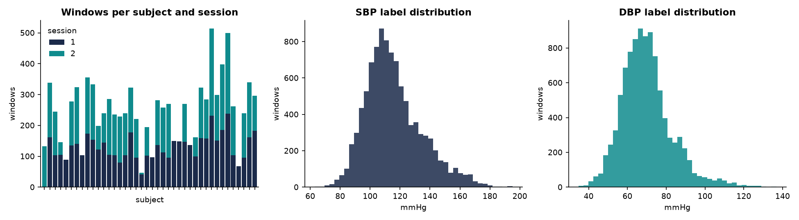
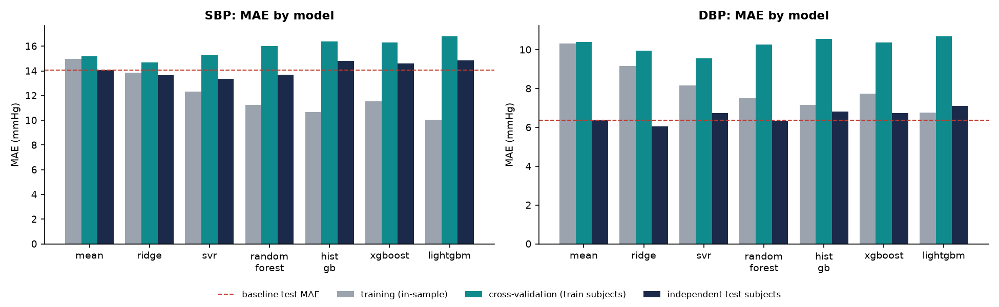
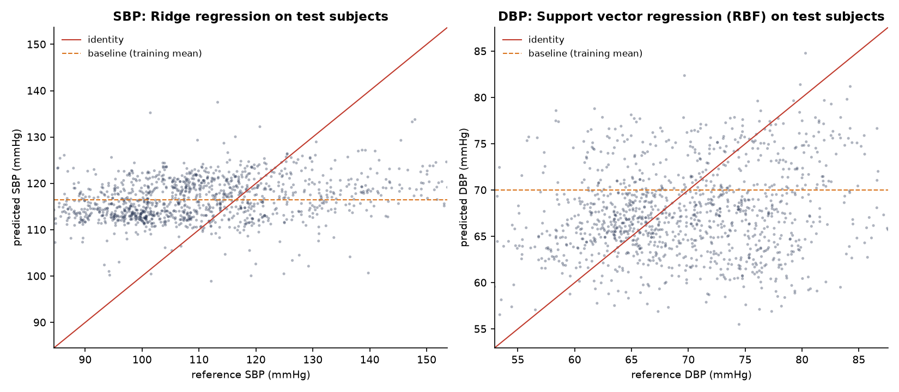
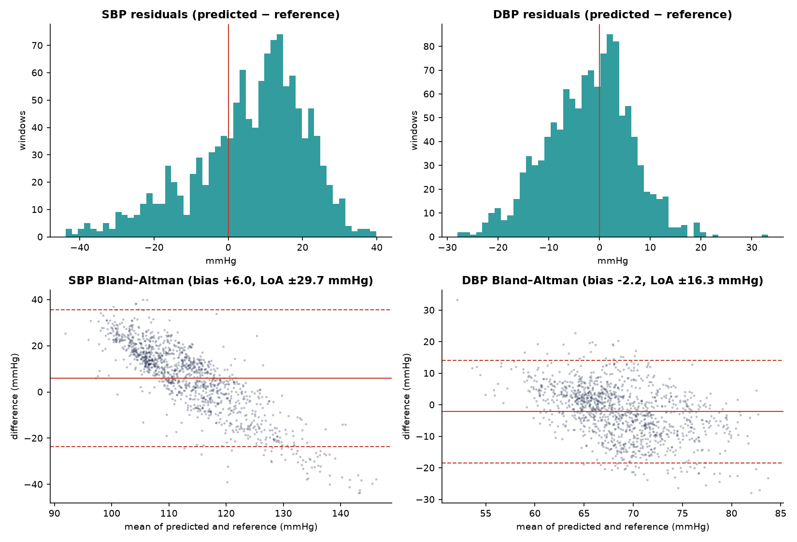
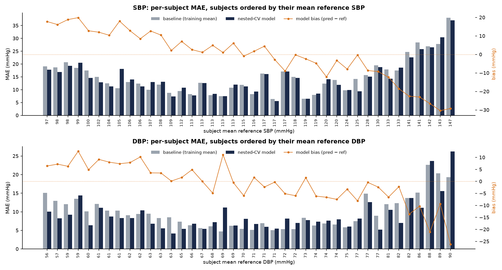
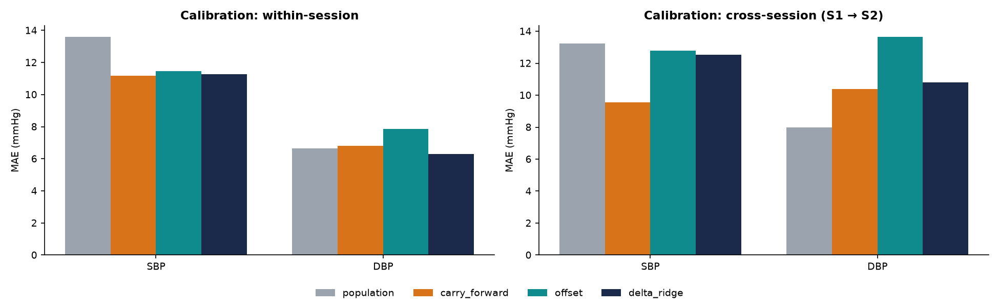

# RakshPulse: Final Model Evaluation

Generated by `python scripts/run_complete_pipeline.py` on 2026-11-21T15:12:46+00:00 (commit `bf2a93c`, rakshpulse 5.2.0). Every number below is computed by that run; nothing is copied from elsewhere.

> [!IMPORTANT]
> This is **offline validation on a public research dataset** (earlobe PPG, Nonin transmissive sensor, CNAP continuous BP reference, healthy adults). It is **not** a validation on MAX30102 hardware: no MAX30102 recordings with reference BP exist yet. On MAX30102 input the exported model runs in `demonstration` mode, and its numbers are not blood-pressure measurements.

## 1. Summary

| Target | Selected model | Test MAE | Test RMSE | Test R² | Baseline test MAE | MAE difference vs baseline [95 % CI] |
|---|---|---|---|---|---|---|
| SBP | Ridge regression | 13.66 | 16.26 | -0.05 | 14.08 | -0.41 [-1.73, +1.01] |
| DBP | Support vector regression (RBF) | 6.75 | 8.61 | -0.23 | 6.38 | +0.37 [-1.31, +1.87] |

- **SBP: no significant difference from the baseline** (predicting the training mean) on the independent test subjects; the 95 % CI of the MAE difference includes 0.
- **DBP: no significant difference from the baseline** (predicting the training mean) on the independent test subjects; the 95 % CI of the MAE difference includes 0.

In plain words: from a single 10 s earlobe PPG window, without a personal cuff calibration, none of the models predicts an unseen person's blood pressure meaningfully better than the population average. This agrees with the project's earlier research (docs/RESEARCH_FINDINGS.md). R² values near or below 0 mean the models explain essentially none of the between-person BP variation.

## 2. Dataset

**Auricle (PhysioNet v1.0.0), healthy cohort: earlobe PPG with CNAP continuous BP, two sessions on different days**

- Usable windows: **9851** from **40 subjects**, 72 recordings; session 1: 39 subjects, session 2: 33 subjects.
- Split by subject: **32 training** subjects (8636 windows) and **8 independent test** subjects (1215 windows), stratified by mean SBP.
- Label range (all usable windows): SBP 63–195 mmHg (mean 115.8), DBP 35–137 mmHg (mean 70.0).
- Activities: rest 6785, cold_pressor 1057, exercise 718, breath_hold 590, valsalva 461, unlabelled 127, not_applicable 113.

**Cleaning steps** (each row is cumulative):

| filter | rule | windows | subjects |
|---|---|---|---|
| all windows | standardised Auricle windows (10 s, 5 s hop) | 30841 | 42 |
| reliable CNAP label | label_valid (CNAP mask valid, label_status ok) | 16419 | 42 |
| plausible BP | SBP (60.0, 250.0), DBP (30.0, 150.0), pulse pressure >= 10.0 | 16369 | 42 |
| label aligned | SBP range inside the window <= 20.0 mmHg | 12743 | 42 |
| ear signal quality | production SQI gate passed (beats, HR, regularity, template, spectrum) | 9851 | 40 |
| no saturation | rail-clipped samples <= 1.0 % | 9851 | 40 |
| core features present | heart rate and beat duration extracted | 9851 | 40 |
| enough windows per subject | >= 20 windows per subject | 9851 | 40 |

**Integrity checks:**

| check | status | detail |
|---|---|---|
| window ids unique | PASS | 30841 windows |
| features match windows one-to-one | PASS | 30841 feature rows |
| subject and session agree between tables | PASS |  |
| every subject documented | PASS | 42 subjects |
| sessions are 1 or 2 | PASS | [1, 2] |
| one source sampling rate | PASS | 1000 Hz |
| all windows 10 s long | PASS |  |
| labels numeric where valid | PASS | 16419 labelled |
| SBP > DBP where valid | PASS |  |
| raw recordings verified against PhysioNet SHA-256 | PASS | 79 recordings |

**Feature reproducibility:** features recomputed by the production extractor from the published raw waveforms for 200 windows; median Spearman agreement across features ρ = 0.999 (full table: `feature_reproducibility.csv`). Small differences come from the stored waveforms being 100 Hz copies of the 1 kHz originals the features were computed from.

## 3. Protocol

- Subject-wise split; the test subjects are used only once, for the final numbers.
- Feature selection on training subjects only: 40 of 47 candidate features kept (missing > 20 %, constant, or |Spearman ρ| > 0.95 with a higher-priority feature are dropped). All features are computable by the production extractor from a single PPG channel, so the model runs on MAX30102 IR input.
- Each pipeline: winsorise (0.5/99.5 % training quantiles) → median imputation → standardisation → model, fitted on training folds only.
- Hyper-parameters: exhaustive grid search with 5-fold GroupKFold over training subjects, separately for SBP and DBP (at most 150 non-overlapping windows per subject).
- Selection: lowest cross-validated MAE. The test set is **not** used for selection, so the test numbers are not optimistically biased; the cross-validation numbers are (they were used for tuning).
- Cross-session: the selected configuration refitted on session 1 of the training subjects and scored on session 2 of the test subjects (new people on a different day).
- Seeds fixed (`seed=0`). Ridge, SVR and random forest results repeat exactly for the same data and package versions; the multithreaded gradient-boosting libraries can differ in the second decimal between runs.
- Neural networks were not retrained: the project's raw-waveform benchmark (CNN, GRU, CNN-LSTM, TCN, Transformer; `results/deep_benchmark/`) did not beat these feature models on the same data.

## 4. Results

### 4.1 Model comparison

**SBP** (mmHg)

| Model | CV MAE | Train MAE | Test MAE | Test RMSE | Test R² | Test bias | Test SD | Fit+tune s |
|---|---|---|---|---|---|---|---|---|
| Baseline (training mean) | 15.18 | 14.98 | 14.08 | 16.92 | -0.14 | 5.87 | 15.88 | 3.40 |
| Ridge regression | 14.69 | 13.87 | 13.66 | 16.26 | -0.05 | 5.96 | 15.14 | 5.30 |
| Support vector regression (RBF) | 15.30 | 12.32 | 13.38 | 15.94 | -0.01 | 4.22 | 15.38 | 3.00 |
| Random forest | 16.01 | 11.23 | 13.70 | 16.10 | -0.03 | 5.74 | 15.04 | 7.00 |
| Gradient boosting (histogram) | 16.38 | 10.68 | 14.80 | 17.46 | -0.21 | 6.35 | 16.27 | 2.10 |
| XGBoost | 16.31 | 11.53 | 14.60 | 17.24 | -0.18 | 6.35 | 16.04 | 3.30 |
| LightGBM | 16.81 | 10.06 | 14.85 | 17.61 | -0.23 | 6.30 | 16.45 | 2.60 |

**DBP** (mmHg)

| Model | CV MAE | Train MAE | Test MAE | Test RMSE | Test R² | Test bias | Test SD | Fit+tune s |
|---|---|---|---|---|---|---|---|---|
| Baseline (training mean) | 10.39 | 10.31 | 6.38 | 7.76 | -0.00 | 0.29 | 7.76 | 0.10 |
| Ridge regression | 9.96 | 9.17 | 6.06 | 7.86 | -0.03 | -0.76 | 7.82 | 0.40 |
| Support vector regression (RBF) | 9.55 | 8.16 | 6.75 | 8.61 | -0.23 | -2.19 | 8.33 | 3.40 |
| Random forest | 10.26 | 7.49 | 6.34 | 8.10 | -0.09 | -1.43 | 7.97 | 7.10 |
| Gradient boosting (histogram) | 10.56 | 7.17 | 6.83 | 8.75 | -0.27 | -1.51 | 8.62 | 2.20 |
| XGBoost | 10.37 | 7.75 | 6.73 | 8.60 | -0.23 | -1.50 | 8.48 | 2.30 |
| LightGBM | 10.70 | 6.76 | 7.12 | 8.96 | -0.34 | -1.28 | 8.88 | 2.50 |

### 4.2 Selected models, all metrics

| Target | Model | Evaluation | MAE | RMSE | R² | Bias | SD | LoA low | LoA high | Windows | Subjects |
|---|---|---|---|---|---|---|---|---|---|---|---|
| SBP | ridge | training (in-sample) | 13.87 | 17.73 | 0.14 | 0.00 | 17.73 | -34.75 | 34.75 | 4317 | 32 |
| SBP | ridge | cross-validation | 14.69 | 18.63 | 0.07 | -0.14 | 18.64 | -36.67 | 36.39 | 3949 | 32 |
| SBP | ridge | independent test | 13.66 | 16.26 | -0.05 | 5.96 | 15.14 | -23.70 | 35.63 | 1215 | 8 |
| SBP | mean | training (in-sample) | 14.98 | 19.14 | 0.00 | 0.00 | 19.14 | -37.52 | 37.52 | 4317 | 32 |
| SBP | mean | cross-validation | 15.18 | 19.32 | -0.00 | -0.00 | 19.32 | -37.87 | 37.86 | 3949 | 32 |
| SBP | mean | independent test | 14.08 | 16.92 | -0.14 | 5.87 | 15.88 | -25.26 | 37.00 | 1215 | 8 |
| SBP | mean | cross-session (train S1 → test subjects S2) | 12.91 | 14.68 | -0.36 | 7.56 | 12.59 | -17.12 | 32.25 | 473 | 6 |
| SBP | ridge | cross-session (train S1 → test subjects S2) | 12.32 | 14.21 | -0.28 | 6.15 | 12.82 | -18.98 | 31.28 | 473 | 6 |
| DBP | svr | training (in-sample) | 8.16 | 11.62 | 0.27 | -1.38 | 11.54 | -24.00 | 21.25 | 4317 | 32 |
| DBP | svr | cross-validation | 9.55 | 13.09 | 0.06 | -1.37 | 13.02 | -26.89 | 24.14 | 3949 | 32 |
| DBP | svr | independent test | 6.75 | 8.61 | -0.23 | -2.19 | 8.33 | -18.51 | 14.13 | 1215 | 8 |
| DBP | mean | training (in-sample) | 10.31 | 13.58 | 0.00 | -0.00 | 13.58 | -26.63 | 26.63 | 4317 | 32 |
| DBP | mean | cross-validation | 10.39 | 13.63 | -0.02 | -0.02 | 13.64 | -26.74 | 26.71 | 3949 | 32 |
| DBP | mean | independent test | 6.38 | 7.76 | -0.00 | 0.29 | 7.76 | -14.92 | 15.49 | 1215 | 8 |
| DBP | mean | cross-session (train S1 → test subjects S2) | 6.17 | 7.24 | -0.00 | -0.35 | 7.24 | -14.53 | 13.83 | 473 | 6 |
| DBP | svr | cross-session (train S1 → test subjects S2) | 7.84 | 9.71 | -0.80 | -3.65 | 9.01 | -21.30 | 14.00 | 473 | 6 |

Bias = mean(predicted − reference). LoA = Bland–Altman 95 % limits of agreement.

### 4.3 Best model and parameters

- **SBP: Ridge regression**, parameters `{"alpha": 10000.0}`; 90 % interval half-width ±30.3 mmHg (split-conformal from out-of-fold residuals), observed test coverage 96%.
- **DBP: Support vector regression (RBF)**, parameters `{"C": 3.0, "epsilon": 2.0, "gamma": 0.01}`; 90 % interval half-width ±21.1 mmHg (split-conformal from out-of-fold residuals), observed test coverage 98%.

### 4.4 Nested subject-wise cross-validation (all subjects)

Every one of the 40 subjects is predicted once by a model whose features, hyper-parameters and model family were chosen on the other subjects only (5 outer folds, inner 5-fold GroupKFold). This is a more stable estimate than the 8-subject test set.

| Target | MAE | RMSE | R² | Baseline MAE | Difference [95 % CI] | Subjects |
|---|---|---|---|---|---|---|
| SBP | 14.50 | 18.48 | 0.04 | 14.82 | -0.31 [-0.85, +0.24] | 40 |
| DBP | 9.45 | 12.62 | 0.08 | 10.14 | -0.68 [-1.41, +0.07] | 40 |

Models chosen by the inner loop: DBP svr ×5; SBP ridge ×4; SBP svr ×1.

Per subject, the model is worse than the baseline for 16 of 40 subjects (SBP) and 19 (DBP). Errors are dominated by each person's offset from the population mean (regression to the mean): the model over-predicts low-BP subjects and under-predicts high-BP subjects.

### 4.5 Per-person cuff calibration

One labelled rest window per recording plays the role of a cuff reading; windows at least 60 s later are scored on the held-out test subjects. `carry_forward` (report the cuff value, no PPG) is the baseline any PPG method must beat. Differences are against `carry_forward`.

| Scenario | Target | Method | MAE | RMSE | R² | Windows | Subjects | vs carry_forward [95 % CI] |
|---|---|---|---|---|---|---|---|---|
| within-session | SBP | population | 13.60 | 16.23 | -0.05 | 1126 | 8 | +2.44 [-3.39, +7.23] |
| within-session | SBP | carry_forward | 11.17 | 14.41 | 0.17 | 1126 | 8 |  |
| within-session | SBP | offset | 11.45 | 14.94 | 0.11 | 1126 | 8 | +0.28 [-2.24, +3.05] |
| within-session | SBP | delta_ridge | 11.28 | 14.53 | 0.16 | 1126 | 8 | +0.12 [-2.48, +2.87] |
| within-session | DBP | population | 6.65 | 8.51 | -0.20 | 1126 | 8 | -0.14 [-1.03, +0.84] |
| within-session | DBP | carry_forward | 6.79 | 8.84 | -0.30 | 1126 | 8 |  |
| within-session | DBP | offset | 7.86 | 9.95 | -0.64 | 1126 | 8 | +1.06 [-0.44, +2.44] |
| within-session | DBP | delta_ridge | 6.31 | 8.35 | -0.16 | 1126 | 8 | -0.49 [-0.97, -0.01] |
| cross-session (S1 → S2) | SBP | population | 13.24 | 15.15 | -0.45 | 473 | 6 | +3.67 [-0.99, +6.35] |
| cross-session (S1 → S2) | SBP | carry_forward | 9.57 | 12.66 | -0.01 | 473 | 6 |  |
| cross-session (S1 → S2) | SBP | offset | 12.78 | 16.05 | -0.63 | 473 | 6 | +3.21 [+0.54, +6.01] |
| cross-session (S1 → S2) | SBP | delta_ridge | 12.51 | 15.79 | -0.57 | 473 | 6 | +2.95 [+0.33, +5.63] |
| cross-session (S1 → S2) | DBP | population | 8.00 | 9.88 | -0.87 | 473 | 6 | -2.38 [-5.84, +0.47] |
| cross-session (S1 → S2) | DBP | carry_forward | 10.38 | 12.95 | -2.21 | 473 | 6 |  |
| cross-session (S1 → S2) | DBP | offset | 13.66 | 17.35 | -4.76 | 473 | 6 | +3.28 [+0.63, +6.26] |
| cross-session (S1 → S2) | DBP | delta_ridge | 10.80 | 12.92 | -2.20 | 473 | 6 | +0.42 [-1.20, +1.69] |

Significantly better than carry-forward: delta_ridge for DBP (within-session, -0.49 mmHg). Every other PPG method is not significantly better than simply reporting the cuff reading.

## 5. Exported model

- Bundle: `models/rakshpulse_ear_bp.joblib` (version `rakshpulse-ear-bp-1.1+0bccb773`), loadable with `rakshpulse.inference.model_loader.load_bundle` and used by `rakshpulse.inference.api.BPEstimator`.
- Contract: `experimental` for Auricle earlobe data; `demonstration` for `max30102` and the simulator; `validated` for nothing.
- Calibration: the bundle carries the `delta_ridge` models; `BPEstimator.calibrate(sbp, dbp, ir, fs)` stores one cuff reading and later estimates are reported relative to it (section 4.5).

## 6. Known limitations

- **No hardware validation.** The model has never seen MAX30102 data. Earlobe transmissive PPG (Nonin) and behind-the-ear reflective PPG (MAX30102) differ in optics, site and signal shape.
- **Small cohort.** 40 subjects; the independent test set has 8, so test metrics have wide uncertainty (see the bootstrap CIs).
- **Reference.** CNAP is a calibrated continuous finger-cuff estimate, not an intra-arterial line.
- **Pseudo-replication.** Windows from one person are correlated; the subject is the unit of analysis for the CIs.
- **No personal calibration.** These are calibration-free population models. The project's research shows that per-person cuff calibration carries most of the usable information (docs/RESEARCH_FINDINGS.md).
- **Not a medical device.** No clinical validation (ISO 81060-2 / IEEE 1708) has been performed.

## 7. Files

All tables are in this folder as CSV: `baseline_comparison.csv`, `calibration_summary.csv`, `cross_session.csv`, `dataset_audit.csv`, `dataset_cleaning_log.csv`, `dataset_validation.csv`, `feature_reproducibility.csv`, `feature_selection.csv`, `metrics_summary.csv`, `model_comparison.csv`, `nested_cv_choices.csv`, `nested_cv_per_subject.csv`, `nested_cv_summary.csv`, `selected_models.csv`, `subject_split.csv`, `test_predictions.csv`.
